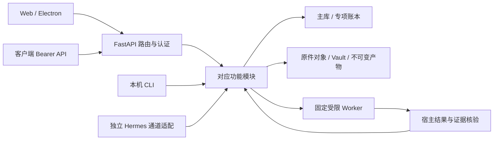

## Supplier intelligence（2026-10-21）

供应商业务位于 `suppliers/`，主库 schema35不变，独立 `supplier-intelligence.sqlite3` schema1，首次明确写入才创建。profiles为按库显式策略；records保存供应商/别名/联系人/产品/报价/来源/问题、任务/模型调用/修正及不可变历史快照；operations保留请求摘要和幂等结果。旧SUP/SRC身份保留，历史原件缺失和事实未核验分开标记；不重建或伪造旧PDF/微信原文。原独占管理标记及原人工区不改写，重复历史导入保留人工覆盖/修正引用，移出当前范围的历史记录只退出当前投影，快照保留。

管理接口均要求既有管理员会话、CSRF、当前身份/库权限与活动目录绑定：

| 路径（/admin/suppliers） | 行为 |
| --- | --- |
| GET /?client_id=&vault_id= | 工作区记录、版本与策略，不调用模型 |
| POST /legacy/preview、/legacy/import | 只读目录/Markdown预览；通过expected_sha256和request_id显式导入旁库，不写原笔记 |
| POST /policy | expected_revision CAS；enabled默认false、cloud_allowed默认false、review_mode manual/automatic、model_configuration_id（app-default或已登记编号） |
| POST /manual、/correction | 原始录入/修正先进入Store知识级原件，稳定请求号及摘要防重复；修正不覆盖原值，保留独立理由与版本 |
| POST /document | run_id已完成且已发布或通过原审核；生成持久任务，不在HTTP调用模型 |
| POST /jobs/{id}/{approve,resume,cancel} | 版本CAS及原所有者；候选明确确认、已知结果恢复、取消后续；发送未知的模型调用不可重发 |
| GET /evidence/{source}、/original/{source}、/markdown/{supplier} | 带范围的依据、原件或只读Markdown投影；原件独立original授权，可指定asset_id，不返回不属于该版本的附件 |
| POST /query、/compare、/classification-preview | 确定性条件查询、保守比较和只读业务/MOC预览；不发送模型、不写MOC或归档 |

新供应商提取在既有原件保留/文档或消息发布后观察，不作为Inbox前置。启用时记录水位，仅新资料自动接入；旧历史不自动外发。后台按库检查发布元数据，有变化且达到30秒节流才读取笔记清单，空闲不反复扫描。正文/文档使用现有完整提取与审核合同，图片/OCR/PDF/Word按既有资料导入配置；供应商模型使用统一配置、Key共享预算与model_configuration_calls用途supplier_extraction。完整文本分窗覆盖，最多8窗，超限发送前失败；逐字段原文/公司头/型号行/币种单位/税运证据校验，未知不补齐。每个窗口绑定固定模型摘要及持久发送记录，已知响应可复用、未知响应保留预留消费且禁止重发。原件保留、笔记已发布、结构化完成是三个独立状态。取消不伪装远端调用已撤回，已返回用量仍记账。

Condition支持kind offers/products/suppliers、库/供应商、关键词（含联系人）、分类、精确型号、币种和价格区间/单位、报价日期、valid_on、税费、规格数组(field, equals 或 minimum/maximum及unit)、历史/待归属开关。金额Decimal，仅明确量纲转换，不推断汇率、目数标准、税运或无限有效期。价格范围必须提供币种及单位；日期/区间严格校验。offset/limit分页返回total/next_offset/snapshot，后续页可指定expected_snapshot防混合版本；coverage明确仅已登记供应商来源，不能宣称全库扫描完整。原来源/权限/路径或笔记观察变化立即拒绝旧结果。比较只在产品规格和税运、时间、数量阶梯等明确相同口径分组，未知条件单列、不做跨口径最便宜结论。人工修正以独立correction_ids及value_basis呈现。

Agent只读 POST `/v1/agent-knowledge/suppliers/{query,compare,evidence}`；MCP增加 `fiber_supplier_query(conditions)`、`fiber_compare_quotes(vault_id,quote_ids)`、`fiber_supplier_evidence(vault_id,source_id,expected_sha256,offset,length)`。每次核对连接enabled/配置库/当前query权限；不接收任意SQL、路径或调用身份参数，证据最长8000字符分页，原件权限不隐式扩张。质量标签始终保留。

GUI：知识→供应商信息，先选操作身份与新独立供应商库；接入与处理中预览/明确导入历史，再选择已登记模型、允许云处理及人工/自动策略。新资料继续从资料导入或已配置消息入口进入目标库；手动报价可单独录入，待确认页提供候选、失败原因、取消及允许的恢复。产品/报价支持筛选、证据和原件，修正保留原值；分类预览只展示建议与现有MOC笔记，实际登记/写入/归档由用户在现有知识关联流程确认。未自动挂接真实Gsup或复活旧supplier库。

备份：旁库纳入现有在线一致性、全量和共享加密增量快照及变化观察。恢复先校验原始字节，再暂停供应商策略，排队/运行任务标为需明确恢复，发送中模型结果标未知；事实、原件、人工修正和幂等历史保留，不自动发送模型或重放旧任务。

---


## 知识库与关联 MOC 展示读取（2026-10-21）

`display_http` 仅对列明的 GET 投影开放锁外计算，最多两个并行读取；开始与交付时仍在既有存储租约内验证管理员会话、元数据和策略代次，交付前复核观察过的文件。权限或内容变化时拒绝旧结果。响应仅在内存中暂存，不跨会话复用。索引过期标记仍在最终租约内写入。

`display_observation` 仅在本次展示请求内批量检查已授权目录中的 Markdown 文件，复用未变化文件的云状态观察；保护目录在枚举时排除。POST 预览、确认、执行与写回不启用该上下文，仍执行原完整检查。Atlas 导航复用短时库/身份列表并合并进行中的请求，手动刷新主动失效缓存；关联页各读取并行，展示读取最长等待60秒，写入超时与重试规则不变。

## 消息入口的独立保存与显式查询范围（2026-10-21）

保存入口沿用单目标及各自入库策略，查询范围不改变保存位置。查询用途入口可通过现有POST /admin/channels的settings新增可选query_vaults列表，每项为vault_id和唯一固定alias（1–32个字母/数字/下划线/连字符/中文，拒绝范围代词与重复别名/ID）；默认查询全部所选库，最多沿用底层20库限制。旧字段缺省不回填、不改变revision；显式null取消范围设置。多库仅用于无入库角色的入口。旧vault_id为既有传输合同锚点，显式范围保存时同步为列表首项，不能决定用户查询范围。配置查询库只增加query授权，已有original/add授权逐库保留，不新增这些权限。

命令仅在消息开头解析：查询：问题（兼容ASCII冒号）查询全部配置范围；查询[库别名]：问题仅查该别名；独立查询入口启用natural_questions后普通自然语言/主题短语等同默认范围，兼用入口保留既有材料/问答区分。未知/失效别名、格式错误、空问题、“查询本库”只产生零模型用法提示，不退回全部、不作为材料入库。别名解绑后失效，新库不自动继承；单库选择不保留到下一条消息。

每条新消息冻结channel-query-scope/v1（配置版本/范围摘要及所选ID/别名），使用既有events.value，不升级数据库schema或改写历史。model调用、成功响应缓存及发送复核绑定同一范围；失效/撤权/来源变化停止交付，不复用不符缓存，不自动重试付费调用或未知发送。原文/本地/本地云/默认模型入口共用范围解析。检索仍使用全局结果上限及现有模型步骤，专家图表逐来源核对库权限，跨库同名文件通过库ID区分。迁移访问屏障、解绑失效、相关入口识别与恢复证据覆盖次级查询库；显式健康单库不读取另一库。已有多库查询入口的别名不能由整库合并动作自动改指目标库，须显式重配。

GUI消息页总览与入口卡片显示保存目标和查询范围；两界面共享范围编辑与别名检查。回复显示本次范围，引用请求显示库别名与笔记定位。发布不创建真实库/入口、不恢复旧记录；当前真实库和原配置保持，后续需管理员明确绑定目标库并保存查询范围才生效。

## Atlas主题入口与收件箱历史（2026-10-20）

Atlas品牌按钮 `#theme-toggle` 使用 `/static/logo-original.png` 的既有品牌裁切；`atlas/theme_choices.openThemePicker` 复用现有sheet生命周期和设置页themeChoices，不直接调用业务API，跨渲染器切换仍须ctx.confirmReload。Esc/关闭归还焦点，默认主题只在显式设置时改变。

`web/inbox_status.isInboxComplete` 仅以已发布为完成证据，同时保留来源缺件、未发布链接和未完成/异常自动任务；原件保存或提取完成不算入库完成。`atlas/inbox_history.createInboxHistory` 仅在浏览器中过滤原响应，默认隐藏完成项；明确链接到历史记录时自动展开历史，不删除记录、不变更状态或去重。消息、文档、媒体复用此过滤，首页冻结批次计数使用相同完成判断。后端接口/数据库结构保持。

## Atlas 入口与维护（2026-10-20）

`web/ui_entry.js` 按校验后的默认主题或当前标签页一次性选择加载 classic/Atlas；`theme_entry.js` 仅存储呈现选择，不存会话。`web/atlas/main.js` 组装会话、路由和视图；`feature_controls` 为共用领域控件提供 Atlas 样式和生命周期，首页看板由 `home_architecture` 与纯状态投影 `architecture_model` 维护。Atlas 资源通过静态白名单、wheel package-data 和候选摘要共同验证；新增 SVG 也进入冻结清单。

`fiber.atlas.v1` 仅含校验的模式/强调色等呈现偏好。主题默认仍由 `fiber.appearance.v1` 管理；原生缓存兼容 version 1，Atlas 可附 `presentationMode=light|dark`。恢复文本草稿只保存在当前标签页内存，密码/密钥/令牌/文件不会恢复。升级只更新程序/源码和发布元数据，不改数据库 schema、库路径或消息运行意图。

## 消息入口回执观察与批次隔离（2026-10-20）

`channels/intake_receipts.take` 在持有原storage lease和发送claim事务的前提下，跳过receipt_state为sending/unknown的当前批次，不再全入口返回。该批次后续通知也停止，须原有明确核对操作；其他批次按原策略/修订/服务水位/额度发送。不自动重发未知结果、不回填旧修订或停用期间的历史消息，不修改来源/去重键。

`GET /admin/channels/overview` 的入口项可附加 `receipts`：enabled（回执策略开关）、pending_batches（当前修订和服务水位内等待首条/后续回执的批次数）、needs_review_batches（unknown）、sending_batches（sending）。后两项包含历史修订，pending不包含歧义批次；它们是只读观测，不触发恢复。旧客户端可忽略，新客户端兼容没有此字段的旧服务，并严格校验非负整数计数。`intake_receipt_health.py` 独立负责投影；原有处理状态和平台连接仍各自展示。

`answer_mode=model` 的查询健康检查读取 `model_configuration.policy.resolve`，与model_answer执行路径一致；其他模型路由模式保留冻结路由校验。只检查配置，平台已连接/配置可用均不证明当前模型或回执端到端成功。

## 微信消息入口图文回复（2026-10-19）

消息入口选择微信、L2知识库、模型回答/自然语言问题及专家图表能力，扫码后确认本人绑定；查询和原件权限足够，纯问答无需新增权限。普通笔记只发送文字；专家命中的图表经授权/版本/哈希校验后，图片单独发送、可靠表格以文字展示。微信使用独立发送器，不复用飞书post消息格式或上游自动重试。配置缺省仍为unknown，旧配置不自动启用图表。

`channels/weixin_output.py`负责分段、加密上传与单次发送，`channels/delivery_parts.py`在原events.value内保存分项尝试，不保存图片或会话令牌。`GET /admin/channels/{id}/events`新增delivery_parts只读摘要，界面可展开分项结果。发送前重新核对授权、原文与专家包绑定；上传失败保留文字并补缺失说明，消息结果未知或进程中断保持原账本并停止，人工核对不会重发。主库及通道库schema不变。

接收轮询的临时网络故障最多6次尝试，间隔2/4/8/16/30秒；仅重试读取，不重试入库、模型或发送。每次仍重新核对当前授权，鉴权拒绝、无效响应和权限变化立即停止。只保存非空的新游标；新消息按平台原ID去重。连接诊断只保留安全错误分类与本项目代码位置，不记录凭据或服务器响应正文。

来源核对、消息准备与分项回执等待移到后台线程，保持事件循环心跳；来源、版本、权限及发送前核对均保留，未引入跨任务缓存或省略校验。进程终止及未知发送仍须人工核对。

## 仓库位置迁移（首版；已合入 Projects 包）

入口：知识库列表 → 该库的「管理」→「迁移仓库位置」。按 Figma 36:170–36:175、38:1160 实现选择位置、预检、确认、进度、完成及恢复界面；保留当前共享主题和侧栏。选择已存在的目标父目录与一个尚不存在的子目录名。关闭本库外部编辑器、暂停同步并明确勾选确认后才执行；预检本身不移动资料、不暂停知识库。预检有效期 10 分钟，执行前重新校验。

首版仅支持 macOS 本机同一文件系统、完整范围且已附加的 external/managed 知识库。legacy 初始化库、跨盘、网络或已识别云同步路径、排除/受保护子树、符号链接、硬链接、特殊文件和嵌套挂载不支持。扫描上限 20,000 项、2 GiB、60 秒，超限停止；不会自动退化为复制后删除，也不修改绝对链接。外部编辑器须由用户关闭，应用不能代替系统锁住其他程序。

预检冻结目录 inode、内容摘要、父目录、范围策略及知识库关联；启动后通过 vault_operations 中 vault_relocation 意图阻止本库新查询/写入/自动任务领取。其他库继续可用。原消息绑定、revision、凭据和暂停状态不改写；已收到消息按原队列容量暂存，迁移完成后继续，不重放已完成任务。各接收端原始事件准入保留原授权校验。

先将文件与 SQLite 快照写入 .state/vault-relocations/<操作ID>-<随机ID>/（目录 0700、文件 0600），核验内容与数据库完整性后才执行同盘排他重命名。仅切换 vaults.absolute_root，保留 vault_id、文件 inode、笔记身份、历史版本、MOC 关系/所有权/修订、授权和消息入口。schema 仍为 35，无模型调用。恢复点含敏感明文，仅供本机私有恢复，不是外部加密备份；首版不自动清理恢复点。

进程中断后保持本库屏障，重启只标记待恢复，不自动移动。回到迁移入口，先「重新核对现场」，取得有效期两分钟的恢复证明后选择继续或恢复原位置。通过原目录身份定位实际位置，绝不覆盖已占用目录；文件、授权、策略或父目录改变时拒绝恢复，保留现场。不会用旧共享数据库覆盖其他知识库的新记录。待恢复期间不要在 Finder 中手动挪动或修改目录。

实现边界：vault_relocation/{plan,files,filesystem,evidence,execution,guard,runtime,routes}.py；web/vault_relocation{,_api,_view}.js 与独立 CSS。管理员端点 /admin/vault-relocations/preview、列表/状态、start、stop、recovery-preview、recover 复用现有会话和 CSRF；开始要求严格布尔 external_writers_stopped=true 与冻结 plan_sha256。合成测试覆盖真实同盘重命名、每阶段中断、回滚、重复提交、目标竞争、恢复点损坏、消息暂存、历史/身份/MOC 和关联查询。

### Obsidian iCloud 显式迁移（2026-10-20）

管理员预检额外接受严格布尔 `icloud: true`；默认 GUI/API 仍执行原本机规则。显式模式只接纳当前用户的 Obsidian iCloud Documents 容器和同一文件系统，不支持跨盘、覆盖目标或复制后删除。仅允许完整范围及既有 GF_supply_chain 保护，保护子树出现则在读取其元数据前停止；旧 L2 的有效保护随目录更名显式保留在 catalog scope。目录身份、业务与策略记录不重建。旧保存规则的根父目录观察允许同一保护由 catalog 显式承接，须同时通过原 inode、策略摘要、范围与各目录校验，不修改设置或扩大权限。

cloud-status 的 `--tree-excluding` 在 lstat 前排除保护名称；整库元数据超时为 180 秒，普通单项为 20 秒，超时单独诊断。`--items` 从标准输入接受最多 256 个已授权直接子名称，不递归、不下载；索引指纹按目录批量核对相关 Markdown 和发布标记，实际证据/图片读取继续独立复核。内容与索引文本不因批量检查改变。此次迁移后按原清单与缓存摘要逐篇验证 643 篇笔记，只更新派生 observation 的 ctime 与 generation 指纹，所有 notes/FTS 分块不变；保留原未定位登记。

本机迁移与 Obsidian 可读验证不代表其他设备已完成云同步。仅知识库文件放入 iCloud，数据库、凭据和处理运行状态继续使用原本机 fiber-data。

## X文章JSON数据封装（2026-10-18）

articles边界新增x_article_json选择与x_article_content渲染，支持data-tsr-stream-part中Result.Ok.value内嵌的JSON响应字符串；仅解析数据，不执行JavaScript。请求帖子的rest_id与Base64 Tweet ID需一致，预览及完整ArticleEntity身份一致；冲突完整结果、重复JSON字段和无正文标记拒绝。逐块核对唯一key、已知类型、UTF-16范围和plain_text覆盖；引用图片须能映射到ApiImage，封面与正文图片保持顺序，沿用下载白名单、尺寸、签名和全量供图检查。不新增API、schema或自动重试，保留旧content_state/DraftJs解析及原marker。真实任务需通过原批次明确重试入口，沿用原件与回执去重。

## 整理任务性能与进度

快速整理默认只使用本地规则与有效缓存；仅显式选择“用模型补充未解决项”才发送模型请求。确认沿用已预览分类，只核对来源、主题定义、权限、配置和人工决定是否变化。新任务的撤销快照对大段历史记录采用私有不可变内容引用；旧任务保留原格式，取消时仍检查文件及关系冲突，拒绝覆盖用户后续修改。

进度读取遇到后台文件写入会短暂显示繁忙并自动退避重试，不会重发任务或模型请求。输入框及未保存草稿保持，顶部继续显示后台进度；离开输入框后更新完整结果。后台记录 confirmation_check、undo_capture、archive_links_and_files、undo_seal 耗时计数，随原任务检查点保存；这些计数不是实时心跳，不替代最终文件及索引结果。

## GUI 暖陶、双语与目录作用域（2026-10-18）

界面沿用原生 ES modules 和现有业务接口，无 schema 迁移。`web/i18n/` 按功能维护随包中英词条；`preferences.js` 的 `fiber.locale.v1` 仅保存 `zh-CN`/`en`，与外观及安全设置独立。登录页和系统设置→外观与阅读均可选择语言，切换原位更新展示文本和无障碍名称，不重建业务表单或发出业务写请求。消息 `Message` 仅供显示，禁止 JSON 序列化；`phrase`/`joinText` 显式标记嵌套 UI 文案，`sourceText` 为共用控件中的用户内容保留原文；用户标题、正文、文件名、路径、ID、MOC 名称及原始诊断保持原文。日期用 Intl 格式化，金额币种及业务时区不变。未知业务枚举保持原值。命令搜索同时匹配中英文导航别名。

`web/reading_layout.css` 最后加载，共用五主题的阅读与分区变量。品牌使用固定黑色 Georgia/Times 衬线，暗色用局部浅底；保存过的字号优先，新用户默认 15px。帮助由 `help_tip.js` 支持 hover、focus、点击固定与 Escape 关闭，必需确认及后果说明保持可见。`inventory_summary.js` 区分接收原件与发布笔记状态，不将 stored 视为正文已入库。

`vault_scope.js` 在保存与处理、布局与外部改动页签内直接选库；复用原控制器的草稿确认、代际检查及只读权限，取消切换恢复原选择。进入页面只读取配置，不启用规则、整理、迁移或写库。`form_sections.js` 只分组现有控件，不重建输入或改变请求字段。知识关联去除重复标题/计数，确认栏不覆盖预览；深度替换、锁定/拒绝关系及明确预览确认门槛保持。

静态路由为 `/static/{filename:path}`，仍以 `STATIC_ASSETS` 精确白名单校验；仅新增命名的 i18n/资源，不提供目录服务。wheel 包含 `web/i18n/*.js`。桌面 preload 新增 `localeSnapshot()` / `applyLocale({language})`，使用既有精确窗口、主 frame、后台 URL 校验；离线页仅可读取，不能写偏好或调用业务 IPC。`locale_state.mjs` 为 profile+backend-origin 的 0600 原子启动镜像，拒绝符号链接、硬链接、超大/损坏/跨来源缓存；只同步菜单和离线页。旧进程缺少 handler 或缓存写失败只记一次诊断，不阻塞网页、不反复弹通知。更新后保存草稿再刷新；原生菜单需要退出管理应用并重开，后台独立运行。

回归入口：`npm test`、`tests/test_web_assets.py`、相关保存规则/目录/整理隔离合同；`tests/e2e/locale_web.cjs`、`vault_scope.cjs`、`locale_desktop.cjs` 使用 `FIBER_GUI_ACCEPTANCE_URL`（127.0.0.1:18000–19000）与 `FIBER_GUI_EVIDENCE`，只面向合成服务/新 profile。测试不操作实库 MOC 或归档，不调用真实模型。

## Map 管理区块与中断恢复（2026-10-18）

整理执行前核对所有受影响 Map。若历史系统区块在本次任务快照中已缺失，可在保留当前正文、人工链接和内部归属的前提下，绑定原文摘要与历史链头，追加新的系统区块；旧日志不删除。区块有人工改动或文件在预览后变化时停止并显示具体 Map。此修复权限仅用于整理任务，普通 Map 写入接口仍严格拒绝缺失/编辑的管理区块。

内部关系提交不代表整个步骤完成。中断恢复核对持久化意图、精确的关系增量和修订号，再幂等补齐 Map、普通笔记 moc 属性及归档。文件交换已发生但结果尚未记录时，先用原交换日志核对两侧文件身份，不能把自身写入误判为人工修改。任务撤销仍恢复任务原有状态，保留人工修改与审计历史；不重算已有分类或重发模型请求。

既有资料整理与新资料发布分开授权。已确认整理计划可移动普通笔记及无整包根目录的已发布笔记，同步稳定身份和来源映射，即使旧发布目录绑定尚未更新；不修改保存规则或启用发布。已有Map接管要求规则active、权限和文件/根目录证据有效；不依赖无关发布目录的旧绑定。专家包和受管理整包仍走原有专用归档路径，新发布门槛保持。

## 整理任务控制与本地快速模式（2026-10-17）

快速整理默认不调用模型或向量服务：一次读取允许范围 Inbox 与 MOC，使用明确规则/特定标签/别名/已有可靠关系，复用有效分类缓存；完整旧模型窗口可只读重验后复用，未知/不完整回复不重发。弱匹配和无可靠证据项保留待解决，可显式“用模型补充未解决项”，发送范围、模型与费用沿用统一配置。

`POST /admin/organization/maintenance/{id}/{operation}` 支持 pause/resume/supplement/retry_unknown/cancel，继续绑定身份、知识库、CSRF与权限。确认写入仍需预览摘要；retry_unknown 须明确接受可能重复消耗，原调用与预留保留。已发请求在独立有超时边界的传输线程中结算；暂停/取消会立即释放整理调度等待，原请求不会自动重发。代际号拒绝暂停/恢复/取消前的迟到提交；已返回原文可保存在调用缓存，不推进已停任务。

暂停保持规划或应用阶段检查点；恢复分析仅使源内容/主题定义/人工决定已变化的项失效，旧结果保留历史。取消未应用任务不写库；已应用任务使用 task-owned 侧账本与原子交换留下的原文件撤销属性、Map、路径及内部关系，不以整库快照覆盖。每轮撤销最多8个文件/移动操作以释放存储锁。用户外部修改或关系冲突会进入 rollback_conflict，保留资料并显示原因；核对后 resume 仅继续撤销，不重新整理。取消结束可新建任务，cancelled 不再接受整理恢复。

撤销侧账本 `maintenance_undo` 保存变更范围及前后证据。大型发布计划按哈希保存在私有 `maintenance-undo-blobs`，进度行只保留引用；撤销前核对快照完整性，读取/预览不创建快照。MOC原不可变计划新增只追加的 reverted 标记以恢复有效历史链；调用/关系事件保留，补偿修订递增。主库 schema35 不变。原版本已应用任务若缺少撤销日志明确拒绝自动撤销，不伪造可恢复状态。模型未知结果仅隔离单项，展示原调用时间/原因；新建快速任务不受其阻塞。专家包只参与文本分类与整包移动，不改写内部文件。

## 整理进度与分析租约（2026-10-17）

`GET /admin/organization/progress?client_id=…&vault_id=…` 在原HTTP鉴权和存储租约内读取任务账本，不扫描资料、不运行模型。自动轮询仅更新任务，应用/索引完成后完整刷新一次；手动刷新仍读取当前资料。未授权范围不返回历史任务。

分析阶段完整快照与计划计算在写锁外进行；发送前后及提交前以短租约检查权限、配置、人工决定，并核对当前正文和MOC。预览/确认仍完整核对，原任务版本、提示词、窗口、缓存键及统一模型消耗保持。正文分隔符旁空白只作位置映射，不修改原文；证据异常项带analysis_error/analysis_detail单独保留原关系，其他项目继续。未确认的预览可用maintenance/{id}/recheck重核异常项；旧暂停任务沿用resume，结果未知不重发。

当前保持单个整理工作者。不能通过额外启动一个tick循环实现两篇并发，现有队列没有逐项独占领取。飞书两类回执仅在领取前未取得存储锁时延后；已领取、已发送或结果未知的回执不因该改动重发。

---

## 普通笔记/Map外部替换的身份核对（2026-10-17）

外部批量核对已覆盖普通身份登记，不限于已发布资料。`note_identity_rebind.py`为一批共享可见普通笔记/身份/目录证据快照；排除发布映射、专家包及保护范围。预览固定原登记版本、目标摘要/物理身份、有效范围/权限代次及目录证据，应用只更新身份侧账本和操作日志，不改笔记/Map、moc属性或人工关系，不创建新笔记ID。每项提交前复核当前根目录/有效范围及正文，目录或内容变化即停止该项；副本不能抢占仍可见的原身份或另一身份。中断后识别已提交侧账本，保持旧ID且不重复加版本。已消失的普通历史记录不会阻塞索引，也不自动删除其关系。

原batch API的Choice.kind新增`note`（publication_id为原note UUID）；旧发布类型及历史批次兼容。`POST .../batch/{id}/apply`可传max_items（默认1000兼容旧调用），GUI固定24项/次，仅收到state=running且完成数量增长才继续，显示进度；未知响应或无进度不盲目重试，恢复读取原批次。state=partial停止展示失败原因。索引更新遇到登记文件被替换时返回layout_tracked_note_replaced/409，而非503。修复后仍需用户确认身份映射并显式更新索引，不自动执行整理、重提取或模型调用。

## 外部改动批量核对（2026-10-17）

GUI：知识库 → 选择知识库 → 整理与布局迁移 → 批量核对外部改动。先扫描，默认所有项暂不处理；可采用唯一候选、手动填写现路径，或明确选中已删除项。生成预览后核对映射并勾选确认，再执行；刷新后可读取原批次状态或恢复未完成项。位置核对不会改正文、Map文本、配置或重入库；来源/去重/人工MOC身份保持，外部移动产生的旧文本链接仍需用户核对。预览有效10分钟，编辑文件、规则或权限变化会拒绝旧预览。已完成项不重复，过期/冲突项重新扫描。完成后显式更新索引；不会自动运行整理或模型。

后端：`publication_reconcile_scan.py`只读核对已登记发布内容（普通笔记/完整包），优先提供文件身份或正文摘要候选，不推测删除。`publication_reconcile.py`组合已有rebind/missing操作，使用vault_operations记录批次及子项，实现显式确认、逐项失败与恢复。无新数据表或schema迁移，扫描不调用模型、不读图片，保护范围遍历前排除；外部生成但未登记的普通笔记仍由原索引读取，不冒充已发布内容。保存目录绑定失效时仍允许权限范围内的位置修复，但不修改或启用保存配置。

API（均需本机管理员会话；POST需CSRF；业务要求query+add权限）：`POST /admin/vault-publication-rebinds/scan`、`POST .../batch/preview`、`GET .../batch/{id}?client_id=…&vault_id=…`、`POST .../batch/{id}/apply`。预览items含kind/publication_id/expected_revision/action/target_path/deletion_confirmed，缺失必须明确确认；apply需confirm=true。索引layout_rebind_required显示批量核对路径；只有event_conflict继续显示事件冲突。

## 飞书自然语言问答

消息入口选择“统一模型检索与引用回答”，并启用自然语言提问，可直接发送“请概括……”“……是什么？”等独立文字问题；原“查询本库：”前缀保持。链接、附件、明确保存/提取和管理指令保持原处理路径，未识别为问题的普通文本仍按原入库策略处理。无上下文代词消解或多轮聊天承诺。

自然语言开关启用时，“列出、列举、给出、罗列”开头的独立请求也进入问答，无需添加“请”或问号。明确保存/入库/归档/提取、链接和转发文本在匹配问答请求词前排除；附件按原消息类型进入资料路径。仅限已绑定本人私聊，同事件继续按原账本去重，不回溯处理历史误收消息。

模型响应由 channels/model_output.py 适配：模型只提交结论及引用编号，原文引文由Fiber从冻结证据提供；如模型返回引文仍逐条核对，禁止改写、伪造或重复引用。仅移除一个完整JSON围栏，继续检查结束状态、角色、工具调用和JSON重复字段。模型原始返回保存在私有channel-query-results目录中，失败记录保留阶段及有限原因码；飞书用自然语言提示，可在消息入口核对详情。不向前端或日志暴露凭据、原始异常或推理内容。

飞书回复由 channels/reply_text.py 提供人类可读投影：普通笔记与专家包均默认隐藏引用编号、笔记标题/路径、原文及程序ID，仅在当前问题明确要求来源/引用/出处时附可读出处，明确要求原文时附原文片段。否定请求优先，同一问题中后续明确更正覆盖先前要求；不增加模型调用或配置。专家图表照常按能力及原件权限显示，资源ID及版本摘要不作为图注；无法展示时保留原因。原结构化证据、内部引文校验、MCP/HTTP机器合同和导出格式保持。

模型沿用应用默认模型及凭据统一预算：先生成最多3条检索式，命中后再生成带来源引用的草稿；无命中时不调用回答阶段。不更改资料、MOC或提取任务。普通笔记只输出文字，已登记专家包沿用出口能力与原件权限控制。网络调用在存储锁外；入场、模型返回及发送前重新检查授权与来源。模型调用超时或进程中断保留未知消耗，不自动重放，失败原因由飞书回执显示。

多检索式和空结果拆词补查时，每条来源只用实际召回该来源的检索式选择正文片段。后续去掉未贡献来源的空检索或重复检索，不改变已冻结片段；来源摘要、权限及版本变化仍会拒绝回答或发送。

## 普通笔记的 MOC 属性同步（2026-10-17）

普通笔记在自动归类、人工挂载和知识关联确认写回后，除原有关系账本及 MOC 管理区链接，还同步标准 YAML `moc` 列表，使用带 Vault 相对目录的 Obsidian 链接消除同名歧义。只局部修改该属性；正文、其他属性、已有人工值与专家包保持。撤销系统关系仅移除 Fiber 自己新增的值，不删除既有人工属性值；人工锁定/拒绝仍沿用原规则。

`organization/note_moc_fields.py` 负责属性局部编辑与去重；`note_moc_sync.py` 使用私有 `note_moc` 账本、原子交换及物理身份登记实现可恢复写入，保留交换前文件。受发布管理的普通笔记同时通过 `note_moc_locations.py` 同步发布位置中的文件身份、受控属性基线和修订号；用户正文修改不写成生成基线，原始来源账本保持。遇到并发修改、权限变化或不支持的 moc YAML 结构明确失败，保留现场；不重排其他属性。系统写入的 moc 不误判为人工关系。历史补齐用 `note_moc_backfill.plan/apply` 复用已确认关系，不重新调用模型或提取资料；主库 schema35 与已有配置不变。

仅属性回写保持分类来源指纹；知识关联/已排程 MOC 投影仅接受已记录的属性变更链，正文或其他人工修改仍使旧证据失效。专家包继续以独立 Skill 身份挂载，内部 Markdown、manifest 和媒体完全不写入 moc。

## 正文自动归类合同（R1–R4）

`organization/text_features.py` 将完整普通正文、专家包domain/双语title/statement/概念与MOC核心问题/主题章节投影为带原文位置的文本；模板/附件角色目录在`note_inventory`遍历前排除。专家图像和脚本不参与分类，导航MOC不作为默认领域分类。

`organization/semantic.py` 复用已启用的固定本地BGE镜像与`knowledge_graph.worker.execute_payload`的禁网、只读、无挂载沙箱。完整正文分片并按内容/模型指纹缓存，评分仅召回候选；不直接授予关系写入。画像不含生成的成员块，防止自我强化。

`organization/model_review.py` 使用库中既有处理模型及正文许可；调用记录计入`model_configuration_calls`与统一Key预算，无分类篇数、调用次数或逐日新额度。长文按上下文窗口覆盖全部正文，已知回复复用；发送状态先持久化，结果未知不自动重发且保留预留；已知用量即使没有最终正文也结算，只有明确输出长度耗尽时才递增技术输出窗口重试，并保留每次调用，仍受统一预算控制。接受JSON外层代码围栏；引用允许去除模型附加的单个Markdown列表标记、规范段落空白及中文相邻排版空格；拉丁词边界、所有字词与标点仍须逐字符对应，引用回填原文真实跨度；跨标题/媒体的正文投影引用拆为多个真实片段，不伪造连续引文，不做模糊或语义改写匹配。输出必须包含已有候选ID、两处独立逐字正文引文和MOC主题引文；校验后才允许自动增挂。模型无匹配/正文不足为异常，未配置/预算/基础设施故障是可恢复暂停，不能计作人工复核。

`organization/processing.py` 在全局写锁外执行本地/外部模型，前后核对权限代次、正文、画像/模型/策略指纹及取消状态；`jobs.run`继续通过原membership原子日志增挂，保留人工pin/reject、正文/其他属性与包内部结构；普通 moc 属性按上节同步。`fiber-v2-body`会重评旧版未分类结果，历史任务保留；旧版未完成计划明确要求新建，不静默用新版执行。常用飞书入口仍只需`/归类`，在途复用、再次发送继续可恢复任务。未知模型调用需要先核对，不通过重复命令制造重复消费。

`vault_save_policy.get`兼容旧绑定漏记后加的内置GF保护：仅允许相同include/策略摘要下增加该隐式排除，仍校验所有目录身份，其他scope变化继续要求重新预览；不改写既有设置或扩大权限。失败写入可通过同一`/归类`恢复，已成功关系和模型回复复用。

当前施工及真实验收/部署状态见STATUS首节。主库保持schema35，私有organization侧账本仍schema1，按需增加vectors/model_reviews表，旧账本只读兼容。

---

## 专家 Skill 与自动归类（2026-10-16）

- 知识关联页面提供原生专家包登记、条件策略、归类预览、任务状态和人工修正。旧配置默认关闭自动归类；分类与提取、保存和移动归档分别控制。目录为Vault相对路径，保护范围优先。日常只处理变化项，历史全库先预览确认。
- 外部包须为受支持的 fake-expert Draft manifest/catalog；登记校验声明文件，保持原目录和内容，不执行包脚本。稳定包ID、版本、位置和MOC关系在私有 `organization.sqlite3` 保存；更新保留旧文字快照，已登记旧版本只读查询不混入新版本，旧图表无法验证时降级。原Fiber发布包保持原发布来源。
- organizer V4 固定上游 af674b8ba2ac88ee523010591db4c9f88f9a31ec；仅调用元数据匹配与分类体系建议，文件操作由Fiber现有写入日志执行。强证据自动关联，标题相似/层级标签进入复核，新建/拆分/合并MOC单独人工确认。本版本分类引擎不调用云模型、不新增处理总量额度。
- 飞书owner私聊只需发送 `/归类`：对当前绑定知识库、当前授权及配置目录范围内的未分类笔记和专家包进行增量归类。已有人工/frontmatter/MOC链接与有效成员关系按已分类跳过；可靠匹配自动增挂，低置信或无匹配进入知识关联页复核。任务进行中再次发送复用同一任务，完成后重复发送跳过未变化内容；回执显示排队、处理数量、结果与失败原因。不会移动正文、重提取或调用模型。原带参管理指令保留兼容，常规操作使用此单一入口；转发材料和非owner消息不作为指令。
- 人工增挂锁定关系；移除记录拒绝关系，自动任务不会加回；解锁才允许后续规则重新判断。原人工正文/历史链接不因分类自动改写，逻辑移除以当前成员决策为准。已完成的取消任务保留其成果，恢复只处理未完成项。分类失败不撤销保存，索引状态单独报告。
- Agent通过新增 `fiber_moc_members`（HTTP `/v1/agent-knowledge/mocs`）枚举MOC及原生专家成员，再调用既有 `fiber_query_expert` 或证据工具。普通笔记只返回文本；专家图表按能力及原件权限读取。直接磁盘Skill调用不会自动读取Fiber的MOC关系。只读连接不获得分类写权限。
- `organization.sqlite3` 纳入备份校验；主数据库仍schema35。包移动/恢复后物理身份变化须重新登记/绑定。含专家成员的MOC账本需要本版本读取，回退旧程序前须单独评估兼容，不能通过整库回滚丢弃后续人工关系或新资料。

---

# Fiber bundle 功能与接口技术参考

核对日期：2026-10-12（Asia/Taipei）。本项目原实例已部署 `0.6.0a1` / 主库schema31 / 通道侧库3 / build `be144f5b`，地址 http://127.0.0.1:8766/。8765为用户独立初始化测试副本，未升级。统一库 UV0–UV6 合同见 [4.11节](#unified-workflow-api)，真实内容及手机验收边界见 [STATUS.md](STATUS.md)。

本文依据实际路由注册、Pydantic 合同、CLI 入口和业务函数核对。下方通用接口详表是历史快照；schema26、Agent等增量见对应功能说明，消息入口管理见第4.7节，本机字体见第4.8节，[本次自动入库新增接口见第4.9节](#channel-auto-intake)。完整接口以对应冻结包的 `create_app(...).openapi()` 为准。服务不公开 `/docs`、`/redoc` 或 `/openapi.json`；其他工作区源码接口存在不代表正式实例已升级。

## 已有画面证据直接生成笔记

管理员明确恢复视频笔记时，原链接重试接口可增加`video_note_mode: "visual_evidence"`，`approve_new_model_attempt`仍默认为false。该方式只适用于已有完整媒体、全空ASR准入、全部成功视觉调用、裁图和时间线的visual_primary任务；不改变其他任务的默认生成方式。仅分配当前恢复尝试，不删除旧Pi运行、费用、历史回执或去重身份。

`video_evidence_notes.py`核对已完成步骤、调用成功状态、帧/结果/输入摘要的一致性，再将已保存的OCR、画面摘要与分析要点机械排版，不做新的模型推断。`video_skill_notes.py`复用原时间点、裁图定位和正文输出；来源文本转义为字面文字，不能注入新图片/HTML。笔记明确语音未核验、OCR未人工校对及分析要点未独立核验。`video-provenance.json.note_authoring=visual_evidence`，`note_runs`为空，原失败Pi运行另列`unused_prior_note_runs`，不冒充生成成功。

缓存缺失/变动、未完成视觉步骤或未成功调用均拒绝，不回退到额外图片/Pi/ASR调用。仍通过原V3访问/来源、画面、裁图、覆盖和最终审计，按当前权限、保存规则、审核方式、abort及稳定发布身份入库。入口阶段`evidence_note`显示“整理已有画面笔记”；没有直接复制预览文件或绕过发布审核。无主库迁移。

## 图片返回格式与明确重试

`video_visual_contract.py`集中维护图片提示词和宿主校验约定；`video_skill_model.json_reply/validate_visual`保留原导入入口。跳过原因必须为`duplicate/transition/talking_head/no_unique_visual`，跳过说明和裁图检查保持；提示词给出完整JSON示例、枚举和有效裁图范围，不因格式错误自动追加模型调用。每次真实响应在私有任务目录`visual/responses/<run>-<frame>.json`保存，绑定run、帧和输入摘要；不写公共日志或直接发布到Vault。失败快照的`visual_response_error`仅含帧/run、受控字段名及任务内响应路径，旧响应和费用保留。

`POST /admin/message-channels/{id}/intake/batches/{batch}/links/{index}/retry`的请求合同保持`{expected_revision,approve_new_model_attempt:false}`。明确重试预先持久分配当前attempt_id，执行沿用该编号；恢复未审核的失败任务，或为仍处review且没有审核/发布结果的旧取消任务创建同权限、同策略的后继（`supersedes_job`），不清除旧取消记录。后继记录当前attempt_id，消费和发布必须匹配当前链接尝试；策略/权限改变、已发出abort、未知发布阶段仍拒绝自动恢复。并发写保护和稳定发布身份保持，重复转发不删除去重记录或重新入库。

当前回执和记录投影排除同库/客户端/任务类型已被明确后继接替的历史任务；当前失败优先于其他取消项显示，整批abort仍优先。已发送/未知回执及去重事件键保留，后继成功后才通知实际入库结果。源任务是否自动保存仍由当前冻结的direct_to_inbox决定，人工审核不被改为自动。无需数据库迁移。

## 2026-10-15 链接兼容与分阶段回执

- `video_source_resolution.py`在V3初始化前展开b23短链：限制同平台HTTPS跳转，逐跳复用固定DNS/TLS连接检查，只读取跳转响应头；保留原链接、跳转链和规范视频地址。成功解析结果随任务冻结，恢复不重新解析；拒绝越界、环路、播放列表与非首分集，不改变原始归档和来源身份。既有YouTube分享/shorts/live/embed形式保留。
- 视频已下载但Qwen未输出文字时使用有限错误`video_skill_asr_empty`，区分于链接获取失败；不把空字幕视为完整提取，不据此宣称无语音。仅识别固定工具错误标记，原始stderr不写日志/API。
- X解析器把JavaScript `\xHH`按字符串解码，保留字面反斜杠；代码字符串的花括号不再截断entity_map。仍拒绝坏转义、缺失正文/图片与不支持实体，不回退为部分原文。受适配代码摘要保护的vendor元数据同步更新。
- 新归档批次使用`receipt_tracking.version=2`，`receipt_updates`保存阶段事件键、状态、受控正文和观测时间；`receipt_event`及既有`receipt_state`指向最近阶段，原字段及未知发送人工核对接口保持兼容。接收确认只表示消息/附件及链接归档，后续根据实际提取、审核、发布/索引状态通知；不会把可选摘要失败视作原文失败。发送前持久置sending，sent/unknown/sending均不自动重发，核对not_sent也不自动重发该事件。旧已发送记录不自动加入新通知，显式重试可接续状态；正文/费用和消耗去重不清除。
- `channels/intake_outcomes.py`只读投影实际工作状态，供回执和`GET /admin/channels/{id}/intake`共享；该响应新增records[].outcome和links[].error_message。原件归档与远端文章/视频取得分开表述；已发布后索引失败明确显示“笔记已保存，索引失败”。读接口不启动任务或发送消息。
- 展开的最近记录在页面可见时每5秒读取，关闭、离开、后台及销毁停止；策略草稿、选择和展开诊断保持，过期响应不覆盖新策略。飞书运行循环在长时间提取前发送接收确认，之后分阶段报告结果。主库schema35、现有数据接口和保存规则不迁移。

## 2026-10-15 统一消息提取、审核、可选摘要和取消

本节为本轮增量合同，优先于下文历史快照中的“通道不ASR/不调用模型”说明。主库保持schema35；入口日志新增取消命令表，不改变原资料。

- 消息原件先归档，按类型提取后执行必要的文件/权限/路径检查。`automatic_policy.Policy`将`processing_mode`与`direct_to_inbox`分离：自动模式成功后直接按现有正文、图片和附件目录规则发布，人工模式等待核验。OCR缺配置、提取失败、预算暂停与待人工审核分别显示；普通文档失败可显式创建幂等后继，保留原件、旧run与费用。
- `extra_summary`新增布尔值、默认false。图文原文不再自动调用额外Pi摘要。启用时原文先发布和索引，`intake_summary`独立任务再生成单独分析笔记；失败不改变原文和父任务，不把分析当独立来源。历史Pi结果仍可查看和按旧快照恢复。
- `GET /admin/vault-catalog/{vault_id}/automatic-jobs`新增`display_state`、`requires_new_model_attempt`。`POST .../automatic-jobs/{identity}/reconcile`可选JSON `{ "approve_new_model_attempt": false }`；必须为严格布尔值，缺省false。失败/未知或格式无效的已付费模型尝试需明确确认新尝试；旧账目不删除，成功片段复用。读取设置与列表不会启动任务。

视频设置（管理员会话）：`GET /admin/video-processing/skill`返回`settings`、CAS用`sha256`、`skill_state`、工具可发现性和可选模型列表；`PUT`接收`{settings,expected_sha256}`。设置包括`skill_path`、`python_path`、`asr_python`、`tool_directories`（绝对现有目录，桌面最小PATH时使用）、`vision_model_configuration_id`、`default_terms`、`max_media_bytes`和`timeout_seconds`。保存不安装依赖、不调用模型；GUI在“收件箱 → 媒体审核 → 视频提取 → 消息入口的视频 V3 设置”。

新通道Bilibili/YouTube链接使用项目`skills/bili-note-V3`：公开来源元数据/完整媒体 → 可用字幕优先 → 无可用字幕自动本地ASR → 关键帧/图片模型 → 裁图与时间线 → 受限Pi生成笔记 → V3完整性与图文审计 → 原审核/自动发布路径。采用默认通用术语，无逐任务询问；采用者记录为`fiber-application-policy`，不伪造人工确认。任务固定Skill、术语、模型及媒体摘要；重试不重下载成功素材，不重跑已完成调用。图片模型可独立选择，沿用该Key的统一预算；画面语义依赖真实图片能力，失败明确保留。Pi在原离线容器只读访问固定Skill和证据，不能执行宿主命令、发布或清理。视频生成笔记的检索来源标记包含模型整理、非独立证据；原始媒体和审计保留。

无字幕路线由`channels/intake_video_skill.py`选择、`video_skill.py`以受管子进程执行原V3的`run_asr.py`及`qwen3_asr_backend.py`：ffmpeg生成16kHz单声道音轨，默认30秒分片/1.5秒重叠，Qwen本地转写并保留原始/规范化SRT及覆盖报告。无字幕不要求用户另行提供字幕。

ASR全empty时按用户批准策略进入`visual_primary`路线。`video_skill_asr_entry.py`在不修改冻结V3的前提下记录有限分片诊断，绑定媒体、完整音轨、上下文和后端摘要；`video_visual.py`仅在完整覆盖且全empty、0有效文字、无分片错误时准入，缺模型/超时/部分失败不切换。用V3深度/场景取帧，间隔网格固定精确源时间点（最多120固定点，整体最多240选择帧），防止FPS输出相位导致画面时间错位；复用原图片Key、裁图和Pi流程。

视觉时间线的`transcript`为空且转写覆盖率为null，语音未核验；`video_visual_audit.py`复用原V3访问/隐私/术语/完整源门禁与视觉来源/裁图/绑定审计，新增实际帧字节、无虚构转写、画面内容非空、选择帧覆盖及笔记局限声明检查。报告schema为`fiber-video-visual-primary-audit/v1`，不冒充原版语音路线通过。来源包附有限ASR诊断与策略摘要，`video-provenance.json.transcript=null`；原字幕/有效ASR路线不变。GUI与分阶段回执说明“语音内容未核验”，最终仍依本库人工/自动入库规则处理。

失败恢复保留媒体、ASR、旧云结果和费用；无用画面结果通过`rejected_vision_runs`标记，`intake_recovery_status`要求确认新费用，明确重试后归档旧结果并续接，不能盲目重试未知发送/调用。无可用视觉内容不生成笔记，ASR空结果不等同于视频没有语音；仅选择帧覆盖，不声称逐帧覆盖全视频。真实验证范围见STATUS.md。

飞书owner向同一入口发送独立纯文字`abort`，或`abort <任务编号>`（完整UUID或唯一前8位；也接受`/abort`），可停止当前批次、自动任务或视频任务。多任务时返回候选编号，跨入口不可操作，不解析文章/共享卡片正文中的abort。先持久记录取消，再停止所属下载、ASR和模型执行器；返回结果及发布提交前再检查，应用重启后仍有效。取消先提交时禁止后续发布；发布已提交时返回无法撤销，保留已入库笔记。原件、历史结果和已提交调用费用保留；被abort的误发资料必须重新发送才可重新入库。取消回执结果未知时不自动重发。

模块职责：`channels/intake_extraction.py`分派提取；`automatic_document_continuation.py`负责文档续接；`intake_summary.py`管理可选派生摘要；`video_skill*.py`隔离V3脚本、所属进程、视觉/笔记证据与管理员设置；`channels/intake_video_skill.py`维护流水线快照；`intake_abort_{commands,scope,store,tasks,publication}.py`分别处理命令、归属、持久记录、停止和发布保护。加密备份覆盖项目Skill、冻结快照及V3任务；候选源码包含完整两种项目Skill，不包含私有配置或视频原件。

验证边界：本机真实ASR样本通过；获取网络视频和视觉/笔记模型的本轮自动测试采用合成传输与响应，不能据此认定真实提供商质量、新手机转发或跨Mac环境已验收。当前部署/检查点见STATUS.md。

## 1. 已有功能与运行条件

“已实现”表示代码入口存在，不能据此认定当前正式实例已配置、已执行或完成真实内容验收。

| 功能 | 已实现行为 | 主要模块 / 接入位置 | 当前边界 |
|---|---|---|---|
| Web 与 macOS 桌面 | 管理、资料导入、审核、模型、知识关联、备份视图；Electron 复用 Web | [web/](../src/fiber_bundle/web/)、[desktop/](../desktop/) | 本机 arm64/ad-hoc 分发；窗口与后台生命周期独立 |
| 本机字体与阅读外观 | 读取 macOS 已安装字体，中英文独立选择/字号、即时预览与客户端保存 | [system_fonts.py](../src/fiber_bundle/system_fonts.py)、[web/font_picker.js](../src/fiber_bundle/web/font_picker.js)、[web/local_fonts.js](../src/fiber_bundle/web/local_fonts.js) | 已部署；只返回名称元数据，其他系统使用预设字体；见[4.8节](#system-fonts) |
| 身份与库权限 | 管理员登录、客户端凭证、撤销、按库 query/original/add、库申请审批与默认查询范围 | [auth.py](../src/fiber_bundle/auth.py)、[vaults.py](../src/fiber_bundle/vaults.py) | 管理会话与客户端 Bearer 各自独立；管理员操作仍重核源所有者权限 |
| 可靠收件与版本 | 原始事件、正文/附件归档、幂等收件、receipt、完整版本和独立原件下载 | [store.py](../src/fiber_bundle/store.py)、[operations.py](../src/fiber_bundle/operations.py) | session 与 knowledge 保留语义分开；原件权限不由 query 推导 |
| 批次与消息入口 | 安静窗口聚合、显式选择、澄清、下载/入库/任务/回执分开记账 | [weixin_batches.py](../src/fiber_bundle/weixin_batches.py)、[feishu_gateway.py](../src/fiber_bundle/feishu_gateway.py) | 独立 Hermes home、固定账号/所有者/客户端/库；真实微信绑定暂缓 |
| 消息入口管理 | 飞书/微信绑定、Hermes进程、平台连接、查询能力分开显示；暂停/解绑/移除及操作核对 | [channels/](../src/fiber_bundle/channels/)、[web/channels.js](../src/fiber_bundle/web/channels.js) | 已部署；仅发现本项目专用gateway；手机收发验证单独标记 |
| 自动入库与网站白名单 | 每个飞书入口控制资料类型、目标库、网站范围；原件归档、内容提取、审核发布与恢复分开 | [intake_routes.py](../src/fiber_bundle/channels/intake_routes.py)、[web/channel_intake.js](../src/fiber_bundle/web/channel_intake.js) | 已部署、默认关闭；v2按类型使用OCR/ASR和已授权模型，仍受依赖、权限与统一Key预算约束；v1保留旧流程，见[4.9节](#channel-auto-intake) |
| GUI 文件导入 | 创建上传、分块摘要、归档、显式处理、取消、候选审核与发布 | [source_imports.py](../src/fiber_bundle/source_imports.py)、[source_import_routes.py](../src/fiber_bundle/source_import_routes.py) | 上传不等于执行；引擎/runtime 必须配置并绑定合同 |
| 文档与图片提取 | MD/TXT、原生 PDF、DOCX/XLSX/PPTX、显式图片 OCR、旧 DOC 离线转换 | [document_capture.py](../src/fiber_bundle/document_capture.py)、[office_documents.py](../src/fiber_bundle/office_documents.py)、[document_ocr.py](../src/fiber_bundle/document_ocr.py) | 原生文本与 OCR 路线分开；损坏、加密、超限、缺引用明确暂停/失败 |
| 长文结构分片 | 按完整段落、代码、列表、表格等单元分片，生成目录并保留来源锚点 | [document_split.py](../src/fiber_bundle/document_split.py)、[document_publication.py](../src/fiber_bundle/document_publication.py) | 无法安全分片的单元不截断；目录不作为原文证据 |
| 公众号 / X 文章 | 固定解析器、隔离采集、原 HTML/图片、显式文本/图片审核与发布 | [articles.py](../src/fiber_bundle/articles.py)、[article_reviews.py](../src/fiber_bundle/article_reviews.py) | X 需完整序列化内容，不能以渲染 DOM 代替；缺图不静默发布 |
| 完整 fake-expert | 固定 Skill/runtime、Draft 包、显式 workpack 恢复、只读包查询和候选导入 | [expert_tasks.py](../src/fiber_bundle/expert_tasks.py)、[expert_reference.py](../src/fiber_bundle/expert_reference.py) | 缺语义材料暂停；完整扫描/视觉后端真实验收仍有缺口 |
| 视频 / 音频 | 直接文件/平台链接、字幕或本地 ASR、术语快照、关键帧、音画审核、发布与清理意图 | [media_links.py](../src/fiber_bundle/media_links.py)、[media_processing.py](../src/fiber_bundle/media_processing.py)、[media_review.py](../src/fiber_bundle/media_review.py) | 当前处理策略上限 **60 秒**，不能因元数据预检接受较长时长而执行长视频；登录与人工审核验收暂缓 |
| 笔记检索与原文回答 | 按当前授权检索、来源/行号/SHA、会话资料、原文引述、证据不足返回 | [search.py](../src/fiber_bundle/search.py)、[evidence_answers.py](../src/fiber_bundle/evidence_answers.py) | 普通检索不隐式调用模型；语义充分性与冲突不由字面命中自动判定 |
| 持久全文索引 | 逐篇分块落盘、中文短词/FTS 检索、命中后重读来源、显式重建 | [note_search_build.py](../src/fiber_bundle/note_search_build.py)、[note_search_cache.py](../src/fiber_bundle/note_search_cache.py) | 外部编辑/移动/删除或权限变化使索引失效；不自动修复或返回部分结果 |
| 模型问答与云整理 | 固定证据任务、本地 oMLX、受限 Pi、OpenCodeGo 整理、调用预算/费用、显式备用选择 | [query_routes.py](../src/fiber_bundle/query_routes.py)、[local_query_gateway.py](../src/fiber_bundle/local_query_gateway.py)、[cloud_answer_tasks.py](../src/fiber_bundle/cloud_answer_tasks.py) | 正式路由入口未启用，备用关闭；云整理只接收绑定答案，仍可能含引述，不是无内容出站 |
| 文档制作与续改 | 从已绑定查询结果准备任务、要求版本、有限执行、不可变草稿、追加要求、文件交付及显式保存 | [document_creation_tasks.py](../src/fiber_bundle/document_creation_tasks.py)、[document_creation_continuation.py](../src/fiber_bundle/document_creation_continuation.py) | 创建准备合同不等于生成；跨范围保存需独立批准；生成内容标 agent_analysis |
| 笔记生命周期与 MOC | 稳定身份、外部变更对账、跨库迁移计划、附件复制、MOC 关联/预览/计划写入/撤销 | [note_migration_execution.py](../src/fiber_bundle/note_migration_execution.py)、[moc_files.py](../src/fiber_bundle/moc_files.py) | 迁库只按指定目标 MOC，否则待分类；附件原库保留，跨库正文链接保留并列待修复项 |
| 知识关联 | 选定笔记分析、关系/主题建议、人工审核、MOC 写回预览与确认、可选语义召回 | [knowledge_graph/](../src/fiber_bundle/knowledge_graph/) | 正式为 `title_similarity_v3`；`body_topics_v5` 正文/多归属与界面修复已实现且候选验证，尚未部署；默认检索不自动切换 |
| 后台与备份恢复 | 单实例后台、队列状态、提醒、显式停止；范围预检、加密完整备份、恢复与单主机激活 | [backend_lifecycle.py](../src/fiber_bundle/backend_lifecycle.py)、[backup_restore.py](../src/fiber_bundle/backup_restore.py) | GUI 备份仅创建意图；snapshot 不是完整备份；跨 Mac/iCloud 验收未完成 |

## 2. 封装边界与数据流



- **界面**：`src/fiber_bundle/web/` 使用原生 ES modules；[api.js](../src/fiber_bundle/web/api.js) 统一 HTTP、CSRF、错误及会话代次处理，功能视图调用命名方法。新静态模块须登记 [web_routes.py](../src/fiber_bundle/web_routes.py) 白名单。
- **HTTP**：[api.create_app(config, settings=None, *, execution_policy=None, lifecycle=None)](../src/fiber_bundle/api.py) 组装入口；各 `*_routes.py` 负责传输与授权，不在页面里实现文件/SQL/模型业务。
- **业务与存储**：按文档、媒体、查询、MOC、备份等模块组织；[Config](../src/fiber_bundle/config.py) 传入路径，[database.py](../src/fiber_bundle/database.py) 提供事务/迁移/共享锁。内部 Python 函数是当前源码集成入口，尚非承诺长期兼容的独立 SDK。
- **外部执行**：固定 Docker 镜像、协议和预算；默认后端不加载 Semantica/BGE SDK。模型、采集、OCR 与本地文件处理有各自 runtime，不能把一个运行时通过视为全部能力可用。
- **Electron**：[main.mjs](../desktop/main.mjs) 管理窗口，[policy.mjs](../desktop/policy.mjs) 限制本机 URL/下载；`nodeIntegration=false`、`contextIsolation=true`、`sandbox=true`。当前没有供业务扩展使用的自定义 IPC/preload API，GUI 接入走 HTTP。

### 2.1 数据位置

下列路径相对 `Config.state_root`，实际状态目录由配置决定。

| 位置 | 内容与职责 |
|---|---|
| `metadata.sqlite3`（schema28） | 客户端/会话/授权、收件/版本、执行/费用、发布、导入及查询/文档任务等主账本 |
| `message-channels.sqlite3`（独立schema3） | GUI通道、消息执行审计；schema2增加既有gateway登记/清理操作，schema3增加自动策略、批次记录及累计消费三表。正式已升级3；只读兼容1/2/3且不创建/迁移，明确写入事务升级 |
| `objects/` 等原件目录 | 内容摘要绑定的原件对象；具体布局由 objects/store 管理，客户端不能直接指定宿主路径 |
| `note-search/{vault_id}.sqlite3` | 可失效、显式重建的持久检索缓存 |
| `knowledge-graph.sqlite3`（独立 schema1） | 分析任务、向量、建议审核和写回记录；未使用时可以不存在 |
| `document-creation.sqlite3`（独立 schema1） | 文档准备合同及要求版本 |
| `weixin-inbox.sqlite3` | 共享收件/批次日志；飞书复用内部结构，但保留 Feishu 原始来源标记 |
| `configs/`、`knowledge-graph-policy.json` | 策略、不可变版本和凭据引用；不将密钥明文当配置导出 |
| Vault 根目录 | Markdown、发布目录和附件；普通文件与受管发布内容的身份/来源规则分开 |

当前存储合同保留 `personal` / `supplier` 两个逻辑库及测试相对路径；`vault_roots` 可显式映射到独立物理根。不能将当前接口描述为任意数量、任意路径的通用 Vault 服务。运行状态不得放入 iCloud；显式 Vault 根需要本地物化、规范路径且不与状态/其他根重叠。

### 2.2 已封装的前端接口

| ES module 导出 | 接入合同与职责 |
|---|---|
| `createAdminApi(session, {onConnection, onUnauthorized}, fetcher=fetch)` | [api.js](../src/fiber_bundle/web/api.js) 返回命名业务方法；同源 Cookie/CSRF、10 秒请求超时、响应校验和会话代次隔离；不直接给视图暴露数据库/模型调用 |
| `createSystemApi(request)` / `validSystemFonts(value)` | [system_api.js](../src/fiber_bundle/web/system_api.js) 向管理 API 提供 `systemFonts()`，校验只含名称的字体记录与数量上限；具体合同见[4.8节](#system-fonts) |
| `createFontPicker(form, button, status, readFonts)` | [font_picker.js](../src/fiber_bundle/web/font_picker.js) 注入字体读取函数，返回 `populate(value={})` / `refresh(explicit=true)`；维护两个下拉框及刷新状态，不保存外观 |
| `localFont(value)` / `fontCatalog(records)` / `createLocalFontFaces()` | [local_fonts.js](../src/fiber_bundle/web/local_fonts.js) 校验已选字体标识、将样式记录整理为家族选择项、通过本地 FontFace 应用字体与独立字号；不访问 HTTP 或持久存储 |
| `createChannelApi(request)` / `createChannelsView(api)` | [channel_api.js](../src/fiber_bundle/web/channel_api.js)封装总览、操作预览/提交/继续核对；[channels.js](../src/fiber_bundle/web/channels.js)组织配置表单和稳定ID卡片。页面每2秒只读观察，最多3分钟；观测超过6秒或请求失败撤下可用状态，离页/退出清空观察 |
| `createGraphApi(request)` | [knowledge_graph_api.js](../src/fiber_bundle/web/knowledge_graph_api.js) 注入已有认证 request，封装 policy/notes/suggestions/jobs/submit/review/writebacks 等操作 |
| `createNoteSelection()` / `renderNoteSelection(...)` | [knowledge_graph_selection.js](../src/fiber_bundle/web/knowledge_graph_selection.js) 管理范围与 SHA 绑定的选择、全选/清空/反选及 100 篇限制；选择状态与编辑草稿分开 |
| `candidatePage(...)` / `suggestionCard(...)` | [knowledge_graph_cards.js](../src/fiber_bundle/web/knowledge_graph_cards.js) 稳定 ID 定位、审核卡片及当前保存/失败反馈；不得把服务器尚未保存的输入显示为已保存 |
| `createTaskObserver({read,onUpdate,onStop,...})` | [knowledge_graph_observer.js](../src/fiber_bundle/web/knowledge_graph_observer.js) 注入只读请求与回调，默认间隔 1500ms、硬截止 180000ms；换范围/离页须停止并丢弃迟到结果 |
| `createDraftGuard(...)` / `captureDraftSave(root)` | [unsaved_changes.js](../src/fiber_bundle/web/unsaved_changes.js) 离页保护与提交快照确认；等待保存时出现的新编辑继续保留 |

后三个知识关联模块属于尚未部署的 R1–R5 源码候选。新增 GUI 复用命名 HTTP 方法和业务合同；不要把视图选择、轮询完成或本地草稿状态当作后端授权/审核。

## 3. HTTP 共用合同

### 3.1 地址、认证与权限

| 项目 | 合同 |
|---|---|
| 监听 | 默认 `http://127.0.0.1:8765`，只允许 IPv4 loopback；端口可配置 |
| Host / Origin | Host 须精确匹配配置 authority；提供 Origin 时必须同源；`/admin/` 写操作必须提供同源 Origin |
| 管理认证 | `POST /admin/login` 设置 HttpOnly / SameSite=strict 的 `fiber_session` Cookie，响应 `csrf`、`expires_at`；后续写操作带 `X-CSRF-Token` |
| 客户端认证 | `/v1/` 使用 `Authorization: Bearer <客户端凭证>`，每次核验当前身份、资源归属与按库权限 |
| 开放入口 | `/health`、`/`、白名单 `/static/{filename}`；管理与业务资源不因此公开 |
| 权限 | `query` 读证据，`original` 取原件，`add` 入库/发布；`create_vault` 独立，不存在“query 自动授予 original/add” |
| 请求 | JSON 为主；摘要通常是 64 位小写十六进制。多数类型继承 `Payload`，严格类型且拒绝未知字段；以具体模型为准 |
| HTTP 限额 | 默认请求体/旧原件响应各 8MiB，请求读取与发送有时限；分块导入有自己的总容量，不能用 16MiB 单请求绕过全局边界 |
| 缓存 / 跨域 | 响应 `Cache-Control: no-store`；不提供跨域浏览器开放接口，OPTIONS 拒绝 |

客户端凭证只在创建时返回；文档示例不包含真实密码、Token 或模型 Key。GUI 使用管理员身份选择 `client_id` 操作业务，不能省掉该所有者的权限检查。

### 3.2 幂等、版本与错误

- `event_id` / `submission_id` / `request_id` 等是各自功能的幂等标识；相同操作网络重送复用同一标识，新的用户操作使用新标识。相同标识的固定输入冲突不会覆盖旧记录。
- `configuration_sha256` / `expected_sha256` / `expected_revision` 绑定已读取的策略、来源或版本。配置保存使用 CAS；收到冲突应重读并展示差异，不能自动改用最新版本重新执行。
- `200/201/202` 表示对应 HTTP 操作成功或已接收，**不统一表示模型执行、人工审核或发布完成**。任务状态、候选状态、发布门禁分别查看各接口。

| HTTP | 常见响应 `error` | 含义 |
|---|---|---|
| 400 / 403 / 405 | `request_denied` | 本机地址/来源边界、权限或不允许的方法 |
| 401 / 404 / 429 | `request_denied` | 未登录、不可见资源或登录限流；不可见资源不应据此推断是否存在 |
| 408 / 413 | `invalid_request_body` | 请求读取超时或请求体超限 |
| 409 | `event_conflict` 或专项代码 | 幂等冲突、索引须更新、无法安全分片等 |
| 422 | `invalid_input` | 类型/字段/业务合同不符；部分专项接口保留安全错误代码 |
| 503 | `storage_unavailable` | 存储/文件访问故障；不输出私有异常正文 |
| 503 | `storage_busy` | 普通请求尚未进入业务处理，排队或存储租约等待超时；不是文件/校验错误。GET 最多重试一次，写操作不自动重送 |
| 503 | `display_busy` | 展示读取并发名额或返回租约暂忙；可能已经完成计算，不声明业务尚未开始。GET 最多重试一次 |
| 503 | `display_changed` | 展示依赖或已观察源文件在读取中变化，旧响应丢弃；GET 最多重试一次 |
| 503 | `display_limit_exceeded` | 超过单次展示读取安全上限；不自动重试 |
| 503 | `backup_snapshot_busy` / `organization_progress_busy` | 分别表示一致性备份期间的租约等待、整理进度读取等待；不视为存储损坏 |

出处：[http_guard.py](../src/fiber_bundle/http_guard.py)、[api.py](../src/fiber_bundle/api.py)。前端保留安全错误与 HTTP 状态，不能从这些有界代码推断未经核实的供应商/网络根因。

### 3.3 请求等待与 Atlas 状态

普通受保护请求的全局排队和存储租约等待分别最多 1 秒；在线备份期间租约等待保持 0.3 秒。取得租约后，原授权检查至响应发送的保护范围不变。`/health`、根页面及静态程序资源不依赖业务存储租约，业务繁忙不会再阻塞健康探测。既有长任务路由继续使用其专属租约合同；等待上限不是业务执行时限。

`GET /admin/http-diagnostics` 要求管理员会话，返回 `scope: "current_process"`、`limit: 64` 与 `requests`。仅在当前进程内保留最近 64 条慢请求（≥500ms）或 5xx；字段为时间、规范化路由、方法、状态、总耗时、排队/存储等待耗时及阶段；展示读取额外包含 `display_phase`（capacity/prepare/compute/deliver）。进入路由处理前的拒绝也按已注册模板归属，路径参数统一为 `{id}`。未知路径归为 `/other`，不记录参数、正文、Cookie 或密钥；重启清空，不新增数据库。响应 `Server-Timing` 提供同次请求的排队、存储等待与总耗时。

Atlas 的 `connection.js` 串行探测健康接口，首次失败显示正在核对，连续两次失败才显示断开；业务接口失败只影响对应页面。隐藏页面停止探测并忽略迟到结果。`read_retry.js` 的一次繁忙 GET 重试可取消，写请求不重放。

Atlas 与复用的经典功能面板共用 `i18n/index.js` 语言状态；偏好与导航准备成功后才切换，失败保留原语言。`select_controls.js` 可通过 `{dialogs:true,popupClass:"a-select-popup"}` 将原生单选框投影为 Atlas 菜单，保留原生值、校验、键盘、重置与草稿合同；弹窗内使用自身容器和 Popover 顶层。`vault_visibility.js` 在列表及首页数据边界排除 `detached/trashed` 库，历史与去重账本不删除，重新接入须原有明确操作。

## 4. 主要接入流程与请求合同

完整方法、路径、查询参数和类型索引见第 7 节；字段级快照见第 8 节。可空字段与可省略字段不同，例如 `PolicySave.expected_sha256` 必须出现，但首次配置可以为 `null`。

### 4.1 收件、检索与问答

1. 客户端读 `/v1/vaults`，选择具有所需授权的实际库 ID。
2. `POST /v1/receipts` 提交 `Intake`：`vault_id/event_id/source_key/session_id/raw_event/assets`；`assets` 含原名、MIME、role、Base64 字节或缺件声明，`retention` 默认 `session`，可明确选 `knowledge`。
3. 读取 `/v1/receipts/{job_id}`，核对存储状态；版本与原件沿 `/v1/vaults/{vault_id}/versions/...` 读取。
4. 无模型检索与原文回答分别用 `/v1/search`、`/v1/answers`；有模型的准备任务、执行 job 和结果是独立接口。

`POST /v1/search` 示例：

```json
{"query":"冷板","vault_ids":null,"limit":10,"session_id":null}
```

`vault_ids=null` 使用当前身份的默认查询范围，不代表全库。返回包含 `status`、`results`、`searched_vault_ids`、`scope`、`index_mode`；命中证据含来源引用，交付前重核文件与身份。`/v1/answers` 另需 `question` 和 `retrieval_query`，原文模式返回 `model_used=false`、引述与来源；证据不足明确返回 `insufficient_evidence`。

本地模型准备示例（SHA 为占位，实际取当前策略响应）：

```json
{"request_id":"query-example-1","vault_ids":null,"question":"冷板有哪些原文证据？","retrieval_query":"冷板","limit":10,"mode":"extractive","configuration_sha256":"0000000000000000000000000000000000000000000000000000000000000000"}
```

提交到 `POST /v1/local-scoped-query-tasks`；管理员用 `/admin/query/tasks` 时另加 `client_id`。管理员 `/admin/query/jobs` 的 `OwnedJob` 指定 `client_id/role/task_id/cloud_edit` 才进入执行准入。`role` 为 `local/cloud`；本地失败不自动改云调用，备用选择需独立明确批准。`mode` 为 `extractive/cited_draft`，不应将所有模式视为自然语言生成。

### 4.2 文件导入 → 提取 → 审核 → 发布

顺序：`POST /admin/imports` → `PUT /{import_id}/chunks` → `POST /finish` → 明确 `POST /start` → 文档/专家候选审核 → 明确发布 → 更新当前库索引。

`ImportRequest` 必填：`client_id/vault_id/submission_id/filename/source_sha256/source_bytes/configuration_sha256/action`。`action=archive/process`；引擎为 `ordinary/fake-expert`，普通 profile 为 `native/ocr/conversion`。`references` 只接受明确上传的资源映射；不读取原文里的任意主机路径或自动下载外部图片。

`ImportChunk` 为 `client_id/ordinal/sha256/data`，ordinal 0–63；实际分块 256KiB，data 是 Base64。返回导入投影包含 `id/state/receipt_id/asset_id/run_id/chunk_bytes/plan` 等；`prepared/processing/needs_review/needs_split/needs_supplement/published` 是不同阶段。归档完成不会自动启动模型或发布。

| 容量 | 默认 / 上限与适用范围 |
|---|---|
| 既有来源 / PDF | 默认 8MiB / 100 页；文件化原生 PDF 路线可显式配置至 16MiB / 300 页 |
| Markdown | 单篇默认及上限 1MiB；分片后的总 Markdown 原生 PDF 容量至 4MiB；目录计入总量 |
| 图片 | 16,000,000 像素、单边 4096；实际 profile 另有资源限制，不靠缩小图片规避完整性 |
| 分片 | `oversize_action=pause/split`；旧任务保留冻结策略，不随新设置改变 |
| 持久索引 | 单库正文/索引各 256MiB、50 万分块、2 万匹配；超限明确失败 |

出处：[source_processing_contract.py](../src/fiber_bundle/source_processing_contract.py)、[note_search_cache.py](../src/fiber_bundle/note_search_cache.py)。上述容量不是对所有格式和 Worker 的统一放行。

文档审核：`GET /admin/documents/{run_id}/review-packet` → `POST /reviews`。`Assessment` 绑定 `source_sha256/result_sha256`，`source_reviewed/visual_reviewed=true`，每个单元恰好一个 `unit_id/verdict/reason`，verdict 为 `accept/reject/uncertain`。全部接受、完整来源及当前权限通过后，才能 `POST /publish`。`knowledge_verified` 仍为 false，不代表独立知识核验。

文章审核复用自己的 `ArticleAssessment` 与 `ArticlePublication`，专家导入使用 `ExpertPublish`；这些合同不可混用。`/admin/source-tasks` 是已归档来源的 Pi 任务路径，要求资料策略与模型策略两个 SHA；不等同于零模型预算的普通上传提取路径。

### 4.3 媒体术语与音画审核：预留 GUI 接口

- 术语由所有者 Bearer 调用：`GET/POST /v1/media/{job_id}/glossary` 读取/冻结，`POST /confirm` 确认指定 `revision/snapshot_sha256`。POST 快照是原始 JSON，受 64KiB/100 术语/100 版本限制。
- 空术语快照结构如下；确认空快照还需明确 `allow_empty=true`，不能由 GUI 自动批准。

```json
{"schema":"fiber-media-glossary/v1","topic":"","terms":[],"unresolved":[]}
```

非空 term 包含 `canonical/full_name/chinese_name/preserve_case/context_keywords/aliases`；alias 为 `value/mode`，mode 为 `safe/contextual`。歧义与 unresolved 不由模型自动纠正。

- 管理员 `GET /admin/media/{job}/review-packet` 得到来源、字幕、帧、术语绑定和历史审核；`/source` 与 `/frames/{sha}` 取当前授权证据。
- `POST /review` 的媒体 `Assessment` 必填来源/结果 SHA、术语 revision/SHA、source/audio/visual 审核、`coverage_ranges` 与逐单元判断。完整来源 `S1`、字幕 `Tn`、帧 `Fn` 均须覆盖；接受单元和完整时长覆盖共同决定发布门禁。
- 发布与清理分开：`POST /publish` 可绑定 `review_id`；`POST /cleanup-plan` 生成意图，`POST /cleanup` 要求 `confirmation_sha256`。用户原件不因工作完成被自动清理。

这些接口已存在，人工术语与音画真实验收按用户要求暂缓。新 GUI 应直接复用这些合同，不能把勾选控件状态当作已保存审核。

### 4.4 知识关联与 MOC 写回

1. 读 `/admin/knowledge-graph/policy`、`/notes?client_id=...&vault_id=...`。
2. `POST /jobs`：`client_id/vault_id/selected`；每项为 `note_id/expected_sha256`，1–100 篇。
3. `POST /jobs/{jid}/start`：`client_id/vault_id`；任务状态与建议分别从 `/jobs`、`/suggestions` 读取。启动请求成功时任务可能仍 queued，不能重复启动。
4. `POST /suggestions/{oid}/review`：范围、`configuration/revision/state/reason`；state 为 `accepted/rejected/suggested`。
5. `POST /writebacks`：范围、`object_id/moc_id/revision/relative/expected_sha256`，可附 `undo`；先预览，`POST /writebacks/{wid}/apply` 需 `confirm=true`。新文件预期摘要用 `absent`。

所有建议绑定模型/profile、当前笔记版本与授权；MOC 写回只接受有效人工审核，不通过模型直接批准。共享成员按贡献记录，撤销本次贡献保留人工及其他来源贡献。图谱语义召回通过内部 `retrieval.recall(..., enabled=True)` 或 `fiber-graph search --graph` 显式接入，当前没有独立的图谱 HTTP search 端点。

### 4.5 文档制作、追加与保存

`POST /v1/document-tasks` 的 `Submit` 为 `submission_id/query_task_id/requirements/requested_format`。先绑定已有查询任务与来源，再由有限 worker 执行；不是任意上传 prompt 的无约束模型入口。`requested_format` 是请求字段，实际生成还须通过格式能力与 runtime 资格检查，不能据字段可填写就宣称任意格式可生成。

追加 `Append` 带 `expected_revision/expected_sha256/amendment_id/addition`；可选择经核验的 `updated_query_task_id/expected_update_sha256`。`/versions` 提供要求/续改历史，`/draft` 返回实际产物字节。

保存 `Save` 为 `target_vault_id/expected_artifact_sha256/save_analysis=true`。返回 `scope_approval_required` 时，由管理员 `POST /admin/document-tasks/{task_id}/save-approval` 绑定 `expected_intent_sha256` 批准，再按已有保存流程操作；不静默扩大原查询资料的可见范围。

### 4.6 索引、后台、备份

- `GET /v1/vaults/{vault_id}/note-index` 只读 readiness；管理员 `POST /admin/note-index/update` 用 `client_id/vault_id` 显式更新。外部修改后收到 stale/409，先重建再查询。
- `GET /admin/backend` 返回状态与队列；`POST /stop` 必须绑定当前 `instance_id`，只停止被管理的当前后台，不提供任意 PID 信号接口。普通 `fiber-bundle serve` 没有生命周期 owner 时不能用它停止。
- 后台恢复只允许继续“已经明确预约、还没有调用尝试”的 reserved 准入；运行中/未知外部副作用不自动重放。
- `POST /admin/backups` 的 `{action:"create"或"restore",bundle:...}` 只产生本机请求意图；完整操作通过 `fiber-backup execute` 等 CLI 执行。恢复到独立目标，身份/执行入口关闭、索引 stale，单主机激活需显式确认源端停止。

### 4.7 飞书 / 微信连接与 Hermes 状态管理（已部署）

GUI入口为“消息入口”；“后台与提醒”提供只读摘要及跳转。每张卡片分别展示账号绑定、进程租约、平台传输和查询/模型/接收/下载/自动入库能力。平台已连接不表示查询或入库已开放；心跳过期保留进程运行证据，但平台状态为未确认。页面刷新保留配置与测试问题草稿。手机收发在本轮仍显示未验证。

| 方法与路径 | 请求 / 返回及职责 |
|---|---|
| `GET /admin/channels/overview` | `channel-overview/v1`：`observed_at/channels/removed_channels/issues`。通道含`id/origin/revision/configuration_sha256/binding_state/runtime/transport/capabilities/operation`；各能力含`enabled/available/reason`。仅查询项目状态，不导入Hermes、不验证凭证、不调用模型、不收发消息 |
| `POST /admin/channels/{id}/lifecycle/preview` | `{action:"pause"或"unbind"或"remove"}` → 当前`revision/configuration_sha256/instance_id/confirmation`；不停止进程或清理文件 |
| `POST /admin/channels/{id}/lifecycle` | `action/operation_id/expected_revision/configuration_sha256/expected_instance_id` → 202及持久操作状态。`operation_id`为新UUID；相同ID与完整请求重送复用记录，输入冲突拒绝 |
| `POST /admin/channels/{id}/lifecycle/{operation_id}/resume` | 显式继续待核对操作；不重发消息。恢复后被标记`interrupted`的旧操作拒绝继续，须重新预览确认 |
| `POST /admin/channels/{id}/legacy-start` | `expected_revision/configuration_sha256`；仅已暂停、仍绑定且运行清单可确认的本项目既有飞书gateway可显式启动 |

写入均要求管理员Cookie、同源Origin与CSRF。先持久记录意图并撤销该入口收发资格，再异步等待专属Hermes实例退出；持有原home实例锁后才清理。操作状态为`pending/completed/needs_review/interrupted`。超过有限等待时间、进程身份不明、文件共享/归属不明均保留凭证并显示待核对；发送状态为`sending/unknown`时，解绑/移除须先通过原`/{id}/reconcile`记录手机核对，绝不自动重发。

- **暂停**保留配置、本人绑定与登录文件。**解除绑定**清除本人配对与专属微信登录文件，保留飞书App凭证。**移除连接**清理专属配置/凭证，并保留移除标记与审计；外部或共享凭证文件保留。
- 笔记、原件、共享客户端权限、历史执行记录及已消耗额度均保留；暂停/解绑不增加配置版本或重置额度。移除记录仍可查看历史执行。
- 既有gateway仅发现本项目状态目录内`configs/hermes-feishu-*/receiver.json`，GUI专属目录另按登记表管理；不扫描个人Hermes home。停止旧进程必须同时匹配专属租约、实例、模块命令及已知settings路径；macOS/Linux读取内核argv保留路径空格边界，不接受任意PID，也不返回进程环境。GUI worker重核启动nonce，旧启动请求不得覆盖重新绑定后的实例。
- 本节初版写操作将通道库1升级到2；第4.9节上线后正式已为3，只读兼容1/2/3，明确写入事务升级，主库保持28。完整备份支持三版并记录实际版本；GUI/既有Hermes home及通道凭证默认均排除。恢复保留移除标记和审计，暂停活跃入口、中断旧清理意图；登录、凭证和运行配置需重新配置，不自动启动或清理。

<a id="system-fonts"></a>

### 4.8 系统设置：本机已安装字体（已部署）

入口为“系统管理 → 系统设置”。首次进入时自动读取，安装新字体后点击“刷新本机字体”；中文和英文字体分别选择，原有预设继续可用。字体列表来自**本机管理服务所在设备**，不来自远端浏览器；当前服务仅监听 loopback，Web 与 Electron 均在同一台 Mac 使用。

#### HTTP 合同

| 项目 | 合同 |
|---|---|
| 方法与路径 | `GET /admin/system/fonts`，无路径参数、查询参数或请求体 |
| 入口 | [system_admin_routes.router](../src/fiber_bundle/system_admin_routes.py) 中的 `get_fonts`；由 [api.py](../src/fiber_bundle/api.py) 注册 |
| 认证与边界 | 有效管理员 `fiber_session` Cookie；沿用 loopback/Host 检查，提供 Origin 时必须同源。只读 GET 不要求 CSRF，不接受客户端 Bearer 代替管理会话 |
| 成功 | HTTP 200，`{"supported": boolean, "fonts": FontRecord[]}`；每个记录恰含 `family`、`postscriptName`、`style` 三个字符串 |
| 数量与名称 | 最多16384条**字体样式**记录；各名称非空、最多256个 UTF-16 码元，禁止 ASCII 控制字符。缺少样式名时使用 `Regular`；家族名或 PostScript 名缺失时枚举失败 |
| macOS | `supported: true`，通过 CoreText 枚举；系统返回空目录、超限或无效名称按失败处理 |
| 其他系统 | HTTP 200、`supported: false`、`fonts: []`；不加载 macOS 框架，界面保留预设字体 |
| 失败 | 401：会话无效/到期；403：Origin 不同源；400：Host/对端不符合本机边界；503：操作系统字体读取失败，`{"detail":"installed fonts are temporarily unavailable"}`。不把操作系统错误伪装成成功的空目录 |
| 副作用与隐私 | 先鉴权并关闭路由内的数据库连接，再调用枚举；不写字体表或外观设置、不迁移数据库。应用仅请求操作系统名称元数据，不自行读取或导出字体文件内容，不返回路径，也不发送到外部服务。响应沿用 `Cache-Control: no-store` |

macOS 响应示例（条目仅作合同演示，实际目录随设备及已安装字体变化）：

```json
{
  "supported": true,
  "fonts": [
    {"family": "Arial", "postscriptName": "ArialMT", "style": "Regular"},
    {"family": "PingFang SC", "postscriptName": "PingFangSC-Regular", "style": "Regular"}
  ]
}
```

非 macOS 的正常返回：

```json
{"supported": false, "fonts": []}
```

#### 模块接口与外观存储

| 接口 | 输入 → 输出 / 职责 |
|---|---|
| [system_fonts.installed_fonts()](../src/fiber_bundle/system_fonts.py) | 无参数 → 上述 `supported/fonts` 字典；标准库 ctypes 调用 CoreText/CoreFoundation并释放持有的原生对象，失败抛 `FontCatalogError`，路由转换为503 |
| [createSystemApi(request).systemFonts()](../src/fiber_bundle/web/system_api.js) | 无参数 → 经 `validSystemFonts` 校验的响应 Promise；复用已有 Cookie、超时、错误和会话代次隔离 |
| [createFontPicker(form, button, status, readFonts)](../src/fiber_bundle/web/font_picker.js) | `form.elements.cjkFont/latinFont`、刷新按钮、状态节点及返回上述 Promise 的 `readFonts` → `{populate, refresh}`；[settings.js](../src/fiber_bundle/web/settings.js) 注入 `api.systemFonts` |
| `populate(value={})` / `refresh(explicit=true)` | `populate` 重建本机字体分组并保留指定/当前选择；`refresh(false)` 仅在尚未读取时自动请求，手动 `refresh()` 可重试。并发读取复用同一 pending Promise，8秒结束界面等待并允许重试；不表示底层枚举已取消。失败保留已有目录/选择，不支持的平台禁用读取按钮 |
| [fontCatalog(records)](../src/fiber_bundle/web/local_fonts.js) | 样式数组 → 按家族去重并排序的 `{family, postscriptName, value, score}` 选择项；过滤无效名称与以`.`开头的私有家族，同一家族优先常规、Book、Medium等非斜体样式。界面计数为**家族数**，与 HTTP 样式记录数不同 |
| [localFont(value)](../src/fiber_bundle/web/local_fonts.js) | `local:`前缀加二元素 JSON 数组字符串 → `{family, postscriptName}` 或 `null`；整个标识不超过1100字符，每个名称最多256字符且不可为空白或包含 ASCII 控制字符 |
| [createLocalFontFaces()](../src/fiber_bundle/web/local_fonts.js) | 返回 `apply(script, value, ratio=1)`；`script`为内部约定的`cjk`或`latin`，结果为 `{family, ready: Promise<boolean>}`。通过安全引用的 `local(postscriptName)` 加载，不构造字体 URL；最多两个别名 `FiberCJK-local/FiberLatin-local`，更换字体/比例时释放旧别名，失败移除并回退 |
| [appearance.js](../src/fiber_bundle/web/appearance.js) | `normalizeAppearance/readAppearance/writeAppearance/createAppearance` 继续负责客户端外观；接受旧预设与已验证的本机字体标识。`cjkSize/latinSize`仍为12–20整数；中文使用限定 unicode-range 与 `size-adjust=cjkSize/latinSize`，比例变化重建别名以避免旧字形度量缓存 |

本机字体的偏好值示例为 `local:["PingFang SC","PingFangSC-Regular"]`，分别写入已有 `fiber.appearance.v1` 的 `cjkFont` 或 `latinFont`，不增加存储键或保存整个目录。只有点击“保存外观”才持久化；取消恢复已保存值，“重置字体与显示”只预览其他七项默认值并保留即时提交的主题。启动时可直接按已保存名称加载，无需先枚举目录。字体被卸载、某些字形缺失或本地加载失败时使用内置字体；完整目录仅在页面内存维护。

字体下拉列表沿用共享 `select_controls.js`。页面状态刷新时，选项内容未变化就复用列表节点和滚动位置；真实选项更新也保留滚动位置。鼠标悬停只更新高亮，键盘导航和首次展开只滚动弹出列表内部，不滚动页面或祖先容器。回归入口为 `tests/e2e/select_scrolling.cjs`，通过 `FIBER_PLAYWRIGHT_MODULE` 指定现有 Playwright；可用 `FIBER_SELECT_SOURCE` 指定冻结源码、`FIBER_GUI_EVIDENCE` 指定临时截图目录、`FIBER_SELECT_ELECTRON` 指定 Electron 可执行文件运行同一组桌面回归。本修复没有新增接口、配置、存储格式或权限。

新增静态模块 `local_fonts.js`、`font_picker.js` 已登记 [web_routes.STATIC_ASSETS](../src/fiber_bundle/web_routes.py)。实现不依赖 `window.queryLocalFonts()`、浏览器字体授权或 Electron IPC，也未扩大桌面权限。本次更新无新依赖、主库/通道库迁移或模型/消息调用；准确发布身份与验收结果集中于 [STATUS.md](STATUS.md)。

对应行为测试：[test_system_fonts.py](../tests/test_system_fonts.py) 覆盖鉴权、同源、失败重试、平台分支及真实 CoreText 元数据；[system_fonts.test.js](../tests/web/system_fonts.test.js) 覆盖 HTTP 命名方法/响应合同；[local_fonts.test.js](../tests/web/local_fonts.test.js) 与 [appearance.test.js](../tests/web/appearance.test.js) 覆盖目录整理、别名/字号回退及新旧偏好兼容。

<a id="channel-auto-intake"></a>

<a id="theme-switcher"></a>

#### 4.8.1 五主题、默认外观与本地偏好（2026-10-17）

单击左上角Fiber Logo或系统设置“更换主题”打开同一个原生dialog。五项为Oracle、Tesla、Cursor、暖陶clay和暗色dark；旧paper/green/gray入口与专属样式移除。卡片点击立即切换当前会话，弹窗保留；底部“设为默认主题”明确保存下次启动/刷新使用的主题，当前/默认分别标记。Esc/关闭/遮罩关闭弹窗并恢复焦点和滚动，不保存默认，也不撤销当前会话选择。存储失败显示错误，草稿保留。导航、会话失效和pagehide关闭弹窗。

| 模块 / 接口 | 合同 |
|---|---|
| `themes.js` | `THEMES/THEME_IDS/DEFAULT_THEME`固定目录；`themeInfo(id)`未知回退clay，`themeFont(id, script, display=false)`解析推荐字体。暗色为独立主题，无明暗/系统配色轴 |
| `appearance_preferences.js` | 保留`fiber.appearance.v1`，新增`defaultTheme`。旧正式主题成为初始默认；旧三主题/非法值回退有效defaultTheme或clay。字体/字号/密度/动效/行距保留，未知和私密字段不保存 |
| `createAppearancePreferences(storage, render, events)` | `saved/current`返回副本；`current.theme`为本窗口临时主题，`saved.defaultTheme`为持久默认。`apply/cancel/save`仅操作非主题表单字段，保存重新读取最新默认，避免旧表单覆盖默认或承认未保存草稿 |
| `selectTheme(id)` / `setDefaultTheme(id=current.theme)` | 前者只切会话，不写存储；后者只保存默认并同步兼容字段theme，不保存字体草稿。默认保存前读取或写入失败中止；临时切换/同步读取失败保留最近已知偏好。重复当前默认不重写 |
| `subscribe(listener)` / `destroy()` | 通知`{saved,current}`，销毁移除监听。跨窗口提交默认只更新默认标记和已提交字段，保留本窗口当前主题和字体预览。不同端口/profile不共享默认 |
| `createAppearance({onWarning})` | DOM/字体应用与revision保护；指定字体不随主题改写。调用`desktop_appearance.js`的有限桥接，序列化并去重主题状态，不向桌面传字体或私密信息。浏览器无桥接仍可用；桌面镜像失败仅记录控制台诊断，相同失败状态保持去重，不在切页或字体预览时反复重试。主题/default改变或刷新可重试，真实本地偏好保存失败仍在主题弹窗提示 |
| `createThemePicker(appearance, {onSelected})` | `open/close/destroy`管理五卡、默认按钮、状态/错误、焦点和清理，无业务HTTP或模型请求 |
| `appearance_bootstrap.js` | app模块前只读defaultTheme（兼容旧theme）及密度/动效/字号；与控制器相同回退，刷新使用默认，避免主题闪变 |
| `desktop/appearance_state.mjs` | 五值枚举和严格payload，仅按profile+backend origin保存默认主题的私有原子缓存；当前主题只在内存。启动窗口前设nativeTheme/background。`fiber:appearance-snapshot`只准精确后台或精确离线主frame；`fiber:apply-appearance`只准后台主frame，返回`{theme,defaultTheme,defaultSaved}`，离线/子frame/其他源拒绝写入 |
| `desktop/offline.js` / build | 离线页只读快照，1秒有界回退；原生已正确配色的背景在初始化期间可见。构建复制唯一权威web tokens/themes，保持CSP、contextIsolation、sandbox、无Node和原有业务IPC权限 |

系统设置显式排除theme/defaultTheme表单字段，字体保存/取消/重置保留当前主题。暗色使用近黑背景与冰蓝强调，`--on-accent`为深墨字；状态、焦点、图表和图谱都有独立语义色，透明状态背景按实际叠加验收。图谱监听现有data-theme原位重染，不改相机/选中/布局；费用图仅改色，不重查数据。新增`desktop_appearance.js`登记STATIC_ASSETS，无新增业务API/schema/依赖。

回归入口：`appearance_preferences.test.js`、`desktop_appearance.test.js`、`status_contrast.test.js`、`tests/desktop/appearance_state.test.js`；`tests/e2e/themes.cjs`覆盖五主题全页面/窄屏/键盘/存储，`theme_guards.cjs`覆盖草稿/慢字体/Sigma/SVG/对比度，`theme_desktop.cjs`覆盖真实Electron/原生颜色/重启/离线/越权拒绝。端到端仅使用18000–19000内隔离服务及独立profile，不连接8765/8766；准确阶段和发布身份见STATUS。

### 4.9 知识入口自动归档与网站白名单（已部署，默认关闭）

在“消息入口”的独立飞书知识机器人卡片展开“自动入库与网站白名单”。本轮支持GUI创建及本项目既有专用飞书gateway；微信连接/查询保持原功能，微信直连自动归档尚不支持。卡片常驻展示总开关、目标库及阻塞原因；连接已建立不会自动开启归档。

保存规则的目录身份变化时，不自动接受同名的新目录：后台显示 `automatic_policy_layout_changed`，须沿用原设置重新预览并确认启用。原件归档与后续处理失败分阶段记录；`failure`保留受控错误码/模块位置，明确恢复同批后移入`failure_history`。恢复保留已有链接阶段、原件、自动任务和回执去重记录，不重发未知回执，不重复提取完成链接。纯链接批次不预先校验无关文档模型。入口状态分别展示平台接收、目录规则、入库子任务心跳与待恢复批数；长任务定期写入处理中观测，历史失败不会在空闲轮询时变为ready。恢复仍使用原批次操作和稳定任务身份，不重放其他历史任务。

发布文件名冲突检查流式检查目录，只保留本次候选名的冲突集合；共享图片目录超过5000项仍可正常保存，不沿用目录选择器的分页扫描限制。大小写/NFC别名、已有文件和预留路径的冲突保护及独占写入保持。自动发布错误记录受控原因和阶段，显式恢复保留failure_history并从原发布阶段继续；已抓取正文/配图、审核凭据和任务ID保持，不重新提取或调用模型。

1. 选择已有`add`授权的可写目标库，勾选文字、链接、图片、文件与同批合并/每条分别保存。原始接收绑定及目标库均须有效，不补授权限、不自动换库。v2归档、资源获取及可选飞书回执不设次数额度，实际操作身份与累计统计保留。旧v1接口仍支持0–100的累计上限；重新保存、暂停、重启不清零。
2. “链接”下默认勾选X长文章、公众号（含图片型）、Bilibili、YouTube和微信视频号；总开关默认关闭。可以取消、全选、清空或逐行添加/删除自定义域名。自定义项匹配该主机及其`www`别名，其他子域须明确另加；空名单不放行任何链接。白名单外链接/混合资料整批待确认，不自动访问。
3. 保存并启用后只处理生效点之后的新消息；接收序号和可取得的飞书发送时间共同排除延迟历史消息。历史批次在最近记录中明确勾选后提交，关闭总开关时也可显式处理；一次最多20批。关闭、暂停、撤权或策略改变阻止未开始的自动工作，不删除原消息。
4. 原件归档与笔记保存分别记进度。目标知识库的“提取与入库策略”独立选择基础提取或 Pi + Skill；两种方式均可在启用策略及“直接保存到 Inbox”后，经过结构校验自动发布。Pi 路线仍需有效模型、内容外发授权及 Tokens 预算；基础提取不调用模型。未启用笔记自动保存时，提取稿等待明确审核发布。发布使用原有独占文件原语，不覆盖人工编辑，不将系统结构校验标成人工审核。

收件箱“保存为一份 / 分别保存”通过原`POST /admin/batches/{batch_id}/choice`将受管飞书批次接入同一入库队列；响应新增`intake`排队结果，HTTP成功不代表笔记已写入。分组按本次明确选择固定，不受入口默认分组覆盖。相同选择、刷新或调度重复执行复用`channel_id + batch_id`及Store事件身份，已归档原件不重新写入；本地原件归档、附件投影和任务登记共用同一存储锁，避免并发发布在中间抢锁后遗留“归档中”；开始前锁超时保留排队状态并退避。进程中断仍须明确继续。微信批次保留既有调度方式，咨询不被转为知识归档。

`GET /admin/batches`保留原响应字段，新增`action/intake`。`intake`包含队列状态、受限失败原因及说明、接收侧后台状态、链接提取/Pi状态、自动保存任务阶段及发布结果。页面仅在可见且存在活动任务时每3秒刷新；切页和完成后停止，读取不创建任务。可重入的存储锁超时与网络/模型未知副作用区分：前者退避等待，后者保留“待核对”，不自动重试。显式重试链接可恢复尚未签发审核结果的对应自动任务，已审核、已发布及未知调用仍保留原核对屏障。

新版消息入口的查询、模型调用次数、回复、下载、专家指令及状态回执次数不设业务额度，GUI不再要求填写这些次数。v2及未标版本的旧GUI入口对应remaining为null（原配置字节及绑定保持）；显式v1内部接口继续保留旧限额；模型调用仍需原有共享API Key预算和内容外发授权，未知调用预约不重置，重复/未知发送不自动重试。关闭回执或专家开关仍保持关闭，次数不限不会启用这些能力。

Pi分析中的分片边界、未读取图片内容等局限记录为`processing_cautions`，逐项保留在分析笔记、来源凭据及原始分析产物，语义正确性仍未核验。它们不替代宿主对完整正文、实际附件和链接的检查；真正的提取失败、原件/附件变更及缺失链接仍阻止完整发布。旧版误将分析局限当成原件缺失时，显式续接只复用成功运行、重建分析说明并创建稳定后继审核任务；旧拒绝凭据、任务及用量保留，不重新调用模型。

微信聊天ZIP按整个导出包处理：识别`聊天记录.txt`及已支持的显式导出格式，文本原位转为Markdown，`[图片]`、`[文件]`及包内Markdown/Wiki引用绑定到已有附件副本；图片使用`![[...]]`、非图片使用`[[...|文件名]]`。不需要普通文档worker、OCR或模型，不将附件逐个误送OCR。原ZIP/TXT/成员保留，复用带摘要和文件身份核对的投影，按Vault与ZIP摘要使用稳定自动任务身份；未随包收到的图片保留原位缺失标记，文字仍保存，笔记及审核元数据标记partial并列出缺图；缺失非图片附件、同名歧义或附件人工变更保留待核对。此类任务复用`document`策略与自动队列，原文仍标记聊天身份/平台完整性未核验；关闭直接保存时停在可明确发布的候选。

保存规则每个目录字段可打开同一个树形选择器，逐级展开、分页并选择完整相对路径；选择只改本地草稿，仍须预览保存。目录查询只读元数据，超过单次扫描预算可通过`next_cursor`继续，目录变化使游标失效；保护路径、只读限制、云端占位文件和链接目录规则保持。

已登记的OpenCode Go模型调用与最小测试均发送稳定`x-opencode-session`，遵循[官方会话要求](https://opencode.ai/v2/docs/console/go/#where-can-i-use-it)。模型有限错误码贯穿执行账本与入库界面，不再统一隐藏为执行失败。`POST P/batches/{batch}/links/{index}/retry`可附加严格布尔`approve_new_model_attempt`（默认false）：含已有调用的失败或等待预算Pi片段只有明确确认后才新建尝试，旧run/用量未知预约不改写，成功片段复用，运行中的调用不允许替换。确认会创建新的调用机会，不代表旧调用未收费；任务仍受来源绑定、权限和统一API Key预算约束。正常已登记模型/Pi处理不再叠加旧的每任务调用次数、每日调用次数或每任务金额上限；旧显式限额API保留。

Pi文章提取对OpenCode Go的GLM-5.3/GLM-5.3-Flash使用16384 Tokens响应容量（包含推理），避免旧4096默认值在模型形成答案前截断。该容量提前按统一Key预算预约，实际用量结算；不修改已保存的模型、推理设置或预算。旧queued运行保持原冻结执行策略，显式新尝试使用新容量，已成功分片直接复用。依据[GLM官方模型说明](https://github.com/zai-org/GLM-5#note)。

Pi处理需要多轮模型/工具交互，总任务等待上限为配置中单次请求超时的3倍（至多600秒），单次请求超时和Tokens预算不变。固定提示提供来源绑定的kind、摘要及证据ID，要求先读取输入并一次写入完整有效`draft.json`；文章/视频分析保持简洁，原文由宿主单独保全。Pi的write要求content为JSON字符串：OpenAI兼容返回若提供草稿对象，仅在固定draft路径、Draft结构及kind/source摘要匹配时序列化，其他调用保持原样，最终草稿证据检查不被替代；超时、执行器退出、协议错误和模型未完成分别提供有限错误原因。每次任务只保存至多100条工具名、完成状态及字符数等诊断元数据，不记录原文、提示词、路径或提供商响应正文。

schema35通过显式、先备份的迁移重建`model_calls`金额预留约束，使未知价格可记录零金额预留，并继续通过独立Tokens预算约束真实调用；未知金额结算保持`NULL`，历史调用、消费及子表外键不变。旧版schema34程序不能直接读取升级后的主库，回退前须保存最新数据并制定兼容方案，不用旧备份覆盖升级后的新资料。

X仅接受可验证的长文序列化，公众号保留原图相对引用，正常v2自动入库不限制图片数量，全部图片位置保留；内部有界解析接口超限时明确返回intake_article_image_limit，不静默截断；单图12MiB和总图80MiB限制不变，缺图不提供完整草稿。视频仅获取可取得的元数据及已发布字幕，字幕语言、来源、时间段和缺口单列；v2链接字幕不设时长额度，保留有界内容读取与格式校验；旧v1仍保留60秒、8MiB媒体范围及64KiB字幕限制，不下载整段视频、不OCR/ASR。当前B站适配单个BV首分P，其他分P保留链接待补全。视频号无可取得内容或只有卡片时保留来源并标待补全。默认预设表示选择范围，真实站点获取能力仍需本人样例验收；自定义域名没有提取器时仅归档链接。HTTPS逐跳核对主机/路径，字幕跳转不能改变视频身份；图片仅访问对应提取器的受限CDN，使用既有公网DNS固定与字节/超时限制，不递归抓取。

**贴图号适配（已部署 `7b1041ef`）**：公众号白名单和 `fetch_articles` 同时覆盖普通图文与没有 `js_content` 的图片消息。后者须同时具备 `img_swiper` / `img_list` 标记及 `cgiDataNew.picture_page_info_list` 数据；按轮播顺序保留所有原图，在图集后独立呈现配文，并保留“图N”文字引用。图少字短或纯图页面不再被普通正文最少字数挡住。验证码页、空图片数据、缺URL、未知图片条目或下载不全仍不提供完整草稿。公网/逐跳检查、限额、摘要绑定和人工审核发布保持；不OCR、不调用模型，正文引用的原图不自动做语义识别。

适配入口仍为 `articles.parse_article`，手动文章捕获/宿主复验及飞书 `intake_fetch.acquire` 共用。新增固定的 `vendor/wechat_image_message.py` 来源于用户更新的 wechat-to-obsidian 解析函数；来源/适配摘要及 Apache-2.0 许可记录于 `vendor/article-source.json`，组件检查包含新模块，运行时不读取用户 Skill 目录。文章worker的Docker COPY清单已补齐，新镜像 `sha256:fecad8905198a79fed8fbc4557e4413abb524b91603ebfe8aa75b0b75cdd8193` 已构建，并在禁网容器中复验真实缓存样例。正式宿主/飞书入口已更新；正式手动处理策略原本不存在，保持未配置，使用手动worker时需显式绑定该镜像，已创建任务仍使用原绑定。没有新HTTP端点、配置键或数据库迁移。用户提供的真实样例经HTTPS获取3张原图及配文并生成隔离审核稿，内嵌Python复验通过；正式发布/手机收发未执行，验证详情见 [STATUS](STATUS.md)。

#### 4.9.1 HTTP 路由与授权

以下12个接口均使用现有管理员Cookie与loopback/Host边界，不能用客户端Bearer代替管理会话；写操作要求同源及`X-CSRF-Token`。`id`取自`GET /admin/channels/overview`的入口UUID，含既有专用飞书的稳定UUID；`batch`取自本入口记录/历史列表，`index`为`value.links`中从0开始的下标。`P=/admin/channels/{id}/intake`，`B=P/batches/{batch}`，`L=B/links/{index}`：

| 方法与路径 | 请求 / 行为 |
|---|---|
| `GET P` | 策略revision、settings、可写目标、累计used/remaining、blockers、最近50条记录及50条历史待确认批次；只读，不触发处理 |
| `PUT P` | `{expected_revision,settings}`；CAS冲突409。保存生效水位，不执行或回放历史。settings见[intake_contract.py](../src/fiber_bundle/channels/intake_contract.py) |
| `POST P/batches` | `{expected_revision,batch_ids}` → 202排队；仅所选批次。中断归档须明确恢复，已有Store意图/原件复用，不二次计归档额度 |
| `POST P/cancel` | 同上；停止所选未开始/缺件工作，原消息保留 |
| `GET B/originals` | 返回`{assets:[{asset_id,original_name,media_type}]}`；仅当前入口客户端持有目标库原件权限且拥有回执的资料 |
| `GET B/originals/{asset_id}` | 原件二进制、对应MIME及`Content-Disposition`；保留文件名/扩展名，不允许任意对象或宿主路径 |
| `GET L` | 返回`markdown/files/digest/review/publication/metadata`；摘要绑定正文、图片、字幕覆盖及来源HTML；尚无提取稿时不伪造空稿 |
| `GET L/assets/{name}` | 提取稿清单中指定文件的二进制；支持已核验的相对附件名，不执行远端HTML |
| `POST L/review` | `digest/reason`及三个严格布尔确认`source_reviewed/text_reviewed/images_reviewed=true`；不发布 |
| `POST L/publish` | `{review_id}`；明确独占发布可检索笔记与相对附件，返回`publication`含`id/state/relative_path`；重复确认验证原文件而不覆盖 |
| `POST L/retry` | `{expected_revision}` → 202明确重试；获取额度继续累计，已发布内容不可重复提取，中断在途工作须先确认进程退出 |
| `POST B/receipt-ack` | `{acknowledgement:sent/not_sent/unknown}`；仅暂停并确认进程退出后记录手机核对，不重发 |

原件/提取稿读取和审核仍重核入口客户端的`original`权限与回执所有权；发布另需目标库`add`和可写范围。自动归档要求入口来源库与所选目标库均已有`add`授权且可写，GUI不会隐式授予权限。切库、撤权、移除或恢复后旧UUID/回执不能绕过当前授权。

#### 4.9.2 策略字段与响应

`PUT P`使用完整`settings`对象，未提供字段取合同默认值，不是部分PATCH。合同拒绝未知字段，布尔/整数使用对应JSON类型，不以字符串代替。旧v1累计上限单位为次数、范围0–100；修改策略版本不会清零已消耗次数，调低后`remaining`最低为0。v2保留这些字段以兼容内部接口，但不执行次数限制，`remaining`为null，GUI保存0。首次保存`expected_revision=0`，以后使用刚读取的revision；相同有效配置可保持版本，实际变化会更新生效水位并停止旧版未开始工作。

| 字段 | 类型 / 默认值 | 合同 |
|---|---|---|
| `enabled` | boolean / `false` | 仅控制生效点后的新消息；开启须有非空资料类型及有效可写目标；仅旧v1要求`store_limit>0` |
| `target_vault_id` | UUID或`null` / `null` | 单个明确目标，来自`targets`；不跟随全局默认查询库切换 |
| `materials` | 去重数组 / 四类全选 | 仅`text/link/image/file`，最多4项；未选类型的混合批次整体待确认 |
| `sites` | 去重数组 / 五类全选 | 仅`x/wechat/bilibili/youtube/wechat_channels`，最多5项；空数组无默认放行 |
| `custom_domains` | 去重域名数组 / `[]` | 最多20项；只填主机，不能填URL、路径、IP或通配符；匹配该主机及`www`别名，其他子域另加 |
| `grouping` | `batch`或`message` / `batch` | 同批合并或每条独立Store回执，保留原批次及消息顺序 |
| `store_limit` | integer / `0` | 累计归档批次预约上限；逐条模式仍按批次预约，不按生成文件数计费 |
| `download_limit` | integer / `0` | 累计附件及网页/图片/字幕网络获取预约上限；一次批次可能消耗多次 |
| `outbound_limit` | integer / `0` | 旧v1飞书回执累计上限；v2不限制次数，仍核对发送身份与未知结果 |
| `receipt` | boolean / `false` | 是否发送“资料已归档”回执；不声称全文已可检索 |
| `fetch_articles` | boolean / `false` | 白名单链接归档后提取可取得的X长文/公众号正文与原图 |
| `fetch_subtitles` | boolean / `false` | 获取可取得的视频元数据/已有字幕，不转录或下载整段视频 |

`GET P`与成功`PUT P`共有`revision/settings/target_vault_id/source_vault_id/supported/used/remaining/binding_current/updated_at`。`used/remaining`各含`store/download/outbound`，不是服务商费用。`GET P`另返回：

| 响应字段 | 含义 |
|---|---|
| `sites` | 五类预设的`id/name/kind`，用于渲染可选网站；不表示该网站真实抓取已验证 |
| `targets` | 当前客户端已有`add`授权、已接入且可写的库`{id,name}` |
| `blockers` | 当前权限、目标、绑定、运行或额度阻塞原因；策略尚未配置/未选目标时仍可读取 |
| `records` | 最近50条，含`channel_id/batch_id/revision/state/reason/value/created/updated`；`value`保存类型、链接、原件回执及派生处理记录 |
| `history` | 本入口最近50条冻结待确认批次，含`batch_id/state/last_received`；读取不会排队或执行 |

安全的关闭状态示例（演示值，不代表替用户保存；完整字段见上表）：

```json
{
  "expected_revision": 0,
  "settings": {
    "enabled": false,
    "target_vault_id": null,
    "materials": ["text", "link", "image", "file"],
    "sites": ["x", "wechat", "bilibili", "youtube", "wechat_channels"],
    "custom_domains": [],
    "grouping": "batch",
    "store_limit": 0,
    "download_limit": 0,
    "outbound_limit": 0,
    "receipt": false,
    "fetch_articles": false,
    "fetch_subtitles": false
  }
}
```

#### 4.9.3 显式操作与状态

处理/取消请求为`{expected_revision,batch_ids}`，revision至少1，每次1–20个本入口批次UUID。处理返回202及`{queued:N,executed:false}`，表示已排队；总开关关闭时也可明确处理所选历史，但入口须运行且当前权限、目标和额度有效。命令/不支持的消息类型不能通过手动选择变成资料；已有归档不会重复执行。取消返回`{cancelled:N,originals_deleted:false}`，仅停止`waiting/queued`，不能据此认定在途操作已撤销。

审核请求必须使用`GET L`的当前`digest`，填写1–2000字符的非空`reason`，并将`source_reviewed/text_reviewed/images_reviewed`三个字段明确设为JSON `true`，不能用数字1或字符串替代。返回`{id,digest,reason}`；保存审核不发布。将返回的`id`作为`review_id`单独提交发布；发布位置为目标库下`intake-<publication UUID>/`，正文及相对附件保持，不能覆盖人工编辑。

链接重试返回202及`{queued:true,executed:false}`，仅为明确下一次尝试，不返还已预约额度；已发布链接不可再次提取，在途中断须先暂停并确认进程已退出。回执核对返回`{receipt_state,replay:"disabled"}`，只记录用户核对结果，不重新发送或返还额度。

| 所在层 | 主要状态 | 含义 |
|---|---|---|
| 批次`state` | `manual/waiting/queued` | 待明确处理、缺附件、待归档；对应原因见`reason` |
| 批次`state` | `archiving/needs_review/stored` | 归档中、失败/中断需核对、原件已归档；`stored`不代表全文可检索 |
| `value.links[].state` | `pending/extracting/link_only/metadata_only/needs_review` | 待提取、获取中、仅链接、仅视频元数据、获取失败需核对 |
| `value.links[].state` | `review_required/published` | 有可审核派生稿 / 已明确发布；图片内容未OCR，字幕缺口仍须核对 |
| `value.receipt_state` | `sending/sent/unknown/budget_exhausted` | 飞书归档回执在途、API确认、未知、额度耗尽；人工可记`not_sent`，不能自动重发 |

同一批次的原件、链接提取、审核、发布和飞书回执分层记录，不能用其中一个成功状态替代其他阶段。策略生效除事件序号外还核对平台发送时间，晚到旧消息不自动补跑。查询及“批次/术语/文档”前缀先路由；不使用模型判断意图。

#### 4.9.4 错误与重试边界

失败响应为`{"error":"code"}`；除可识别的`intake_*`业务码外沿用现有通用错误，不返回宿主路径或秘密。

| HTTP / 示例码 | 处理方式 |
|---|---|
| 401/403 `request_denied` | 未登录、会话失效或同源/CSRF不满足；恢复当前管理会话后核对请求 |
| 404 `request_denied` | 入口/批次/稿件不存在、下标无效，或原件/回执权限不可用；不将404解释为可安全重建 |
| 409 `intake_revision_conflict` | 重读策略，保留并核对草稿，不能自动覆盖新版本 |
| 422 `invalid_input` | 请求结构、字段类型、枚举、范围或严格审核确认不合法 |
| 422 `intake_target_required/intake_read_only_vault/intake_store_limit_required` | 先补明确可写目标、资料类型或有效累计上限 |
| 422 `intake_platform_not_supported/intake_policy_changed/intake_target_changed` | 微信自动归档未支持，或绑定/版本/运行/目标变化；停止当前动作并重新核对 |
| 422 `intake_stop_before_recovery/intake_download_requires_reconciliation` | 先暂停入口并等待实际进程退出，核对中断结果，不能重复下载/发送 |
| 422 `intake_draft_changed/intake_review_required/intake_published_retry_forbidden` | 重读来源与当前稿件，显式重新审核；不得覆盖人工内容或重提取已发布资料 |
| 503 `storage_unavailable` | 存储不可用或锁竞争；查询可稍后刷新，有副作用操作须先读状态确认是否已完成 |

`records[].reason`与`blockers`还可能返回`intake_site_not_allowed/intake_attachments_missing/intake_*_budget_exhausted/intake_content_incomplete`等有限原因；状态原因不等于HTTP失败，也不保证后台会自动重试。

#### 4.9.5 Python / 前端集成边界

| 入口 | 输入 → 输出 / 职责 |
|---|---|
| [intake_repository.save](../src/fiber_bundle/channels/intake_repository.py) | `config,identity,Save` → 策略快照；CAS、生效水位及既有授权，不启动处理 |
| [intake_actions.inspect / select / cancel](../src/fiber_bundle/channels/intake_actions.py) | `config,identity[,BatchAction]` → 状态或排队/取消结果；只读观察与显式历史动作分开 |
| [intake_runtime.tick](../src/fiber_bundle/channels/intake_runtime.py) | async `config,identity,adapter` → 当前处理状态；GUI和既有专用飞书共用热读策略 |
| [intake_processing.advance / download](../src/fiber_bundle/channels/intake_processing.py) | `advance(config,identity)` → 本次处理数；async `download(...,adapter)` → 是否执行资源下载；检查权限并预约额度 |
| [intake_fetch.acquire](../src/fiber_bundle/channels/intake_fetch.py) | `url,settings,reserve,guard` → `Content(metadata,assets,files)`；有界正文/原图/已有字幕获取，每次外部I/O重核并先预约 |
| [intake_reviews.packet / review / publish](../src/fiber_bundle/channels/intake_reviews.py) | `config,identity,batch,index[,digest/reason或review_id]` → 当前稿件/审核/发布记录；重核原件摘要、授权和独占文件写入 |
| [intake_receipts.reconcile](../src/fiber_bundle/channels/intake_receipts.py) | `config,identity,batch,acknowledgement` → 回执核对；只更新审计，不重发 |

带`leased=False`的业务入口默认自行持主存储租约；只有既有Guard已持整请求租约的认证HTTP路由传`leased=True`，扩展调用不得靠此跳过锁。入口路由仅解析、认证和转换结果；页面不能直接访问SQL、目录或SDK。前端复用[createChannelApi](../src/fiber_bundle/web/channel_api.js)的`channelIntake*`命名方法及既有会话/CSRF封装；配置、记录、审核分别在`channel_intake.js`、`channel_intake_records.js`、`channel_intake_review.js`，无需新增IPC或通用爬虫框架。

#### 4.9.6 数据兼容、上线与回退

策略、批次尝试及消费分别位于既有`message-channels.sqlite3`的`channel_intake_policies/channel_intake_records/channel_intake_consumption`三表。主库保持schema28；通道sidecar显式写操作事务升级至3，1/2/3只读兼容。备份支持三版并记录实际版本；恢复关闭自动策略、中断旧工作并保留消费，不启动机器人。旧接收/确认/Store路径复用，新策略接管的批次不会被旧自动保存器重复执行；这些批次通过本卡片的明确恢复操作继续。

本次正式已在完整停机备份后从1→3，旧表记录不变，新五表为空；正式包与备份见[STATUS](STATUS.md)。回退须先停止新进程并保全上线后新增收件/资料/账本，再恢复匹配的旧sidecar与包，不能让旧schema1/2代码读取schema3，也不能覆盖上线后的新数据。候选合成测试和正式窗口/重连核验已通过；真实X/公众号/B站/YouTube/视频号内容质量及手机端到端仍待验收。

持久预约先于下载、归档或发送；失败/未知不自动释放额度或重试。附件中断、飞书回执未知、缺图、无字幕、超限等分别显示原因；飞书回执默认关闭且使用独立出站额度，未知结果阻止后续回执发送。HTTP入口复用Guard的整请求租约，内部worker自行持锁，不能嵌套主存储租约。实现与验收状态集中于[STATUS](STATUS.md)，真实平台/手机结果不由合成测试替代。

<a id="vault-save-policy"></a>

### 4.10 Vault 保存规则、实际发布位置与整理（VL2–VL5 候选）

候选主库 **schema30**；正式仍为28。schema29 增加 `vault_save_policies` / `vault_directory_previews`，schema30 保留旧草稿并增加 `active` 状态及 `publication_locations`。显式 `database.migrate` 先备份再升级，只读请求不迁移。无策略继续 `legacy_bundle`；已有草稿不会自动激活，必须重新预览并传 `enable_publication=true` 后确认保存。`publication_ready` 还要求当前根、目录、scope 和策略绑定有效。

以下管理员接口要求本机 Cookie，写请求同时要求当前 CSRF；HTTP Guard 负责存储租约。整理/迁移/重绑还使用明确 `client_id/vault_id`，重新核对 query/add 授权、可写状态及 scope，不能凭管理员登录扩权。

| 方法/路径 | 输入与结果 |
| --- | --- |
| `POST /admin/vault-catalog/directory-preview` | `{root,scope:{include,exclude}}` 发现未接入库；续页传 `directory_preview_id/relative_parent/cursor`，不另传 root |
| `GET /admin/vault-catalog/{vault}/directories` | 可选 `relative_parent/cursor`，已接入库的有界目录元数据 |
| `GET /admin/vault-catalog/{vault}/save-policy` | `revision/settings/state/binding_current/publication_ready/effective_mode/read_only/mocs/pending_operation` |
| `POST /admin/vault-catalog/{vault}/save-policy/preview` | `{expected_revision,settings,enable_publication:false}`；冻结启用意图，返回 `preview_id/paths/create_directories`；零 Vault 写入 |
| `PUT /admin/vault-catalog/{vault}/save-policy` | `{preview_id,expected_revision}`；核对 CAS 和目录，创建明确列出的空目录并保存 draft/active，不转换已有笔记 |
| `POST /admin/vault-catalog/{vault}/save-policy/abandon` | `{operation_id,preserve_directories:true}`；保留现场，结束旧建目录意图后重新预览 |
| `POST /admin/vault-publications/{kind}/{source_id}/preview` | kind 为 article/document/media/expert/intake；沿用各入口审核字段，返回实际 `publication_id/entry_note_path/package_root/layout_mode/paths`，不写 Vault、不新建来源账本 |
| `POST /admin/vault-publications/{kind}/{publication_id}/discard-preview` | 仅取消未进入来源账本且没有文件 claim 的预览；通道 preparing 账本也禁止取消 |
| `GET /admin/vault-placements?client_id=…&vault_id=…` | 已发布新布局笔记、MOC、位置和待处理操作；`available/blocked/rebind_required` 区分状态 |
| `POST /admin/vault-placements/preview` | Scope 加 `note_identity/expected_sha256/action`；action 为 archive/link_archive/associate_only；关联传 `moc_id/moc_revision`，冲突时选 `destination` |
| `POST /admin/vault-placements/{operation}/{apply\|reconcile\|cancel}` | `{client_id,vault_id,confirm:true}`；返回 `state/association_state/source_path/target_path`，取消仅允许未执行预览 |
| `GET /admin/vault-layout-migrations?client_id=…&vault_id=…` | 仅账本内、尚未转换的旧发布包；有界候选列表，不遍历未知目录猜来源 |
| `POST /admin/vault-layout-migrations/preview` | Scope 加 `kind/publication_id`；逐项映射、人工改动、入链/出链及待修复项；零 Vault 写入 |
| `POST /admin/vault-layout-migrations/{operation}/{apply\|reconcile\|cancel}` | Scope 加 `confirm:true`；执行先独立备份 metadata.sqlite3、实际旧文件及 source.json；旧包与图片原件全保留 |
| `POST /admin/vault-publication-rebinds/preview` | Scope 加 `kind/publication_id/expected_revision/entry_note_path`；外部移动/原子保存后的显式位置与文件身份核对，不改正文 |
| `POST /admin/vault-publication-rebinds/{operation}/{apply\|reconcile\|cancel}` | Scope 加 `confirm:true`；CAS 修复位置/注册身份，保留来源与 MOC；原文件仍存在时拒绝合并副本 |

保存 `settings` 为 `layout_mode`、`inbox_dir/archive_dir/image_dir`、`image_link_style`（obsidian/markdown）、`archive_on_moc`、`moc_destinations`（同库 MOC UUID→领域目录）。缺省 Inbox/Archive/images、不自动准备归档。路径必须为规范库内相对目录，不能互相覆盖用途；不得借设置扩大权限。开启 `archive_on_moc` 只在明确 MOC 关联后准备预览，实际移动仍需确认；多 MOC 的不同目标必须明确选择。

目录发现每页最多100项、本层最多5000个名称/500ms检查预算；预览5分钟、最多200份。隐藏、trash、云占位、符号链接及排除路径在访问子项元数据前过滤，父目录逐组件打开；不读正文、不建索引或调用模型。整理、历史转换与重绑预览有效10分钟，文件树受既有有界扫描及单包4096项/128MiB限制；超限拒绝，不声称扫描完整。

`publication_layout.prepare(config,db,kind,id,vault,files,…)` 将已审核逻辑文件映射为冻结计划；`publication_commit.apply` 独占创建文件、持久登记 inode/摘要、图片先写正文最后写。普通单篇标题笔记使用共享图片，多分片/非图片附件及完整专家保留完整包；专家自有隐藏 canonical 命名空间仅供已登记包读取。全部 publisher 接入该边界，旧 `relative_path` 仍是原账本目录含义，新返回通过 `layout_mode/layout_version/entry_note_path/package_root` 显式区分。原 `publication_files.rename_exclusive` 根直接子项约束保持。

`publication_locations` 按 `(kind,publication_id)` 存入口、可空 package_root、revision、prepared/committing/published/reconcile 及冻结计划。计划包含逻辑/物理文件映射、审核与最终摘要、claim、实际文件身份和目录绑定；通道须等审核侧库提交后才登记 published。`note_inventory`、持久索引及检索交付核验复用同一已提交身份；旧包转换后仅本应用索引隐藏旧副本，Obsidian 仍可看到保留的目录。检索 provenance 的 `document_source_spans` 区分审核稿与最终稿摘要、UTF-8 投影跨度、scope/status 及 `matches_published`；不能明确投影或后续改链时标记 offsets_unavailable，不复用错误的字节跨度。

`note_placement` 负责关联/归档预览，`note_placement_execution` 分别记录 MOC 结果、可核验文件交换/移动及恢复；`vault_layout_migration` 处理一个账本内旧包；`publication_rebind` 只修复当前文件身份。部分写入或未知人工改动保全现场，只有明确 reconcile 才继续；准备态可取消，执行后不能以取消删除文件。不提供全局文件系统+数据库原子保证，不提供新布局跨 Vault 自动迁移。

加密备份覆盖主库和 `layout-migration-backups/` 的真实旧文件。恢复重新绑定已发布位置，清空目录预览并取消未写入的准备态操作；其他部分操作保留待核对，不自动重放。未完成写入跨备份/新物理根的接续未实现，须离线核对，不能用原预览直接重试；已完成发布的恢复组合流程已验证。已解除/废弃库的正文不恢复，历史身份和 MOC 审计保留、旧物理绑定失效，位置标为待核对；其他未知缺失 Vault 仍拒绝恢复。保存策略需再次确认根/目录并启用；旧 schema28 备份先以匹配运行时恢复到停止状态，再显式升级，不能直接用旧代码读取 schema30。

## 5. 可复用的 Python 与外部适配接口

以下是封装后的主要业务入口；参数中的 `config` 为 `Config`，`db` 为主库连接。调用带 `_locked` 的变体需要遵守已有租约约定，不能自行嵌套全局锁；未经 HTTP/CLI 授权的内部调用不获得额外权限。

| 入口 | 输入 → 输出 / 责任 |
|---|---|
| [Store.ingest / ingest_locked](../src/fiber_bundle/store.py) | 固定 ingress/event/source/session、AssetInput、retention → Receipt；可靠收存与幂等，不负责模型审核 |
| [articles.parse_article / complete_article](../src/fiber_bundle/articles.py) | 原 HTML + URL → Article；Article + 图片映射 → ArticleDraft；纯解析，不访问网络/数据库/Vault |
| [search.search](../src/fiber_bundle/search.py) | config/db/client_id/query/requested/limit，可选 session_id → 当前授权证据字典 |
| [evidence_answers.answer](../src/fiber_bundle/evidence_answers.py) | question + retrieval_query + 范围 → 原文回答/证据不足结果，不调用模型 |
| [note_search_build.build](../src/fiber_bundle/note_search_build.py) | config/client_id/vault_id → 构建结果；单库显式构建，提交时重核来源与权限 |
| [source_import_execution.prepare / launch / execute](../src/fiber_bundle/source_import_execution.py) | 导入所有者/ID → 固定 run_id / 启动投影；execute(config,run_id) 执行既有绑定 |
| [document_review.checked / record / gate](../src/fiber_bundle/document_review.py) | 当前候选 + Assessment → 校验/不可变审核/发布门禁；与解析器解耦 |
| [media_glossary.freeze / confirm](../src/fiber_bundle/media_glossary.py) | 所有者/job/raw 或 revision/SHA → 固定术语快照及确认状态 |
| [media_review.checked / record / gate](../src/fiber_bundle/media_review.py) | 处理结果 + 媒体 Assessment → 全单元/全覆盖核验及门禁 |
| [note_migration.run](../src/fiber_bundle/note_migration.py) | Bearer、源/目标库、action 及笔记版本/路径/摘要 → 固定迁移预检；实际执行由 note_migration_execution 接管 |
| [moc_associations.run / moc_files.run](../src/fiber_bundle/moc_associations.py) | 同库 MOC 身份/版本/笔记 → 关联；文件计划/应用/对账由 [moc_files](../src/fiber_bundle/moc_files.py) 处理 |
| [knowledge_graph.jobs.submit / execute](../src/fiber_bundle/knowledge_graph/jobs.py) | cid/vid/Selection 元组 → 固定待执行任务；execute(config,cid,vid,jid) 才分析 |
| [knowledge_graph.catalog.review](../src/fiber_bundle/knowledge_graph/catalog.py) | oid + configuration/revision/state/reason → 当前范围的审核记录 |
| [knowledge_graph.writeback.prepare / apply](../src/fiber_bundle/knowledge_graph/writeback.py) | oid/MOC版本/路径/SHA → 意图；wid + confirm → 受控写入，不覆盖人工内容 |
| [document_creation_tasks.submit / amend](../src/fiber_bundle/document_creation_tasks.py) | 查询任务、要求、格式或预期版本 → 持久准备/续改；与生成、下载、保存分开 |
| [document_creation_delivery.deliver](../src/fiber_bundle/document_creation_delivery.py) | owner/task/sender + 产物 SHA/大小/allow_delivery → 至多一次文件交付记录，失败不重生成 |
| [backup_restore.restore / activate](../src/fiber_bundle/backup_restore.py) | bundle/destination/password → 恢复记录；config + source_stopped → 单主机激活 |
| [local_query_contract.prepare / accept](../src/fiber_bundle/local_query_contract.py) | 固定本地配置 + 两条 system/user 消息 / provider 返回 → 有界 OpenAI-compatible 合同；宿主另核验引用 |
| [model_gateway.prepare / complete](../src/fiber_bundle/model_gateway.py) | 固定 ExecutionConfig/run_id/payload → 有界 OpenCodeGo 返回；不接受请求方指定任意 endpoint/key |
| [feishu_events.normalize](../src/fiber_bundle/feishu_events.py) | Binding + 原 SDK payload → 共享收件 envelope 或 None；只接受绑定应用/所有者私聊，保留飞书来源 |

### 5.1 通道、模型与 Worker 合同

- **Hermes 适配**：`Binding` 固定 account_id/owner_id/client_id/vault_id；微信与飞书有独立启动配置、预算与原事件来源。飞书 [Settings](../src/fiber_bundle/feishu_gateway.py) 的 `download_limit/store_limit/model_limit/outbound_limit/expert_limit` 默认为 0；query/expert 开关和 authorization_id 独立控制。`query_enabled` 路线固定一次调用/一次尝试，不能以聊天收到回复证明知识任务已开放。
- **文件交付回调**：`FileSender = Callable[[str, AssetInput, Callable[[str], None]], Awaitable[bool]]`，分别记录 allocate/upload/send 阶段；`TextSender = Callable[[str, str, Callable[[], None]], Awaitable[bool]]`。新通道实现这些回调并复用持久交付状态，不自行循环重发未知结果。
- **模型配置**：[query-routing.example.json](../configs/query-routing.example.json) 是 `query-routing-preparation/v1` 准备合同，`enabled` 必须保持 false；可配置 local、cloud 和明确批准的 backups。这里的 false 不是所有执行 worker 的统一总开关，真正执行还需任务/job、有限准入和 `--allow-inference` 等条件。凭据以受限本机文件引用读取，不传给 Worker 或界面。
- **本地协议**：本地 endpoint 受 loopback 格式约束；请求含固定 model、两条 system/user messages、max_tokens、stream=false，返回须匹配 model/usage 并通过宿主证据检查。
- **云协议**：当前受控提供方为 OpenCodeGo；云整理边界 `local-answer/v1` 只含绑定答案，不转发完整检索包、会话目录或凭据。引用数量/顺序/原文保真由宿主核对，失败成本仍记账。
- **知识图谱协议**：[contracts.py](../src/fiber_bundle/knowledge_graph/contracts.py) 定义 `fiber-knowledge-graph/v1`，最多 100 篇、单篇 64KiB、总正文 4MiB；Worker 输入 8MiB、输出 4MiB，模型修订/文件摘要/维度冻结。正文取样与 embedding token 额度分别检查。
- **runtime 固定**：文档、OCR、Office、媒体 ASR、完整专家和图谱各有对应不可变镜像/依赖/模型摘要；不得用可变 tag 替代实际镜像 ID。未配置/未资格验证不隐式下载、启用或转到其他后端。

## 6. CLI 入口索引

以下 **19 个命令**已登记在 [pyproject.toml](../pyproject.toml) 的 project.scripts，可通过安装环境运行，源码环境使用 `uv run <命令>`。模块级 `python -m` 入口不因此自动成为安装命令。具体参数以对应 `--help` 为准；带副作用的 check/reconcile/restore 不能当只读检查。

| 命令 | 职责 / 主要操作 | 实现 |
|---|---|---|
| `fiber-bundle` | init、set-password、serve、migrate；check 会对账修改 receipt；snapshot 仅元数据快照 | [cli.py](../src/fiber_bundle/cli.py) |
| `fiber-backend` | start/run/status，独立生命周期与单实例锁，不自动初始化/迁移 | [backend_cli.py](../src/fiber_bundle/backend_cli.py) |
| `fiber-backup` | preflight/create/restore/execute/verify/activate/retire；完整加密备份/恢复 | [backup_cli.py](../src/fiber_bundle/backup_cli.py) |
| `fiber-setup` | check/init，新目标本机安装检查与初始化 | [setup_cli.py](../src/fiber_bundle/setup_cli.py) |
| `fiber-execute` | create/create-article/create-document/run/status/cancel/recover 等受限执行 | [execution_cli.py](../src/fiber_bundle/execution_cli.py) |
| `fiber-publish` | 指定客户端和 run_id 显式发布文章版本 | [publication_cli.py](../src/fiber_bundle/publication_cli.py) |
| `fiber-answer` | 指定客户端/来源的证据问答入口 | [answer_cli.py](../src/fiber_bundle/answer_cli.py) |
| `fiber-answer-worker` | 既有 answer 队列的有限 worker | [answer_worker_cli.py](../src/fiber_bundle/answer_worker_cli.py) |
| `fiber-document-worker` | 文档制作/续改有限 worker，显式推理/恢复准入 | [document_creation_worker_cli.py](../src/fiber_bundle/document_creation_worker_cli.py) |
| `fiber-local-query-worker` | 本地问答有限 worker，默认 max-tasks=0 | [local_query_worker_cli.py](../src/fiber_bundle/local_query_worker_cli.py) |
| `fiber-cloud-answer-switch` | 云整理备用选择与显式审计 | [cloud_answer_switch_cli.py](../src/fiber_bundle/cloud_answer_switch_cli.py) |
| `fiber-cloud-answer-worker` | 云答案整理有限 worker | [cloud_answer_worker_cli.py](../src/fiber_bundle/cloud_answer_worker_cli.py) |
| `fiber-weixin-worker` | 独立微信接收/任务/发布/回执 worker 与诊断 | [weixin_worker_cli.py](../src/fiber_bundle/weixin_worker_cli.py) |
| `fiber-feishu-gateway` | 固定配置的独立飞书启动及预检 | [feishu_gateway_cli.py](../src/fiber_bundle/feishu_gateway_cli.py) |
| `fiber-notes` | capture/compare/check/track/rebind，外部笔记变更对账 | [note_changes_cli.py](../src/fiber_bundle/note_changes_cli.py) |
| `fiber-note-migrate` | plan/check/prepare/prepare-reviewed/prepare-publication/apply/reconcile/status/resume/project-mocs | [note_migration_cli.py](../src/fiber_bundle/note_migration_cli.py) |
| `fiber-moc` | create/show/link/unlink-system/plan-file/apply-file/reconcile-file | [moc_cli.py](../src/fiber_bundle/moc_cli.py) |
| `fiber-graph` | configure/run/cancel/quarantine/status/browse/search；语义召回显式 --graph | [knowledge_graph/cli.py](../src/fiber_bundle/knowledge_graph/cli.py) |
| `fiber-moc-dispatch` | schedule/dispatch/status/reconcile，发布后的有界 MOC 调度 | [moc_dispatch_cli.py](../src/fiber_bundle/moc_dispatch_cli.py) |

媒体预检/链接/术语/处理、检索索引、模型路由准备等另有 `python -m fiber_bundle.<对应模块>` 入口，操作步骤见 [README](../README.md)；不能假定存在未登记的 `fiber-media` 或 `fiber-note-search` 命令。

## 7. HTTP 完整操作索引

下表由当前 `create_app()` 的内部 OpenAPI 与源码装饰器交叉核对。`Q` 为 URL 查询参数；必填标 `*`，路径中的 `{...}` 参数必填。`P` 补充路径参数的枚举/数值限制。`B` 为请求体类型，第 8 节列出字段；`无` 表示未声明请求体/查询参数。成功码取路由声明，不表示任务最终状态；下载、字节响应及业务返回详情以链接的 handler 为准。列表分页也必须遵循具体端点参数，不能默认所有列表具有 offset/limit。

### admin_routes.py

| 方法与路径 | 输入 | 成功 HTTP | 封装入口 |
|---|---|---|---|
| `POST /admin/login` | B: Login | 200 | [login](../src/fiber_bundle/admin_routes.py) |
| `GET /admin/session` | 无 | 200 | [session](../src/fiber_bundle/admin_routes.py) |
| `POST /admin/logout` | 无 | 200 | [logout](../src/fiber_bundle/admin_routes.py) |
| `GET /admin/clients` | 无 | 200 | [clients](../src/fiber_bundle/admin_routes.py) |
| `POST /admin/clients` | B: NewClient | 201 | [create_client](../src/fiber_bundle/admin_routes.py) |
| `POST /admin/clients/{client_id}/revoke` | 无 | 200 | [revoke](../src/fiber_bundle/admin_routes.py) |
| `PUT /admin/clients/{client_id}/vaults/{vault_id}` | B: Permissions | 200 | [permissions](../src/fiber_bundle/admin_routes.py) |
| `GET /admin/vaults` | 无 | 200 | [list_vaults](../src/fiber_bundle/admin_routes.py) |
| `PATCH /admin/vaults/{vault_id}` | B: DefaultQuery | 200 | [default_query](../src/fiber_bundle/admin_routes.py) |
| `POST /admin/vaults/{vault_id}/approve` | B: Approval | 200 | [approve](../src/fiber_bundle/admin_routes.py) |
| `GET /admin/receipts/{job_id}` | 无 | 200 | [receipt](../src/fiber_bundle/admin_routes.py) |
| `GET /admin/batches/pending` | 无 | 200 | [pending_batches](../src/fiber_bundle/admin_routes.py) |
| `GET /admin/batches` | 无 | 200 | [batch_history](../src/fiber_bundle/admin_routes.py) |
| `POST /admin/batches/{batch_id}/choice` | B: BatchChoice | 200 | [choose_batch](../src/fiber_bundle/admin_routes.py) |

### query_routes.py

| 方法与路径 | 输入 | 成功 HTTP | 封装入口 |
|---|---|---|---|
| `POST /v1/local-query-tasks` | B: LocalSubmission | 202 | [receipt](../src/fiber_bundle/query_routes.py) |
| `POST /v1/local-note-query-tasks` | B: LocalNoteSubmission | 202 | [notes](../src/fiber_bundle/query_routes.py) |
| `POST /v1/local-scoped-query-tasks` | B: LocalScopedSubmission | 202 | [scoped](../src/fiber_bundle/query_routes.py) |
| `POST /v1/cloud-answer-tasks` | B: CloudSubmission | 202 | [cloud](../src/fiber_bundle/query_routes.py) |
| `GET /v1/query-tasks/{role}/{task_id}` | P: role=["local", "cloud"] | 200 | [status](../src/fiber_bundle/query_routes.py) |
| `GET /v1/query-tasks/{role}/{task_id}/result` | P: role=["local", "cloud"] | 200 | [result](../src/fiber_bundle/query_routes.py) |
| `POST /v1/query-tasks/{role}/{task_id}/cancel` | P: role=["local", "cloud"] | 200 | [cancel](../src/fiber_bundle/query_routes.py) |
| `GET /v1/query-jobs/{job_id}` | 无 | 200 | [job](../src/fiber_bundle/query_routes.py) |

### query_admin_routes.py

| 方法与路径 | 输入 | 成功 HTTP | 封装入口 |
|---|---|---|---|
| `GET /admin/query/policy` | 无 | 200 | [policy](../src/fiber_bundle/query_admin_routes.py) |
| `PUT /admin/query/policy` | B: PolicySave | 200 | [save](../src/fiber_bundle/query_admin_routes.py) |
| `GET /admin/query/tasks` | 无 | 200 | [tasks](../src/fiber_bundle/query_admin_routes.py) |
| `POST /admin/query/tasks` | B: AdminSubmission | 202 | [submit](../src/fiber_bundle/query_admin_routes.py) |
| `POST /admin/query/cloud-tasks` | B: AdminCloudSubmission | 202 | [cloud](../src/fiber_bundle/query_admin_routes.py) |
| `POST /admin/query/jobs/{job_id}/recover` | 无 | 200 | [recover](../src/fiber_bundle/query_admin_routes.py) |
| `POST /admin/query/jobs` | B: OwnedJob | 202 | [launch](../src/fiber_bundle/query_admin_routes.py) |
| `POST /admin/query/jobs/{job_id}/cancel` | 无 | 200 | [cancel](../src/fiber_bundle/query_admin_routes.py) |
| `GET /admin/query/tasks/{role}/{task_id}` | P: role=["local", "cloud"] | 200 | [detail](../src/fiber_bundle/query_admin_routes.py) |
| `POST /admin/query/tasks/{role}/{task_id}/cancel` | P: role=["local", "cloud"] | 200 | [cancel_task](../src/fiber_bundle/query_admin_routes.py) |
| `GET /admin/query/tasks/{role}/{task_id}/result` | P: role=["local", "cloud"] | 200 | [result](../src/fiber_bundle/query_admin_routes.py) |
| `POST /admin/query/tasks/cloud/{run_id}/backup` | B: BackupSelection | 200 | [select](../src/fiber_bundle/query_admin_routes.py) |

### desktop_routes.py

| 方法与路径 | 输入 | 成功 HTTP | 封装入口 |
|---|---|---|---|
| `GET /admin/backend` | 无 | 200 | [status](../src/fiber_bundle/desktop_routes.py) |
| `POST /admin/backend/stop` | B: Stop | 200 | [stop](../src/fiber_bundle/desktop_routes.py) |
| `GET /admin/backend/reminders` | 无 | 200 | [reminders](../src/fiber_bundle/desktop_routes.py) |
| `PUT /admin/backend/reminders/{batch_id}` | B: Reminder | 200 | [reminder](../src/fiber_bundle/desktop_routes.py) |

### backup_admin_routes.py

| 方法与路径 | 输入 | 成功 HTTP | 封装入口 |
|---|---|---|---|
| `GET /admin/backups` | 无 | 200 | [listing](../src/fiber_bundle/backup_admin_routes.py) |
| `POST /admin/backups` | B: BackupSelectionIntent | 201 | [prepare](../src/fiber_bundle/backup_admin_routes.py) |

### management_routes.py

| 方法与路径 | 输入 | 成功 HTTP | 封装入口 |
|---|---|---|---|
| `GET /admin/inventory/receipts` | 无 | 200 | [receipts](../src/fiber_bundle/management_routes.py) |
| `GET /admin/inventory/executions` | 无 | 200 | [executions](../src/fiber_bundle/management_routes.py) |
| `POST /admin/inventory/executions/{run_id}/cancel` | 无 | 200 | [cancel](../src/fiber_bundle/management_routes.py) |
| `POST /admin/inventory/executions/{run_id}/reconcile` | 无 | 200 | [reconcile](../src/fiber_bundle/management_routes.py) |
| `GET /admin/inventory/components` | 无 | 200 | [components](../src/fiber_bundle/management_routes.py) |
| `POST /admin/inventory/components/check` | 无 | 200 | [check_components](../src/fiber_bundle/management_routes.py) |
| `GET /admin/inventory/versions/{vault_id}` | Q: client_id*=string, offset=integer [值0..1000000] 默认0 | 200 | [versions](../src/fiber_bundle/management_routes.py) |
| `GET /admin/inventory/original/{vault_id}/{version_id}/{asset_id}` | Q: client_id*=string | 200 | [original](../src/fiber_bundle/management_routes.py) |

### document_creation_admin_routes.py

| 方法与路径 | 输入 | 成功 HTTP | 封装入口 |
|---|---|---|---|
| `GET /admin/document-tasks` | 无 | 200 | [listing](../src/fiber_bundle/document_creation_admin_routes.py) |
| `POST /admin/document-tasks` | B: AdminSubmit | 200 | [submit](../src/fiber_bundle/document_creation_admin_routes.py) |
| `GET /admin/document-tasks/{task_id}` | 无 | 200 | [status](../src/fiber_bundle/document_creation_admin_routes.py) |
| `GET /admin/document-tasks/{task_id}/draft` | 无 | 200 | [draft](../src/fiber_bundle/document_creation_admin_routes.py) |
| `POST /admin/document-tasks/{task_id}/append` | B: Append | 200 | [append](../src/fiber_bundle/document_creation_admin_routes.py) |
| `GET /admin/document-tasks/{task_id}/input-update/{query_task_id}` | 无 | 200 | [update](../src/fiber_bundle/document_creation_admin_routes.py) |
| `POST /admin/document-tasks/{task_id}/cancel` | B: Revision | 200 | [cancel](../src/fiber_bundle/document_creation_admin_routes.py) |
| `POST /admin/document-tasks/{task_id}/save` | B: Save | 200 | [save_analysis](../src/fiber_bundle/document_creation_admin_routes.py) |

### web_routes.py

| 方法与路径 | 输入 | 成功 HTTP | 封装入口 |
|---|---|---|---|
| `GET /` | 无 | 200 | [index](../src/fiber_bundle/web_routes.py) |
| `GET /static/{filename}` | 无 | 200 | [static](../src/fiber_bundle/web_routes.py) |

### search_routes.py

| 方法与路径 | 输入 | 成功 HTTP | 封装入口 |
|---|---|---|---|
| `POST /v1/search` | B: SearchRequest | 200 | [retrieve](../src/fiber_bundle/search_routes.py) |

### answer_routes.py

| 方法与路径 | 输入 | 成功 HTTP | 封装入口 |
|---|---|---|---|
| `POST /v1/answers` | B: AnswerRequest | 200 | [answer](../src/fiber_bundle/answer_routes.py) |
| `GET /v1/answers/{run_id}` | 无 | 200 | [result](../src/fiber_bundle/answer_routes.py) |

### answer_submission_routes.py

| 方法与路径 | 输入 | 成功 HTTP | 封装入口 |
|---|---|---|---|
| `POST /v1/answer-tasks` | B: AnswerSubmission | 202 | [submit](../src/fiber_bundle/answer_submission_routes.py) |
| `POST /v1/note-answer-tasks` | B: NoteSubmission | 202 | [submit_notes](../src/fiber_bundle/answer_submission_routes.py) |
| `POST /v1/scoped-note-answer-tasks` | B: ScopedSubmission | 202 | [submit_scoped_notes](../src/fiber_bundle/answer_submission_routes.py) |
| `GET /v1/answer-tasks/{run_id}` | 无 | 200 | [status](../src/fiber_bundle/answer_submission_routes.py) |

### document_routes.py

| 方法与路径 | 输入 | 成功 HTTP | 封装入口 |
|---|---|---|---|
| `GET /v1/documents/{run_id}` | 无 | 200 | [overview](../src/fiber_bundle/document_routes.py) |
| `GET /v1/documents/{run_id}/pages/{physical_page}` | P: physical_page=integer 1..100 | 200 | [page](../src/fiber_bundle/document_routes.py) |
| `GET /v1/documents/{run_id}/segments/{unit_id}` | 无 | 200 | [segment](../src/fiber_bundle/document_routes.py) |
| `POST /v1/documents/{run_id}/search` | B: DocumentSearch | 200 | [search](../src/fiber_bundle/document_routes.py) |

### document_creation_routes.py

| 方法与路径 | 输入 | 成功 HTTP | 封装入口 |
|---|---|---|---|
| `POST /v1/document-tasks` | B: Submit | 200 | [submit](../src/fiber_bundle/document_creation_routes.py) |
| `GET /v1/document-tasks/{task_id}` | 无 | 200 | [status](../src/fiber_bundle/document_creation_routes.py) |
| `GET /v1/document-tasks/{task_id}/versions` | 无 | 200 | [versions](../src/fiber_bundle/document_creation_routes.py) |
| `GET /v1/document-tasks/{task_id}/draft` | 无 | 200 | [draft](../src/fiber_bundle/document_creation_routes.py) |
| `POST /v1/document-tasks/{task_id}/append` | B: Append | 200 | [append](../src/fiber_bundle/document_creation_routes.py) |
| `GET /v1/document-tasks/{task_id}/input-update/{query_task_id}` | 无 | 200 | [preview_update](../src/fiber_bundle/document_creation_routes.py) |
| `GET /v1/document-candidates/{query_task_id}` | 无 | 200 | [candidates](../src/fiber_bundle/document_creation_routes.py) |
| `POST /v1/document-tasks/{task_id}/cancel` | B: Revision | 200 | [cancel](../src/fiber_bundle/document_creation_routes.py) |
| `POST /v1/document-tasks/{task_id}/save` | B: Save | 200 | [save_analysis](../src/fiber_bundle/document_creation_routes.py) |
| `POST /admin/document-tasks/{task_id}/save-approval` | B: Approve | 200 | [approval](../src/fiber_bundle/document_creation_routes.py) |

### document_admin_routes.py

| 方法与路径 | 输入 | 成功 HTTP | 封装入口 |
|---|---|---|---|
| `GET /admin/documents` | 无 | 200 | [listing](../src/fiber_bundle/document_admin_routes.py) |
| `GET /admin/documents/{run_id}/review-packet` | 无 | 200 | [review_packet](../src/fiber_bundle/document_admin_routes.py) |
| `GET /admin/documents/{run_id}/source` | 无 | 200 | [source](../src/fiber_bundle/document_admin_routes.py) |
| `GET /admin/documents/{run_id}/images/{sha256}` | 无 | 200 | [image](../src/fiber_bundle/document_admin_routes.py) |
| `POST /admin/documents/{run_id}/reviews` | B: DocumentAssessment | 200 | [assess](../src/fiber_bundle/document_admin_routes.py) |
| `POST /admin/documents/{run_id}/publish` | 无 | 200 | [publish](../src/fiber_bundle/document_admin_routes.py) |

### source_admin_routes.py

| 方法与路径 | 输入 | 成功 HTTP | 封装入口 |
|---|---|---|---|
| `GET /admin/sources` | Q: client_id*=string, vault_id*=string | 200 | [sources](../src/fiber_bundle/source_admin_routes.py) |
| `GET /admin/source-policy` | 无 | 200 | [policy](../src/fiber_bundle/source_admin_routes.py) |
| `PUT /admin/source-policy` | B: PolicySave | 200 | [save_policy](../src/fiber_bundle/source_admin_routes.py) |
| `POST /admin/source-tasks` | B: SourceRequest | 202 | [submit](../src/fiber_bundle/source_admin_routes.py) |
| `POST /admin/source-tasks/{run_id}/start` | 无 | 202 | [start](../src/fiber_bundle/source_admin_routes.py) |
| `GET /admin/articles` | 无 | 200 | [articles](../src/fiber_bundle/source_admin_routes.py) |
| `GET /admin/articles/{run_id}/preview` | 无 | 200 | [preview](../src/fiber_bundle/source_admin_routes.py) |
| `GET /admin/articles/{run_id}/source` | 无 | 200 | [source](../src/fiber_bundle/source_admin_routes.py) |
| `GET /admin/articles/{run_id}/images/{sha256}` | 无 | 200 | [image](../src/fiber_bundle/source_admin_routes.py) |
| `POST /admin/articles/{run_id}/reviews` | B: ArticleAssessment | 200 | [review](../src/fiber_bundle/source_admin_routes.py) |
| `POST /admin/articles/{run_id}/publish` | B: ArticlePublication | 200 | [publish](../src/fiber_bundle/source_admin_routes.py) |

### source_import_routes.py

| 方法与路径 | 输入 | 成功 HTTP | 封装入口 |
|---|---|---|---|
| `GET /admin/imports` | Q: client_id*=string, vault_id*=string | 200 | [listing](../src/fiber_bundle/source_import_routes.py) |
| `POST /admin/imports` | B: ImportRequest | 201 | [create](../src/fiber_bundle/source_import_routes.py) |
| `GET /admin/imports/expert-commands` | Q: client_id*=string [长度1..400], vault_id*=string [长度1..400] | 200 | [expert_commands](../src/fiber_bundle/source_import_routes.py) |
| `PUT /admin/imports/{import_id}/chunks` | B: ImportChunk | 200 | [chunk](../src/fiber_bundle/source_import_routes.py) |
| `POST /admin/imports/{import_id}/finish` | B: ImportOwner | 200 | [finish](../src/fiber_bundle/source_import_routes.py) |
| `POST /admin/imports/{import_id}/start` | B: ImportOwner | 202 | [start](../src/fiber_bundle/source_import_routes.py) |
| `POST /admin/imports/{import_id}/cancel` | B: ImportOwner | 200 | [cancel](../src/fiber_bundle/source_import_routes.py) |
| `POST /admin/imports/{import_id}/resume-expert` | B: ExpertResume | 202 | [resume_expert](../src/fiber_bundle/source_import_routes.py) |
| `GET /admin/imports/{import_id}/expert-query` | Q: client_id*=string [长度1..400], question*=string | 200 | [query_expert](../src/fiber_bundle/source_import_routes.py) |
| `GET /admin/imports/{import_id}/source` | Q: client_id*=string [长度1..400] | 200 | [original](../src/fiber_bundle/source_import_routes.py) |
| `GET /admin/imports/{import_id}/expert` | Q: client_id*=string [长度1..400] | 200 | [expert](../src/fiber_bundle/source_import_routes.py) |
| `GET /admin/imports/{import_id}/expert-package` | Q: client_id*=string [长度1..400] | 200 | [package](../src/fiber_bundle/source_import_routes.py) |
| `POST /admin/imports/{import_id}/publish-expert` | B: ExpertPublish | 200 | [publish](../src/fiber_bundle/source_import_routes.py) |

### note_search_routes.py

| 方法与路径 | 输入 | 成功 HTTP | 封装入口 |
|---|---|---|---|
| `GET /v1/vaults/{vault_id}/note-index` | 无 | 200 | [status](../src/fiber_bundle/note_search_routes.py) |

### note_search_admin.py

| 方法与路径 | 输入 | 成功 HTTP | 封装入口 |
|---|---|---|---|
| `GET /admin/note-index/status` | Q: client_id*=string, vault_id*=string | 200 | [status](../src/fiber_bundle/note_search_admin.py) |
| `POST /admin/note-index/update` | B: Scope | 200 | [update](../src/fiber_bundle/note_search_admin.py) |

### knowledge_graph/routes.py

| 方法与路径 | 输入 | 成功 HTTP | 封装入口 |
|---|---|---|---|
| `GET /admin/knowledge-graph/policy` | 无 | 200 | [inspect](../src/fiber_bundle/knowledge_graph/routes.py) |
| `PUT /admin/knowledge-graph/policy` | B: PolicySave | 200 | [save](../src/fiber_bundle/knowledge_graph/routes.py) |
| `GET /admin/knowledge-graph/notes` | Q: client_id*=string, vault_id*=string | 200 | [notes](../src/fiber_bundle/knowledge_graph/routes.py) |
| `GET /admin/knowledge-graph/suggestions` | Q: client_id*=string, vault_id*=string | 200 | [suggestions](../src/fiber_bundle/knowledge_graph/routes.py) |
| `GET /admin/knowledge-graph/jobs` | Q: client_id*=string, vault_id*=string | 200 | [listing](../src/fiber_bundle/knowledge_graph/routes.py) |
| `POST /admin/knowledge-graph/jobs` | B: GraphSubmission | 202 | [submit](../src/fiber_bundle/knowledge_graph/routes.py) |
| `POST /admin/knowledge-graph/jobs/{jid}/start` | B: Scope | 202 | [start](../src/fiber_bundle/knowledge_graph/routes.py) |
| `POST /admin/knowledge-graph/jobs/{jid}/{action}` | B: Scope; P: action=["cancel", "quarantine"] | 200 | [job_action](../src/fiber_bundle/knowledge_graph/routes.py) |
| `POST /admin/knowledge-graph/suggestions/{oid}/review` | B: Review | 200 | [review](../src/fiber_bundle/knowledge_graph/routes.py) |
| `GET /admin/knowledge-graph/writebacks` | Q: client_id*=string, vault_id*=string | 200 | [intents](../src/fiber_bundle/knowledge_graph/routes.py) |
| `POST /admin/knowledge-graph/writebacks` | B: MocIntent | 200 | [preview](../src/fiber_bundle/knowledge_graph/routes.py) |
| `POST /admin/knowledge-graph/writebacks/{wid}/apply` | B: GraphConfirmation | 200 | [apply](../src/fiber_bundle/knowledge_graph/routes.py) |
| `POST /admin/knowledge-graph/writebacks/{wid}/{action}` | B: Scope; P: action=["cancel", "reconcile"] | 200 | [reconcile](../src/fiber_bundle/knowledge_graph/routes.py) |

### delivery_reconciliation.py

| 方法与路径 | 输入 | 成功 HTTP | 封装入口 |
|---|---|---|---|
| `GET /admin/delivery-reconciliation` | 无 | 200 | [get](../src/fiber_bundle/delivery_reconciliation.py) |
| `POST /admin/delivery-reconciliation` | B: Feedback | 200 | [post](../src/fiber_bundle/delivery_reconciliation.py) |

### media_admin_routes.py

| 方法与路径 | 输入 | 成功 HTTP | 封装入口 |
|---|---|---|---|
| `GET /admin/media` | 无 | 200 | [listing](../src/fiber_bundle/media_admin_routes.py) |
| `GET /admin/media/{job}/review-packet` | 无 | 200 | [review_packet](../src/fiber_bundle/media_admin_routes.py) |
| `GET /admin/media/{job}/source` | 无 | 200 | [source](../src/fiber_bundle/media_admin_routes.py) |
| `GET /admin/media/{job}/frames/{sha}` | 无 | 200 | [frame](../src/fiber_bundle/media_admin_routes.py) |
| `POST /admin/media/{job}/review` | B: MediaAssessment | 200 | [review](../src/fiber_bundle/media_admin_routes.py) |
| `POST /admin/media/{job}/publish` | B: Publication / null | 200 | [publish](../src/fiber_bundle/media_admin_routes.py) |
| `POST /admin/media/{job}/cleanup-plan` | 无 | 200 | [cleanup_plan](../src/fiber_bundle/media_admin_routes.py) |
| `POST /admin/media/{job}/cleanup` | B: Cleanup | 200 | [cleanup](../src/fiber_bundle/media_admin_routes.py) |

### media_glossary_routes.py

| 方法与路径 | 输入 | 成功 HTTP | 封装入口 |
|---|---|---|---|
| `GET /v1/media/{job_id}/glossary` | 无 | 200 | [show](../src/fiber_bundle/media_glossary_routes.py) |
| `POST /v1/media/{job_id}/glossary` | B: 原始 JSON：fiber-media-glossary/v1 | 200 | [freeze](../src/fiber_bundle/media_glossary_routes.py) |
| `POST /v1/media/{job_id}/glossary/confirm` | B: GlossaryConfirmation | 200 | [confirm](../src/fiber_bundle/media_glossary_routes.py) |

### api.py

| 方法与路径 | 输入 | 成功 HTTP | 封装入口 |
|---|---|---|---|
| `GET /health` | 无 | 200 | [health](../src/fiber_bundle/api.py) |
| `GET /v1/vaults` | 无 | 200 | [list_vaults](../src/fiber_bundle/api.py) |
| `POST /v1/vaults` | B: Named | 201 | [new_vault](../src/fiber_bundle/api.py) |
| `POST /v1/receipts` | B: Intake | 202 | [intake](../src/fiber_bundle/api.py) |
| `GET /v1/receipts/{job_id}` | 无 | 200 | [receipt](../src/fiber_bundle/api.py) |
| `GET /v1/vaults/{vault_id}/versions` | Q: offset=integer [值0..1000000] 默认0, limit=integer [值1..100] 默认20 | 200 | [versions](../src/fiber_bundle/api.py) |
| `GET /v1/vaults/{vault_id}/versions/{version_id}/assets/{asset_id}` | 无 | 200 | [original](../src/fiber_bundle/api.py) |

## 8. 请求类型字段快照

下表展开继承字段，`必填`表示不能省略，`可选`表示有默认值或 default_factory；可空的必填字段仍要传 `null`。类型名重名时使用本文别名：AnswerSubmission、DocumentAssessment、MediaAssessment、GraphSubmission/Selection/Confirmation、GlossaryConfirmation、BackupSelectionIntent；原名与定义见对应路由源码。`Scope` 共同字段为 client_id/vault_id。

`string [长度1..400]` 为通用 Identifier；SHA pattern 校验形状不替代实际字节摘要核验。下表是传输模型约束，业务函数还校验当前授权、摘要、版本、完整单元、显式布尔确认及资源策略。JSON Schema 不会表达全部自定义 validator。多数模型拒绝额外字段；BatchChoice 保留原 BaseModel 行为，不能由它推导其他接口容忍未知字段。

| 类型 | 必填字段（类型 / 限制） | 可选字段（默认 / 限制） |
|---|---|---|
| `AdminCloudSubmission` | local_task_id: string [长度1..400]; request_id: string [长度1..400]; configuration_sha256: string [pattern=^[a-f0-9]{64}$]; client_id: string [长度1..400] | 无 |
| `AdminSubmission` | request_id: string [长度1..400]; question: string [长度1..2000]; retrieval_query: string [长度1..200]; configuration_sha256: string [pattern=^[a-f0-9]{64}$]; client_id: string [长度1..400] | vault_ids: list&lt;string [长度1..400]&gt; [项数*..20] / null; limit: integer [值1..20] = 10; mode: {"extractive", "cited_draft"} = "extractive" |
| `AdminSubmit` | submission_id: string [长度1..400]; query_task_id: string [长度1..400]; requirements: string [长度1..16384]; requested_format: string [pattern=^[a-z][a-z0-9-]{0,31}$]; client_id: string [长度1..400] | 无 |
| `AnswerRequest` | question: string [长度1..2000]; retrieval_query: string [长度1..200] | vault_ids: list&lt;string [长度1..400]&gt; [项数*..20] / null; session_id: string [长度1..400] / null; limit: integer [值1..20] = 10 |
| `Append` | expected_revision: integer [值1..32]; expected_sha256: string [pattern=^[a-f0-9]{64}$]; amendment_id: string [长度1..400]; addition: string [长度1..16384] | updated_query_task_id: string [长度1..400] / null; expected_update_sha256: string [pattern=^[a-f0-9]{64}$] / null |
| `Approval` | query: boolean; original: boolean; add: boolean; client_id: string [长度1..400] | 无 |
| `Approve` | expected_intent_sha256: string [pattern=^[a-f0-9]{64}$] | 无 |
| `ArticleAssessment` | manifest_sha256: string [pattern=^[a-f0-9]{64}$]; source_reviewed: true; text_reviewed: true; images_reviewed: true; reason: string [长度1..2000] | 无 |
| `ArticlePublication` | review_id: string [长度1..400]; manifest_sha256: string [pattern=^[a-f0-9]{64}$]; confirm: true | 无 |
| `Asset` | data: string / null; original_name: string [长度1..400]; media_type: string [长度1..128]; role: {"body", "attachment"} | expected_sha256: string / null; expected_size: integer [值0..*] / null |
| `BackupSelection` | client_id: string [长度1..400]; backup_index: integer [值1..4]; selection_id: string [长度1..128]; approve: true | 无 |
| `BatchChoice` | action: string | question: string / null |
| `Cleanup` | confirmation_sha256: string [pattern=^[a-f0-9]{64}$] | 无 |
| `CloudSubmission` | local_task_id: string [长度1..400]; request_id: string [长度1..400]; configuration_sha256: string [pattern=^[a-f0-9]{64}$] | 无 |
| `DefaultQuery` | default_query: boolean | 无 |
| `DocumentSearch` | query: string [长度1..200] | limit: integer [值1..20] = 10 |
| `ExpertPublish` | client_id: string [长度1..400]; artifact_sha256: string [pattern=^[a-f0-9]{64}$]; source_reviewed: boolean; candidate_acknowledged: boolean | 无 |
| `ExpertResume` | client_id: string [长度1..400] | workpack_import_id: string [长度1..400] / null |
| `Feedback` | ledger: string; delivery_id: string; outcome: {"received", "not_received", "unsure"} | 无 |
| `ImportChunk` | client_id: string [长度1..400]; ordinal: integer [值0..63]; sha256: string [pattern=^[a-f0-9]{64}$]; data: string [长度1..349528] | 无 |
| `ImportOwner` | client_id: string [长度1..400] | 无 |
| `ImportRequest` | client_id: string [长度1..400]; vault_id: string [长度1..400]; submission_id: string [长度1..400]; filename: string [长度1..512]; source_sha256: string [pattern=^[a-f0-9]{64}$]; source_bytes: integer [值1..16777216]; configuration_sha256: string [pattern=^[a-f0-9]{64}$] / null; action: {"archive", "process"} | engine: {"ordinary", "fake-expert"} = "ordinary"; profile: {"native", "ocr", "conversion"} = "native"; expert_profile: {"native-text", "scan-text", "scan-structure", "visual"} = "native-text"; expert_backend: {"pypdf-native", "paddleocr-ppocrv6", "pymupdf-tesseract", "docling", "paddleocr-ppstructure-v3", "pdftoppm"} / null; workpack_import_id: string [长度1..400] / null; references: dict&lt;string, string [长度1..400]&gt; [键数*..32]; overrides: dict&lt;string, integer [值1..*]&gt; |
| `Intake` | vault_id: string [长度1..400]; event_id: string [长度1..400]; source_key: string [长度1..400]; session_id: string [长度1..400]; raw_event: string; assets: list&lt;Asset&gt; [项数1..100] | retention: {"session", "knowledge"} = "session" |
| `Judgment` | unit_id: string [长度1..20]; verdict: {"accept", "reject", "uncertain"}; reason: string [长度1..2000] | 无 |
| `LocalNoteSubmission` | request_id: string [长度1..400]; vault_id: string [长度1..400]; question: string [长度1..2000]; retrieval_query: string [长度1..200]; configuration_sha256: string [pattern=^[a-f0-9]{64}$] | limit: integer [值1..20] = 10; mode: {"extractive", "cited_draft"} = "extractive" |
| `LocalScopedSubmission` | request_id: string [长度1..400]; question: string [长度1..2000]; retrieval_query: string [长度1..200]; configuration_sha256: string [pattern=^[a-f0-9]{64}$] | vault_ids: list&lt;string [长度1..400]&gt; [项数*..20] / null; limit: integer [值1..20] = 10; mode: {"extractive", "cited_draft"} = "extractive" |
| `LocalSubmission` | request_id: string [长度1..400]; receipt_id: string [长度1..400]; session_id: string [长度1..400]; question: string [长度1..2000]; retrieval_query: string [长度1..200]; configuration_sha256: string [pattern=^[a-f0-9]{64}$] | limit: integer [值1..20] = 10; mode: {"extractive", "cited_draft"} = "extractive" |
| `Login` | password: string [长度1..1024] | 无 |
| `MocIntent` | client_id: string [长度1..400]; vault_id: string [长度1..400]; object_id: string [pattern=^[a-f0-9]{64}$]; moc_id: string [长度1..400]; revision: integer [值0..*]; relative: string [长度1..512]; expected_sha256: string [pattern=^(absent\|[a-f0-9]{64})$] | undo: string [pattern=^[a-f0-9]{64}$] / null |
| `Named` | name: string [长度1..100] | 无 |
| `NewClient` | name: string [长度1..100]; create_vault: boolean | 无 |
| `NoteSubmission` | request_id: string [长度1..400]; vault_id: string [长度1..400]; question: string [长度1..2000]; retrieval_query: string [长度1..200] | limit: integer [值1..20] = 10; mode: {"extractive", "cited_draft"} = "extractive" |
| `OwnedJob` | role: {"local", "cloud"}; task_id: string [长度1..400]; client_id: string [长度1..400] | cloud_edit: boolean = false |
| `Permissions` | query: boolean; original: boolean; add: boolean | 无 |
| `PolicySave` | expected_sha256: string [pattern=^[a-f0-9]{64}$] / null; value: object | 无 |
| `Publication` | review_id: string [pattern=^[a-f0-9]{8}(-[a-f0-9]{4}){3}-[a-f0-9]{12}$] | 无 |
| `Reminder` | enabled: boolean | 无 |
| `Review` | client_id: string [长度1..400]; vault_id: string [长度1..400]; configuration: string [pattern=^[a-f0-9]{64}$]; revision: integer [值0..*]; state: {"accepted", "rejected", "suggested"}; reason: string [长度1..400] | 无 |
| `Revision` | expected_revision: integer [值1..32]; expected_sha256: string [pattern=^[a-f0-9]{64}$] | 无 |
| `Save` | target_vault_id: string [长度1..400]; expected_artifact_sha256: string [pattern=^[a-f0-9]{64}$]; save_analysis: true | 无 |
| `Scope` | client_id: string [长度1..400]; vault_id: string [长度1..400] | 无 |
| `ScopedSubmission` | request_id: string [长度1..400]; question: string [长度1..2000]; retrieval_query: string [长度1..200] | vault_ids: list&lt;string [长度1..400]&gt; [项数*..20] / null; limit: integer [值1..20] = 10; mode: {"extractive", "cited_draft"} = "extractive" |
| `SearchRequest` | query: string [长度1..200] | vault_ids: list&lt;string [长度1..400]&gt; [项数*..20] / null; limit: integer [值1..20] = 10; session_id: string [长度1..400] / null |
| `SourceRequest` | client_id: string [长度1..400]; vault_id: string [长度1..400]; receipt_id: string [长度1..400]; asset_id: string [长度1..400]; source_sha256: string [pattern=^[a-f0-9]{64}$]; kind: {"document", "article"}; submission_id: string [长度1..400]; configuration_sha256: string [pattern=^[a-f0-9]{64}$]; model_configuration_sha256: string [pattern=^[a-f0-9]{64}$] | 无 |
| `Stop` | instance_id: string [长度1..400] | 无 |
| `Submit` | submission_id: string [长度1..400]; query_task_id: string [长度1..400]; requirements: string [长度1..16384]; requested_format: string [pattern=^[a-z][a-z0-9-]{0,31}$] | 无 |
| `AnswerSubmission` | request_id: string [长度1..400]; receipt_id: string [长度1..400]; session_id: string [长度1..400]; question: string [长度1..2000]; retrieval_query: string [长度1..200] | limit: integer [值1..20] = 10; mode: {"extractive", "cited_draft"} = "extractive" |
| `BackupSelectionIntent` | action: {"create", "restore"} | bundle: string [长度1..400] / null |
| `DocumentAssessment` | source_sha256: string [pattern=^[0-9a-f]{64}$]; result_sha256: string [pattern=^[0-9a-f]{64}$]; source_reviewed: true; visual_reviewed: true; judgments: list&lt;Judgment&gt; [项数1..300] | 无 |
| `GraphConfirmation` | client_id: string [长度1..400]; vault_id: string [长度1..400]; confirm: true | 无 |
| `GraphSelection` | note_id: string [长度41..48]; expected_sha256: string [pattern=^[a-f0-9]{64}$] | 无 |
| `GraphSubmission` | client_id: string [长度1..400]; vault_id: string [长度1..400]; selected: list&lt;GraphSelection&gt; [项数1..100] | 无 |
| `GlossaryConfirmation` | revision: integer [值1..100]; snapshot_sha256: string [pattern=^[a-f0-9]{64}$] | allow_empty: boolean = false |
| `MediaAssessment` | source_sha256: string [pattern=^[a-f0-9]{64}$]; result_sha256: string [pattern=^[a-f0-9]{64}$]; glossary_revision: integer [值1..100]; glossary_sha256: string [pattern=^[a-f0-9]{64}$]; source_reviewed: true; audio_reviewed: true; visual_reviewed: boolean; coverage_ranges: list&lt;dict&lt;string, integer&gt;&gt; [项数1..100]; judgments: list&lt;Judgment&gt; [项数1..107] | 无 |

<a id="agent-connections"></a>

## 外部 Agent 接入接口（schema27）

[agent_connections/](../src/fiber_bundle/agent_connections/) 封装连接管理、文件应用、只读 MCP、实际 Hermes 和有限操作；[routes.py](../src/fiber_bundle/agent_connections/routes.py) 只解析管理请求/身份并转换结果。前端位于独立 `web/agent_*.js`，Web/Electron 共用 HTTP，不新增任意命令 IPC。

| 接口 | 合同与行为 |
|---|---|
| `GET /admin/agent-connections/catalog` | 安全安装/模型引用信息，零推理 |
| `GET/POST /admin/agent-connections` | 最多50连接 / 创建暂停连接；POST含request_id、configuration |
| `GET/PATCH /admin/agent-connections/{id}` | 详情 / 保存并暂停、失效旧验证；PATCH含expected_revision、request_id、configuration |
| `POST /admin/agent-connections/{id}/{enable,pause,revoke}` | CAS/幂等生命周期，真实变更专属query授权 |
| `POST /admin/agent-connections/{id}/operations` | kind仅apply_config/probe/test_query/rotate_credential；绑定revision/request_id；202返回有限operation |
| `GET /admin/agent-connections/{id}/operations` | 最多50项，offset=0..10000，安全摘要；无问题正文/提示词 |
| `GET /admin/agent-connections/{id}/operations/{oid}` | 状态；成功答案交付前重核身份/权限/配置/来源 |
| `POST /admin/agent-connections/{id}/operations/{oid}/cancel` | expected_revision/request_id，幂等取消审计；仅停止所属进程 |
| `GET /admin/agent-connections/{id}/configuration-export` | 非秘密命令、args/env与凭证文件引用；不返回token |
| `GET /v1/agent-context` | Bearer推导身份/范围及配置/授权SHA，不接受调用方伪造身份 |
| `POST /v1/agent-evidence/verify` | 当前context+最多10条sources；重读来源，不重新搜索；返回verified=true或拒绝 |
| `POST /v1/agent-requests` | 专属Bearer发起有界TurnRequest，202；与GUI同一执行/预算合同 |
| `GET /v1/agent-requests/{oid}` | 仅本人操作及当前可见结果 |

所有管理修改沿用管理员会话、CSRF/Host/Origin。严格拒绝额外字段；版本/请求内容冲突409。ConnectionSpec为`fiber-agent-connection/v1`，显式1..20个不重复库，类型hermes/mcp、policy evidence_only/augmented。Hermes接受`local-primary`或`opencodego-primary`模型配置引用；MCP不接受模型。`catalog.models`包含安全的处理位置、端点、模型与额度，不返回凭据引用或读取密钥；云端不默认选中。默认限额2次查询×5命中、证据8000字符、prompt32KiB、60秒、一次生成/1024输出tokens；硬上限及字段定义以 [contracts.py](../src/fiber_bundle/agent_connections/contracts.py) 为准。

TurnRequest含request_id、question（≤2000）、retrieval_queries（1..2条，各≤200、1..8词），可显式指定连接范围内的vault_ids。三项MCP stdio工具为`fiber_list_vaults`、`fiber_search`、`fiber_index_status`；没有写入、原件、模型工具。适配器固定本机HTTP、无代理/重定向/自动重试；导出的PYTHONPATH用于桌面内嵌解释器定位模块。

回答`fiber-agent-answer/v1`将claims/citations与model_supplement分开；宿主附sources、实际检索/模型调用轨迹、用量和draft/未语义核验属性。引用必须对应当前可见的完整证据；无命中仍区别于检索错误。生成前后与GUI交付时重核授权/来源。实际Hermes通过独立HERMES_HOME调用run_conversation，辅助子进程/个人配置访问被约束。代理只允许一次所选模型请求：本机 loopback，或固定 `https://opencode.ai/zen/go/v1/chat/completions`；禁用代理/重定向，云端 TLS 使用校验 CA、元数据请求仅本机响应。Go 请求采用自身 User-Agent、稳定的连接 session 和 JSON 模式，宿主不剥代码围栏或放宽回答合同；进程守卫不是操作系统沙箱。

`opencodego-primary`复用当前路由的`cloud_answer`主配置、价格和凭据读取路径，作为独立的 Agent 云端回答选择，问题与检索片段会发送到云端；原 M10“只发送已绑定本地答案”的云整理合同不变。`agent_connections/cloud_budget.py`在现有操作`payload_json.cloud_reservation`中持久预约，无新增 schema/table；与`model_calls`在同一事务内共享每日次数和 USD 上限。失败/未知保留全额预约，成功结果新增`cloud_cost_nusd`/`currency=USD`；本地调用仍不记录云费用。备用未启用。云端相关源码尚未进入当前正式包，部署状态见 STATUS。

持久化使用`agent_connections`、`agent_connection_operations`两张STRICT表和私有受管目录；秘密位于`agent-connection-secrets/`，0600、所有者/非链接校验，普通导出和完整备份均排除秘密。文件操作先保存意图，中断需核对且不重放；恢复关闭旧身份、标记repair_required。有限执行拥有自己的子进程、硬截止/取消及持久共享每日配额，未知/失败不返还。测试入口：[tests/agent_connections](../tests/agent_connections/)，实际Hermes测试需显式FIBER_HERMES_CHECKOUT；合成provider通过不代替真实模型质量。

## 9. 验证与维护定位

原 schema25 详表核验在临时目录初始化合成主库，仅调用 `create_app().openapi()`，将 **145 个 HTTP 操作**与源码 handler 交叉匹配；没有启动服务器、外部通道或模型，也没有迁移正式数据。字段表不替代真实业务权限/来源/门禁测试。

| 合同范围 | 现有测试入口 |
|---|---|
| HTTP、会话、按库授权 | [test_api.py](../tests/test_api.py) |
| 字面检索与来源 | [test_search.py](../tests/test_search.py) |
| 上传、导入、冻结来源 | [test_source_imports.py](../tests/test_source_imports.py) |
| 模型配置、所有者任务、job | [test_query_routes.py](../tests/test_query_routes.py) |
| 媒体术语、审核绑定/历史 | [test_media_glossary_routes.py](../tests/test_media_glossary_routes.py)、[test_media_review_history.py](../tests/test_media_review_history.py) |
| 文档准备与续改执行 | [test_document_creation_tasks.py](../tests/test_document_creation_tasks.py)、[test_document_creation_lifecycle.py](../tests/test_document_creation_lifecycle.py) |
| 笔记迁移与 MOC 文件 | [test_note_migration_execution.py](../tests/test_note_migration_execution.py)、[test_moc_files.py](../tests/test_moc_files.py) |
| 图谱合同/生命周期/取样/主题 | [knowledge_graph/](../tests/knowledge_graph/) |
| 完整备份与恢复 | [test_backup_operations.py](../tests/test_backup_operations.py)、[test_backup_restore.py](../tests/test_backup_restore.py) |

新增功能时沿用对应目录与类型合同；新增 HTTP 路由须在 api.py 注册，新增静态模块须进白名单。调整输入、成功码、CLI 或 runtime 合同时更新本文对应条目并验证受影响接口；当前部署证据继续集中于 STATUS，不在本文累计施工流水。更详细模块职责见 [ARCHITECTURE.md](ARCHITECTURE.md)，运行参数与流程见 [README](../README.md)。


<a id="portable-distribution"></a>

## 10. 干净分发接口（PKG，已本机部署）

2026-10-10，正式 `fdc109db` / 发行代码 `944fe9e`；以下接口位于[独立源码](../dist/clean-distribution/20261010-111826/candidate-published/source/)，正式8765已更新；根工作区仍保留未发布增量，发行分支为 `codex/pkg-release-20261010`。完整用户操作见[包内使用说明](../dist/clean-distribution/20261010-111826/release-published/使用说明.md)。基础app与 `.sh` / `.command` 共用 `Contents/Resources/bin`、内嵌Python、同一HTTP后端；数据位于显式所选项目目录。

| 接口 / 模块 | 输入与结果 | 约束 |
|---|---|---|
| 初始化 / 设置密码 / 启动后台 / 检查环境脚本；`desktop/portable_layout.py` | 第一个参数为绝对数据目录，省略则交互输入；启动额外参数转交 `fiber-backend` | 从脚本目录相对定位app，不依赖系统Python / Node / uv；初始化仅新目录，密码隐藏输入 |
| `fiber-component`；`runtime_components.install(config,bundle,pin)` | `--project-root`、`--config`、`--bundle`、`--manifest-sha256`；返回installed及清单位置，services_started=false | 显式本地安装，不联网；全量摘要 / 平台 / 路径检查，拒绝符号链接、既有配置及残留installing，不自动覆盖 |
| `runtime_components.verify(root,manifest,pin)` | `fiber-component/v1`：id / platform / files / runtime；runtime含source、dependencies、scanner | id仅hermes-feishu / hermes-agent，平台darwin-arm64-cp312；清单和文件精确对应，pin须由可信渠道单独核对 |
| `agent_connections.installation.current(config,selection=...)` | `fiber-hermes-installation/v1`：root、python；可选dependency_root、component_root、component_sha256、scanner | 新项目必须明确选择；不扫描个人home。组件模式每次核验文件并使用当前应用解释器，保存的旧路径不回写；既有显式独立解释器路径保留 |
| `fiber-feishu-gateway --check-runtime` | 既有source / dependencies / scanner及摘要；新增可选component={root,sha256} | root相对项目，保留旧清单兼容；只做runtime预检，不读取账号秘密或连接平台 |
| `fiber-setup check --project-root ...`；`GET /admin/inventory/components` | 增加capabilities：core、hermes_messages、hermes_agent、docker_extraction_graph、ocr_asr、local_cloud_models | HTTP沿用管理员认证；报告installed_integrity_checked / selected_integrity_checked不等于连接成功。账号和模型not_checked；模型凭据not_read |
| `desktop/release.py` | 显式--python-runtime / --python-lock / --dependency-root / --dependency-lock / --wheel / --out | `fiber-dependencies/v1`固定versions与files；独立Python输入固定字节，sysconfig重定位后签名；不能隐式吸收构建机site-packages |

安装文件位于所选项目 `.local-state/runtime/<id>`；消息清单为 `runtime/hermes-feishu-runtime.json`，Agent选择为 `configs/hermes-installation.json`。消息与Agent的私有home、凭据、进程及授权继续独立；安装组件不会初始化账号或启用额度。

个人加密备份排除runtime软件树及 `configs/hermes-installation.json`；恢复后重新安装 / 选择组件，重配Key和平台凭据、重建索引并明确激活，不自动启动或重放任务。该候选无数据库结构变化，保持主库28 / 通道3。固定候选及验证边界见[STATUS](STATUS.md)。

<a id="unified-workflow-api"></a>

## 4.11 统一库、自动审核和整库合并（UV0–UV6 开发候选）

版本 `0.6.0a1` / 主库 schema31；本项目原实例已在8766部署。所有以下管理接口要求管理员 Cookie，会写入的请求还要求 CSRF；路由不会信任调用方自填的系统审核结果。升级须停机保全后显式迁移，不能让 schema30 应用直接读取 schema31。

v1 保存规则的 JSON 和摘要保持兼容。v2 通过 `policy_version=2` 显式选择，新增 `moc_dir/book_dir/attachment_root/original_dir/moc_archive_mode`；预设为 Map、Book、Attachments、Attachments/pristin，归档模式可选 off/preview/automatic。正文 Inbox、归档 Resource、图片 Attachments/images；普通分片用有序清单保持一份笔记身份，完整专家包内部字节不改。改配置只影响之后新准备的任务。

v2 普通原文直接保存为 `<inbox_dir>/<文章标题>.md`，Pi 分析用 `fiber-note-supplements/v1` 清单明确标为附属分析，保存为同级 `<文章标题>-分析.md`，两份笔记互链。图片仍使用配置的 `image_dir`；原始清单/JSON保存在 `original_dir`。`body_files` 包含所有可读笔记，`supplement_roles` 区分分析与原文分片；检索中的分析始终标为非独立证据。真正 `fiber-document-notes/v1` 分片和专家包继续保持目录规则；仅有匹配源摘要的旧 Pi 来源清单可在首次准备时识别为附属分析。已发布或已冻结的计划不重排，不搬移历史文件；用户手工删文件不清除发布去重记录。

| 接口 | 输入 / 行为 |
| --- | --- |
| `GET/PUT /admin/vault-catalog/{vault}/automatic-policy` | PUT 为 `{expected_revision,settings}`；settings 指定 client_id、review_mode、review_method、publish_mode、allowed_kinds，以及可选 model_config_path/allow_model_source_content；默认人工。启用需 query/original/add、已确认 v2 规则及完整模型配置。 |
| `GET /admin/vault-catalog/{vault}/automatic-jobs` | 有界持久任务列表，分别记录提取、审核、发布和索引，不把归档原件当作发布成功。 |
| `POST /admin/vault-catalog/{vault}/automatic-jobs/{job}/cancel`、`publish`、`reconcile` | 取消保留已完成效果；publish 只接续已审核任务；reconcile 重核权限、配置和产物，未知消费/外发不自动重放。 |
| `GET /admin/vault-catalog/{vault}/attachment-projections`；`POST .../attachment-projections/{id}/reconcile` | 原件投影状态及显式核对恢复，不覆盖人工修改文件。 |
| `GET /admin/channels/{channel}/expert-intents` | 专家命令的授权、等待、歧义、候选名、到期及回执状态；不暴露原始秘密配置。 |
| `POST /admin/channels/{channel}/expert-intents/{event}/reconcile` | `{for_state,acknowledgement:"sent"\|"not_sent"\|"unknown"}`；先暂停并停止该入口，仅核对 UNKNOWN 回执，不重发、不重置额度。 |
| `GET /admin/vault-merges/inventory/{vault}?client_id=…` | 有界只读受管/历史文件清单，供用户明确选择历史内容。 |
| `POST /admin/vault-merges/preview` | Selection：client_id、source_vault_ids、target_vault_id、historical_files、target_grants、switch_channel_ids、switch_default。完整目标授权清单；执行身份须三项权限。返回映射、冲突、复制量、跨文件系统及冻结摘要，不复制正文。 |
| `POST /admin/vault-merges/freeze` | `{selection,plan_sha256}`；重算一致才持久冻结。 |
| `GET /admin/vault-merges`、`GET /admin/vault-merges/{id}` | 有界操作列表及逐阶段状态。 |
| `POST /admin/vault-merges/{id}/start` | `{plan_sha256,backup_path,backup_password}`；先认证完整加密备份并核对冻结内容，再排队复制。密码不写账本或日志。 |
| `POST /admin/vault-merges/{id}/cancel`、`resume`、`rollback` | `{plan_sha256}`；受操作锁和当前状态约束。回退仅清理自身创建且摘要/物理身份未变的副本，保留审计、账本和费用。 |

系统审核凭据独立存储于 `automatic_reviews`，与人工 review 二选一；provenance 明确展示 `system_rules/system_model`。规则检查不等于语义正确；fake-expert 保持 knowledge_verified=false 和语义 deferred。模型复用已有执行配置、预算和消费结算，不创建默认可用 Key。

`automatic_*` 负责持久编排及审核；`expert_file_*` 负责可信命令与文件绑定；`publication_role_layout/attachment_projection` 负责目录落点；`vault_merge_*` 负责预检、备份、复制、重绑、切换和恢复。HTTP 入口只解析/授权，GUI 使用独立 API 模块。长文件复制在全局写锁外执行，提交前后重核文件、权限及根身份；不声称跨数据库/文件系统整体原子。

合并源文件全部保留；当前位置及原件访问改由目标权限决定。相关通道和 Agent 切换后保持暂停，需明确核对后启用。已完成合并可加密备份恢复到新目录并重建索引；未完成合并跨根恢复保留待核对，不自动沿用旧路径。回退后刷新索引，暂停入口不自动恢复。实际配置与操作见 [README](../README.md#unified-vault)。

## GUI 观察合同（0.6.0a2）

前端入口 `web/home.js` 组装页面；`home_api.js` 限定只读路径/参数，`home_data.js` 串行协调、去重、取消和失效，`home_status.js` 推导状态，`home_render.js/home_flow.js` 展示。会话、身份、Vault及权限代次变化会清除旧范围；管理写入优先，写入不盲目取消或重试。401清除私有显示并保留普通文字草稿，503合并存储根因并标注旧数据，403/404不冒充缺能力。

`GET /admin/note-index/summary?limit=20&offset=0` 需要管理员会话，只读取最多50库的缓存元数据/有界计数及既有任务标记；返回库范围、截断、generation、缓存时间、`freshness_verified=false`。缺缓存、旧版本、损坏或不完整逐库报告。不会遍历笔记、计算指纹、写刷新标记或创建任务；索引更新仍由原显式入口完成。

`GET /admin/inventory/executions` 保留旧字段，补充 run 的 `binding_kind/updated_at`、call 的 `id/model/price_revision/created_at` 和100条限额/截断信息。模型取历史调用记录，不用当前配置补齐。`GET /admin/clients` 新增 grant 的 `permission_revision`，用于撤销后重新授权的前端缓存失效。

`GET /admin/inventory/components.gui_features` 由已注册路由和有效schema共同声明索引摘要、执行归属、统一工作流等合同；`runtime_verified=false`，不能据此断言外部运行时健康。缺声明保留已知旧流程，未知新增摘要不调用有副作用的替代接口。费用复用原 `local_calls`，未新增本地逐日/模型分组。主库schema仍31，无迁移。


## QA修复：连接校验与操作反馈

`GET /admin/channels/{identity}/start-readiness` 是已登录管理员的只读启动预检，返回 `ready / issues / revision`，不启动worker、不改变授权。实际启动仍重新检查当前配置与权限。连接校验错误返回受控 `channel_configuration_invalid` 或 `channel_input_invalid`，附有限的字段问题代码 `issues`；权限失败保留403，不输出输入值或Secret。相关实现为 `channels/validation.py`、`channels/errors.py` 与 `web/channel_validation.js`。

知识库预检只取消整库累计字节上限，单文件、笔记及目录/引用限制保持；`vault_errors.py` 返回有限诊断码，前端 `vault_catalog_errors.js` 给出对应修正步骤。Electron废纸篓桥接的预期HTTP失败返回 `native_error: {status, code}`，renderer继续执行401会话清理及统一文案，不透传任意远程异常。

`web/notice_lifetime.js` 管理顶部提示的生命周期：成功5000ms、错误10000ms，替换、清理与旧计时回调互不干扰。字段缺项与连接状态独立保留。worker失败仅持久化受控分类与应用内模块/行号，不记录异常文本、局部变量或消息内容。


<a id="processing-v2-contract"></a>

## 统一处理v2与外部接入合同（P0/A0，2026-10-14）

实施合同已冻结，代码实现结果以STATUS各阶段checkpoint为准。旧未带版本的入库策略按v1读取，保持累计次数语义；新GUI显式保存v2，基础处理不需要store/download/expert次数额度，旧冻结任务不自动重放。

- 处理方式：basic / pi_skill；模型与Skill配置由宿主固定引用，任务保存来源摘要和策略快照。
- 内容完整性：passed / partial / unknown / not_checked；基础文件/摘要/路径/当前权限验证不可关闭。
- 独立设置：completeness_check默认true，direct_to_inbox默认false；关校验+开入库保存为not_checked，不生成伪人工审核。开校验时partial/unknown阻止自动保存。
- 模型预算：稳定credential_id、周期token或USD额度、原子预留、实际usage结算和unknown保留；本地基础处理不创建模型账本。
- MCP质量范围：all / complete；旧资料缺字段为unknown，complete只包含passed。连接scope与当前授权始终取交集。
- MCP原三工具保持兼容；新增catalog/query_expert/read_evidence通过能力声明协商。只查询已发布可见资料，原件权限另验，不使用导入任务所有者替代外接身份。
- 导出：固定成员/版本/摘要，确定性生成，预览与确认绑定；独立Fiber主题包保留子模块Draft状态，无Key、无提取额度，不捎带配置/凭据。

双开关四组合及A0–A4页面/验收见[HANDOFF](HANDOFF.md#fiber-skill-mcp-gui-20261014)。

### P2实际接口与存储（候选schema32）

- `GET /admin/system/model-budgets`：管理员只读，返回budgets与已配置credential元数据；不读取Key、不返回秘密路径或服务商未知余额的伪数值。
- `PUT /admin/system/model-budgets`：管理员Cookie+CSRF，payload为secret_file（绝对凭据引用）、可选credential_id、expected_revision、settings（label/unit/limit/period/timezone）。同一credential_id追加文件别名用于轮换，不删除既有消费；变更账务单位/日历被明确拒绝，避免账本混算。
- `model_budget_policies/model_credential_aliases/model_budget_reservations/model_call_budget_bindings/pi_processing_runs`为schema32新增表。31→32使用既有显式migrate及先备份机制；没有对8765/8766执行迁移。
- `pi_processing.prepare/materialize/result`固定来源与Skill摘要、云内容授权、有界输入及有效证据ID；executor processing模式禁外部网络，仅允许read/write/edit。新镜像需包含bundled固定Skill，否则运行失败，不回退到全权限Pi。

P3源码接线：`automatic_policy.Policy` v2新增`enabled/completeness_check/direct_to_inbox/processing_mode/model_configuration_id`；GET automatic-policy附带已有models。`channels/intake_pi.py`在持久正文/图片归档后，分片运行固定Pi Skill，原始note与analysis分开，保存每段run_id及实际模型账本。`system-save-credential/v1`仅表示显式未校验保存依据；检索返回completeness_status、known_gaps、save_basis，模型分析标记非独立证据。GUI沿用现有保存规则/执行页面；新通道策略v2去除存储/下载额度字段，v1冻结任务保持。

P4源码候选schema33新增`video_tasks`，v31/v32显式迁移并保全备份。`video_contract/tasks/runner/tools`分别负责资源/时间轴合同、任务授权与状态、分段/Pi/发布、离线容器；`video_links`复用现有public-only downloader，以`fiber-media-link-capture/v3`获取原件后进入同一管线；v1/v2捕获原义保持。`video_capture`复用固定本地ASR及关键帧函数，后台独立测量时长、校验字幕/帧摘要，不采信模型的完整性声明。

管理API：GET/PUT `/admin/video-processing/settings`（固定媒体/获取镜像、已验证ASR资源、超时，CAS摘要）；GET/POST `/admin/video-processing`（指定client/vault，POST引用已归档MP4/WAV import_id、完整时长、可选字幕与帧/术语选项）；POST `/{id}/actions`（start/resume/cancel/publish）；POST `/links`及`/links/{id}/actions`负责明确公开获取与取消/继续。所有为管理员Cookie/CSRF，当前client权限/代次、目标库策略及模型/工具版本逐步复核。

产物`fiber-video-segment/v1`与`fiber-video-coverage/v1`绑定原件摘要和时间范围；每段完整结果、模型run_id保存，转写与模型分析分开，已完成段不重跑。使用既有intake发布位置及原子提交，无伪造人工审核。恢复副本暂停v2策略/未完成视频，不自动重放。视频文件/进度目录进入现有备份范围。

P5使用现有`vault_operations(kind=expert_authoring)`持久化页章/分片、固定工具与模型/权限代次、工作包摘要和关联Pi run_id，无额外主库迁移。`expert_authoring_entry/tools`在固定完整compiler镜像中生成canonical units并验证最终workpack；`expert_authoring_units/proposals`约束分片、原文span摘要与proposal身份；`expert_authoring_runner`推进、归档生成的私有workpack并交既有`expert_execution`编译。编译器调用无模型；只有Pi proposal调用计入共享预算。

沿用`/admin/imports/{id}/start`显式开始/继续章节材料；读取expert projection附带authoring进度/实际模型调用，失败码对应真实设置项。普通发布/原始包下载接口保留。新v2 expert保存规则将Draft放Inbox，legacy Book合同保持；自动队列等待authoring而不误判compiler未启动。关闭校验使用独立保存依据，Draft未升级Review/Gold。扫描无结构workpack保持明确暂停。

通道配置新增`policy_version=2`：基础下载/专家命令不检查累计业务次数；保留幂等消费身份，旧v1不变。GUI移除新策略的下载/专家/模型次数字段，通知次数独立。统一模型预算尚未设置时，新的Pi提取在调用前暂停，不回退旧累计模型次数门槛。HTTP/GUI仍按既有当前权限与入口状态校验，不自动启用旧入口或重放历史。

A1连接合同`fiber-agent-connection/v2`增加`quality_scope=all|complete`；v1序列化/配置SHA原字节保持，只有显式GUI保存才升级。`agent_connections.visibility`在后台搜索及交付复核中限制当前连接范围与质量，complete只含passed；修改过的已发布笔记质量重新为unknown。证据投影保留质量/缺项/保存依据。

管理员GET `/{identity}/access-materials`（安装说明与无秘密清单）、GET `/{identity}/access-skill`（固定模板ZIP）、POST `/{identity}/knowledge-preview`（query/limit，当前连接权限只读试查，无模型）。前缀`/admin/agent-connections`；具体路由在既有泛化控制路由之前注册，Cookie/CSRF行为已测。下载不意味着宿主加载或新授权；旧三个MCP工具与受管检索保持兼容。


### 统一处理 A2：连接授权知识服务

`POST /v1/agent-knowledge/catalog|evidence|expert` 仅绑定外部连接身份；GUI对应 `/admin/agent-connections/{id}/knowledge-catalog|knowledge-evidence|knowledge-expert` 使用所选连接权限。目录分页20/上限50；证据要求module_id及expected_version，正文最多200行/16000字符，对象32768字节，附件需独立original权限且上限256KiB。页码只在匹配当前正文的来源映射上定位，视频时间段与行号取交集。专家模块必须已发布、canonical字节与发布摘要一致；在固定无网络运行时执行原查询协议并在交付时再次授权/版本检查，不借用导入者。新增3个MCP只读工具，旧3工具合同保留。


### 统一处理 A3：离线主题 Skill

`POST /admin/skill-exports/preview`冻结connection_id、vault_id、name、mode(selected/vault/moc)、module_ids、include_originals。MOC只扩展当前可见直接引用。GET列表/详情；POST `/{id}/actions`接受step/cancel及preview_sha256；GET `/{id}/download`仅完整且复核通过时提供ZIP。使用既有vault_operations(kind=skill_export)及私有skill-exports目录；每次显式step处理一个模块，GUI确认后推进，离页中断后须明确继续。冻结连接授权摘要、成员版本及附件/投影文件摘要；取消后不恢复，失败可在绑定仍有效时续跑，来源/授权变化须新预览。每次快照独立UUID，不覆盖旧包。单包1000模块/64MiB为运行保护。普通附件读取沿用256KiB有界接口，较大原件列明缺项；专家canonical子包不删改。确定性ZIP含Skill、索引、安装说明、版本/质量/缺项清单及所有文件SHA256，不调用模型。备份包含生成目录，恢复不重放任务。


### 统一处理 P6：验收与候选边界

候选schema33，旧库须显式备份迁移；默认策略不激活模型或入口。固定Pi0.87.1容器中三种Skill以无外网、本机合成provider验证加载及read/write/edit产物，不代表真实语义质量。外部宿主隔离实测为Hermes0.19.1（Skill+六MCP工具）与Claude Code2.1.233（MCP，合成provider）。Electron只新增精确UUID、无查询参数的接入Skill/主题ZIP下载路由；鉴权仍在后台。旧原生PDF已发布正文没有字节映射时，只对发布摘要匹配的文档解析生成器的类型化页码标题，忽略代码围栏内文本；不读取未发布候选或借用处理所有者。导出预览/收尾/下载完整复核，单步保留当前权限与源版本检查，缓存仅限同一请求。扫描/视觉独立结构审核、真实平台/云语义、跨设备及公证属于独立验收，不随源码/候选通过自动关闭。


P6 GUI补齐：`gui_features.video_processing`只在schema33/任务表/GET路由均存在时声明；首页按所选身份/库读取视频状态并跳转预填范围。GET视频列表只返回状态、分段摘要及错误，不携带帧/转写正文。专家产物详情增加module_id、来源版本/SHA、发布完整性及缺项；导出按钮跳转知识库向导并预选当前模块，不授予权限。离线导出沿用现有Markdown代码掩码，代码围栏/行内代码中的链接示例保持原字节，MOC不将这些示例当作主题成员。

## MC1–MC6：托管模型配置（schema34）

`model_configuration/` 按合同/存储、Keychain/AES-GCM秘密、服务发现/原生协议、策略快照、显式测试、可信环境和备份分工。四张增量表为 `model_credentials`、`model_configurations`、`model_configuration_settings`、`model_configuration_calls`；旧表、配置解析与摘要算法保持兼容。凭据代次文件位于实例 `model-secrets/`，0600，主材料通过 macOS Security Framework 保存在独立账户。普通响应无 Key/密文/比较指纹；日志、容器、进程参数不接收真实 Key。轮换撤销旧代次，不重置稳定凭据预算。

管理员接口均沿用 Cookie，变更另需 CSRF：

| 接口 | 合同与行为 |
|---|---|
| GET `/admin/models` | `fiber-model-catalog/v1`：预设、凭据元数据、模型/能力来源、当前验证、引用范围、默认版本；不解密 Key、不调用服务。 |
| POST `/admin/models/discover` | Connection：provider/name/base_url/protocol、临时 api_key 或 credential_id/revision；只读分页 GET models，连接修改使旧结果失效。四预设、local/custom 的认证与端点边界独立校验。无推理。 |
| POST `/admin/models` | Save 额外 model/effort/configuration_id/expected_revision/budget_tokens；新建允许客户端稳定 ID 的同内容重试，版本冲突拒绝。托管秘密与记录失败回滚。新 Key 默认每日100000 Tokens；同 Key 复用预算。 |
| POST `/admin/models/{id}/control` | action=default/enable/disable/delete、expected_revision；default 可带 expected_default_revision。引用阻止停用/删除；删除隐藏配置并保留调用历史。 |
| POST `/admin/models/{id}/test` | expected_revision 与 approve_tokens=true；明确短句调用，预留最多640 Tokens，512输入/128输出/15秒；无知识内容。异步状态持久化，重启中断不重放。 |
| GET `/admin/models/tests/{call_id}` | state/input_tokens/output_tokens/error_code/message；验证绑定模型版本及Key代次，轮换使共享凭据旧验证失效。 |
| GET `/admin/models/runtime` | 当前确切Pi/创作镜像状态、架构/版本、分能力投影与准备状态。GET不安装。 |
| POST `/admin/models/runtime/prepare` | 明确加载附带归档，先核验SHA、架构、recipe与源码身份，不安装Docker、不执行任务。 |

`RegisteredPolicy` 扩展旧 ExecutionConfig 而不改变旧序列化摘要；固定Agent、跟随默认及新任务解析后冻结模型/effort/凭据代次/环境快照。OpenAI Responses、Anthropic Messages和Chat协议保留原生工具与推理签名；宿主网关添加Key，Pi容器只见占位凭据。创建文档的两轮调用同样预留共享预算，不能通过绕过模型测试消耗未计账Tokens。未知价格使用 `charged_nusd=NULL`、Tokens记账，不能采用未核实金额预算或把0显示为免费。既有OpenCodeGo价格合同保留。

可信清单 `vendor/model-runtime.json` 绑定Pi0.87.1、ARM64、源码、recipe、确切镜像及归档摘要；实际执行再核验。`creation_executor/registered_bridge.mjs` 仅用于托管模型，旧创作桥保持。附带 `Resources/model-runtimes/model-runtime.tar.gz`，不随保存/设默认自动加载。MCP检索不依赖Pi环境，视频/ASR环境仍独立。

备份模块把解密材料作为可选 `fiber-model-backup/v1` 字段放入两个已认证、密码加密的备份header；没有明文临时文件或额外公开marker秘密。保留旧encrypted-backup/v1三文件布局；恢复验证原始范围和两份header一致后，在新目录重新加密并绑定新Keychain账户，更新当前秘密路径与预算别名，保留稳定ID/历史消费，清除验证并中断未完成测试。源秘密和原钥匙串不修改。旧任务及Agent继续沿用恢复暂停/重新授权规则。旧外部凭据仍reconfigure；普通配置与分发包不包含解密材料。真实跨Mac迁移须单独验收。

受控模型错误返回code/field/message，服务商原始错误体不回显；401/403/列表不支持/429/明确额度不足/网络/不兼容/Keychain/密文损坏/应用预算/环境问题分别定位。全局通知沿用自动消失，弹窗字段错误及持久测试状态保留。前端职责在 models_api/model_wizard/models_catalog 中，保留高级旧路由入口。

`model_configuration/legacy.py` 仅在显式保存新Key时核对旧路由明确声明且地址/协议匹配的凭据文件，常量时间比较成功后采用原预算身份与历史，原文件/固定路由不改。已有金额预算不转换单位，价格未知模型明确拒绝，不能以新100000 Tokens默认值静默覆盖旧上限；未声明的全局Agent秘密不读取。


### GUI 使用与费用报告补充（2026-10-15）

- `GET /admin/system/usage` 的 `summary`、`daily[]`、`by_key[]` 增加 `price_unknown_calls`（已完成但缺单价）、`pending_calls`（reserved）、`result_unknown_calls`（其他未结算状态）；三者之和为既有 `unsettled_calls`。原字段/凭据分组和USD估算口径保持，无数据库迁移。前端兼容旧报告，但拒绝不完整或合计不一致的新分类。
- 首页自动任务保留 `vault_id`/`client_id`，进入知识库保存规则后异步展开系统任务并聚焦记录；读取和导航不启动处理。审核统计包括当前已读取范围的自动及视频异常。
- `web/ui_updates.js` 记录本页首次健康响应中的构建身份，后续变化时提示重新载入，不自动刷新。它不是已载入JS的独立校验摘要。桌面“查看 → 重新载入界面”及提示按钮沿用未保存草稿离开确认。已有旧窗口须保存草稿后重新载入；新的原生菜单需下次启动桌面程序才出现。
- `web/model_tabs.js` 仅切换原查询/配置DOM的可见性，不重建表单或发起模型请求。字体筛选保留当前选择，最近选择仅保存在本次页面会话；外观表单已有预览展示实际中英文字体，未保存时保留吸底保存/取消。首页架构可展开，完整诊断仍保留；后台停止按钮仍使用原确认流程。

### 目录选择器交互（2026-10-15）

保存规则的七类目录及MOC专属归档目录统一通过`directoryField`打开`createDirectoryPicker`，独立浏览树不再占用编辑器空间。保留可编辑完整相对路径；选择仅变更对应草稿并使旧规则预览失效，预览/确认保存才创建新目录或启用新规则。

`createDirectoryBrowser.refresh(path="")`仍兼容无参数浏览；传相对路径时逐层展开祖先，并按现有`next_cursor`查找当前目录，返回`found/root/missing/invalid/cancelled`状态及可定位元素。选择器据此高亮、聚焦并滚动到当前目录。每层只按需读取目录元数据；权限、隐藏目录/符号链接排除及访问范围检查继续由原接口负责。重复展开共享进行中的读取；关闭/刷新通过代次丢弃旧结果。读取失败可重试，缺失目录和待创建路径保留，不自动改选。弹窗取消返回原按钮，其他表单草稿保留。接口、数据库schema及正式保存规则不变。


<a id="project-skills"></a>

## 项目 fake-expert Skill 与任务版本

- 唯一发现目录为配置所属项目根的 `skills/fake-expert/`；不扫描用户主目录或全局技能。`GET /admin/project-skills` 只读显示目录、完整文件摘要、协议版本和运行资格；`PUT /admin/project-skills` 需管理会话、CSRF 和 `expected_sha256`，启用时先执行固定镜像内离线 doctor。独立配置为 `<state_root>/configs/project-skills.json`，不覆盖 `source-processing.json` 或模型配置。
- 安装需完整的 fake-expert 1.2.0（UX CLI v0.2）目录和已有 Python/pypdf/pdftoppm 编译镜像。镜像按 `sha256:` 固定，禁网/只读挂载/现有受限容器执行；不自动安装包、下载模型或执行 Skill 中任意 shell 指令。后续兼容更新按文件树和实际 doctor 判定，协议或依赖不匹配明确失败。
- 新原生文本 PDF 导入在任务登记时选择并冻结完整文件树、Pi 指令摘要及编译镜像资格，保存在 `<state_root>/project-skills/snapshots/<sha256>/`。Skill 以只读完整目录提供给 Pi，Pi 的提案继续由宿主核对并交给完整编译器。语义 workpack、Draft/deferred 和既有发布规则保持。
- 任务 plan、专家操作和 Pi 输入均绑定同一快照。更新/删除项目源目录或关闭设置不切换旧任务；同一提交先匹配已有导入身份，避免更新后重复登记。新任务可采用兼容新版；损坏或缺失时不得回退旧版本。旧快照不自动清理，已运行任务仍受原有宿主代码与权限检查。
- 加密备份纳入项目 Skill 源目录、冻结快照、资格和独立设置；恢复仍使用已有预检和路径边界。保留全部旧设置与资料，不迁移主库结构。本功能不增加次数或图片额度，继续沿用统一模型 Tokens/费用控制以及文件安全、容器资源和超时保护。
- 验证边界：真实本地 Pi + 完整 compiler、原生 PDF 发布、暂停后更新与去重已通过；测试上游模型为合成响应。此证据不代替真实书籍的领域准确性、云服务或扫描 PDF 验收。


### V3 图片与 ASR 模型配置（2026-10-15）

- `video_skill_settings.py`：`Settings` 从 `video_skill` 保持兼容导出，新增 `asr_backend`（`local-qwen3`默认、`transcription-api`）、`asr_model`（默认`Qwen/Qwen3-ASR-0.6B`或本地绝对目录）、`asr_language`（默认`auto`）、`asr_device`（`auto/cpu/mps/cuda`）、`asr_dtype`（`auto/float32/float16/bfloat16`）、`asr_api_model_configuration_id`（固定`model_…`）、`asr_api_response_format`（`json/verbose_json`）、`asr_api_reserve_tokens`（每30秒默认16384、1–200000）。原设置文件兼容，无主库迁移。视觉选择接受固定注册模型或`app-default`；留空沿用库处理模型。
- 管理 API 仍为 `GET/PUT /admin/video-processing/skill`，PUT沿用`expected_sha256`及管理员/CSRF校验，保存先验证引用可用。读取不探测模型，保存不下载模型或发起调用。`web/video_skill_settings.js`同时出现在模型配置页与原视频入口，带CAS冲突保护、显式重新读取和未保存草稿确认。固定图片/ASR模型在目录中标明引用，替换前不允许停用/删除；音频专用配置不走文本“Reply OK”测试。
- `video_asr_transport.py`：复用注册凭据的加密Key和本地/HTTPS地址校验，连接Base URL下`/audio/transcriptions`；支持OpenAI/custom/local及JSON/verbose_json。Multipart包含WAV、model、默认术语prompt及非auto时的language；每片最多30秒16kHz单声道PCM16，正文上限2MiB、返回1MiB、有限超时，无代理/跳转/盲目重试。JSON必须有text；不将聊天接口可用冒充转写能力。
- `video_asr_api.py`：宿主编排每片，使用`model_configuration_calls`（`policy_json.purpose=video_asr`）及原Key预算；`video_processing`新增`asr_policy_sha256/asr_runs/asr_response_sha256/previous_asr_runs`，不保存明文Key。响应按调用ID保存在任务`transcript/api-results/`，绑定音频/配置/响应摘要。成功不重发，未知/失败调用须确认新尝试；缺Token用量保留uncertain预留、金额未知，`usage_report`不会将缺用量成功调用当已核实结算。取消返回后结算已知使用量并再次复核，禁止迟到发布。
- `video_asr_api_entry.py`：固定V3音轨提取/标准化入口，不加载Qwen或访问提供商；使用原V3覆盖和审计，API转写时间戳表示30秒音频区间，不声称逐字对齐。`fiber-api-asr-diagnostic/v1`绑定完整音轨、来源、术语、后端及各片响应；仅全部片成功且text为空时可由`video_visual`原正向准入进入画面主导。失败/超时/缺片不能转换。`video_skill_notes`来源记录新增ASR配置/调用引用及精度，`transcription_api`使用`asr_normalized.srt`。
- 本地路线通过原ASR CLI传递`--model/--language/--device-map/--dtype`，保留离线限制、默认术语、受管进程取消；本应用不自动下载模型。旧任务快照不补新参数时继续旧默认。
- 协议参考：[音频转写 API](https://developers.openai.com/api/reference/resources/audio/subresources/transcriptions/methods/create)。兼容服务须独立核实模型权限及返回格式；保存配置不等于真实服务质量验收。


## 自动处理待办的只读状态投影

`GET /admin/vault-catalog/{vault}/automatic-jobs`保留原`state/phase/reason`，补充`display_state/display_message/action_required/superseded_by/publication_state/entry_note_path/title/vault_id`。显式`supersedes_job`仅在同库、同身份、同类型且时间不早于原任务时生效；查后继不受最近100条展示页限制。旧记录/审核/费用不变，不删除或重放。后台已登记发布且索引失败时显示保存与索引两阶段，不冒充待审核或检索完成；仅真正reviewed任务显示待确认保存。读取不执行文件修复、重提取、发布或模型调用。首页、收件箱和系统任务历史共用呈现合同，可见当前范围按30/60秒读取，失败停止高频刷新。已删除/移动的受管笔记仍须显式核对位置，不能借显示修复绕过位置/身份校验。


## fake-expert 图表查询与出口适配（2026-10-16）

普通笔记只参与文字检索并返回文字与出处；仅已登记的专家 publication/module/version 可扩展图表。Book 目录名没有来源权限含义，用户自行修改的专家展示笔记也不冒充原专家包证据。混合查询先查现有文本索引，同一专家模块版本的展示笔记去重，命中的专家包再返回 `expert_blocks`；未命中专家时不增加该字段、不读取专家附件。

新版 Skill 的兼容依据是内容摘要及 CLI/direct compiler/search 协议，而非 ZIP 文件名。新任务固定 Skill、宿主 helper 和运行环境，旧任务及预算暂停恢复继续使用固定版本。新版原生文本 PDF 的图表保存在自包含 Draft；图表显示不改变 `draft / deferred / knowledge_verified=false`，只有图片相关而无足够文字证据时仍弃答。旧版包保留原文字查询。

`expert_blocks` 按模块版本关联文字、`evidence_ids`、`object_ids` 和 `media[].resource_id`。新版 v0.3 查询用经审核的宿主检索算法读取版本绑定文字目录，不执行包内任意脚本，不复制全部图片，不调用模型。取图复用 `/v1/agent-knowledge/evidence`（管理预览对应 `/admin/agent-connections/{id}/knowledge-evidence`），请求 `kind=expert_media`、`module_id`、`expected_version`、`identity=<resource_id>`；每项重新检查当前库映射、query/original 权限和文件摘要。缺失、撤权、旧版本分别返回明确状态，不影响其他文字或图表。

专家查询 `/v1/agent-knowledge/expert` 及管理预览接口保持原字段，新增可选 `output_capability=unknown|text|images|full`（默认 unknown）、`output_format=json|markdown`（默认 json）。能力未知或仅文字时不读图；图文出口只读取已关联资源，表格仅在有已核验行列数据时作为表格，否则显示原图。Markdown 导出为 `markdown_archive_base64` ZIP，含 `answer.md` 与相对 `assets/`，不写入知识库或触发重新提取。传输容量保护不等于提取/保存业务额度。

界面入口为“Agent 与客户端 → 对应连接 → 知识模块与来源（只读）→ 读取授权知识目录”；支持查询专家 Draft、查看对象及证据、下载回答 Markdown 与图片。常规 Hermes 问答测试同样按 `expert_blocks` 展示专家图表；普通结果继续文字显示，专家图表失败在对应位置保留原因。模型消耗、提取/保存配置和历史资料不因查询或格式转换改变。各出口的最终验收及部署身份以 STATUS 当前任务快照为准。

消息入口的“专家图表展示”配置对应 `expert_media=unknown|text|images|full`：旧入口没有此字段时沿用 unknown，仅文字并标注缺项，不自动修改配置或 revision。显式开启飞书图文后，关联资源在当前原件授权下读取，上传与最终发送前均复核来源/版本/库映射及权限；单图上传失败保留文字，最终发送结果未知不自动重发。未支持原生表格的出口保留可核验行列文字并说明展示限制。

MCP 保持原六个工具。`fiber_query_expert` 可声明相同的输出能力；`fiber_read_evidence(kind=expert_media, identity=<resource_id>)` 可按项读图，unknown/text 不读取图片。允许原件的 v2 连接同时要求 `allow_originals=true`、当前 can_original、enabled 及库范围；v1、未授权、暂停/撤销连接和 add 写入仍拒绝。图片以 MCP ImageContent 返回只证明客户端/模型可接收，`user_visible=unconfirmed` 不宣称所有外接客户端都能展示；文字、出处、缺失原因始终保留。


### 知识关联恢复与本地环境检测

- `knowledge_graph/runtime_setup.py`：显式探测最多4个已安装的`fiber-graph*`镜像；仅本机Unix Docker，镜像按SHA固定、禁网/只读/无宿主挂载/无凭据，验证SDK、模型文件摘要和当前算法；不下载、启用或分析笔记。`POST /admin/knowledge-graph/runtime/detect`需管理员与CSRF，返回`state/profile/policy_saved:false/model_calls:0`。GUI明确确认后复用原`PUT /admin/knowledge-graph/policy`和CAS修订保存；不自动重放历史任务。
- `GET /admin/knowledge-graph/notes`仍返回数组，新增可选`q`（最多200字符）、`offset`（0–10000）；每页100条，当前稳定身份优先，按当前授权/来源核对。`note_listing.py`负责筛选分页，`knowledge_graph_loading.js`分离主列表与次要建议/任务失败，权限失效整页清空；`knowledge_graph_setup.js`提供持续诊断、索引更新、位置核对和环境检测入口。
- `publication_availability.py`：管理员在原`query/add`范围内明确预览、确认整个发布正文已缺失。`POST /admin/vault-placements/missing/preview`接收scope、kind、publication_id、expected_revision；`POST /missing/{operation_id}/apply`接收scope、confirm:true。无文件写入，重核根/登记摘要/修订/权限/正文不存在和预览有效期；正文部分存在、符号链接、恢复文件、过期或并发变化均拒绝。主表沿用schema35的`reconcile`状态加`plan.availability.state=missing`，不改表结构；原映射、来源、内容字节和去重保持，`vault_operations(kind=publication_missing)`记录审计。
- `publication_locations.get`将上述明确标记投影为逻辑`missing`，库存不交付其缺失内容；其他未核对位置异常仍阻止交付，不能全局忽略检查。整理列表显示缺失记录，既有`publication_rebind`允许其找回后受控重绑，恢复published并清除当前availability标记，旧操作审计保留。MOC归属、原失败/取消及模型台账保持。

- `knowledge_graph/writeback_sources.py`为明确MOC写回使用当前授权文件快照，复核固定分析源的SHA、文本、物理身份、权限代次、profile及已接受审核；仅允许本意图日志记录的MOC身份交换投影。MOC自身写入使检索缓存失效时，不使用旧正文、不绕过来源校验，也不会把成功文件写入误判为未知。查询/列表仍要求当前索引。GUI写入失败在表单持续显示并刷新写回/对账记录。

- `moc_placement_projection.py`将已有MOC文件的成员/归档链接改写纳入原整理预览、文件摘要和交换恢复；保留人工正文，受管块被人工修改或存在其他待核对写入时拒绝。已完成的受控文件交换通过`moc_file_journal.record_applied`原子发布带前件/物理身份的日志链，下一次MOC写回不会把受控归档误判为人工编辑。应用内归属与MOC Markdown因此保持一致；无已登记MOC文件时不猜测路径或创建新文件。
- 本地环境检测仅在认证前/后短暂持有主存储租约，离线镜像核验在租约外执行，不长期阻塞消息接收。保存/启用仍走现有CAS接口；探测结果不隐式授予权限或执行分析。

### Existing MOC adoption and explicit expert archival (schema35)

- `moc_registration.py` / `moc_registration_routes.py` serve `/admin/vault-placements/mocs`: GET lists visible files under the configured MOC directory and owned incomplete registrations; POST `/preview` accepts `client_id/vault_id/path/expected_sha256`; POST `/{operation_id}/{apply|reconcile|cancel}` requires `confirm:true`. Admin+CSRF and current query/add grants apply. Preview freezes file/root/policy/title and expires after15min; confirmation uses existing MOC CAS journals, preserves human bytes and tracked identity, appends a managed block, and records `vault_operations(kind=moc_registration)`. Foreign blocks, duplicate bindings and changed sources are refused. No model, download or schema migration.
- `note_placement` adds explicit `expert_archive` / `expert_link_archive` actions. They require a registered complete expert publication under version2 policy, target only `book_dir`, and reuse exclusive directory rename, full member/hash checks, location/identity updates, MOC projection and reconciliation. Canonical bytes and source publication/dedup/assurance ledgers remain unchanged. Ordinary automatic placement still preserves expert books. Listings expose `kind/package_root`; previews expose `expert_package/package_files/package_bytes_preserved/knowledge_verified`.
- `publication_links.relocate(affected_only=True)` is used only for archival preflight: stationary references unrelated to moved basenames are left alone; moved-note dependencies, ambiguous affected references, unsupported syntax and canonical-package rewrites still fail closed. Existing migration defaults remain conservative.
- `web/vault_moc_registration.js` owns adoption preview/recovery and refreshes the ordinary placement selectors. `web/vault_placements.js` exposes separate whole-Draft actions and reports the frozen target and file count. Existing human MOC links are not inferred as newly reviewed memberships.


### Three GUI maintenance modes (schema35)

`organization/maintenance_plan.py` defines quick/additive/deep scopes and version-bound differences; all modes scan only effective grants and prune protected/template/attachment paths before note reads. Existing references are not new classification evidence. `maintenance_analysis.py` reuses source-exact body/semantic/model helpers outside the writer lease; model calls use registered configuration, source-content permission, shared budgets, and durable unknown-result handling. No mode enables the existing automatic policy.

Admin API: POST `/admin/organization/maintenance` accepts client_id/vault_id/mode and optional new_mocs[{title,topic}]. It queues analysis and returns a public task projection. GET `/admin/organization` lists its progress/differences without file keys, original source bodies or internal CAS records. POST `/admin/organization/maintenance/{id}/{confirm|cancel|resume}` takes the same scope; confirm additionally requires the exact plan_sha256. Previews have no time limit. The input entity set, MOC files/membership revisions and manual decisions are checked again on list refresh and before confirmation; audited task-scoped manual resolutions remain supported. Legacy persisted expires_at fields do not expire unchanged previews. Content, root, scope, policy, permission epoch, model and graph bindings are rechecked; repeated pending requests reuse their plan. The legacy job confirm route cannot confirm maintenance without a digest.

`maintenance_apply.py` separates membership and archive phases. Quick moves reliably classified Inbox notes to archive_dir and whole native Drafts to book_dir; additive adds only and never moves; deep replaces ordinary human/system classification only after explicit preview confirmation, preserving pinned/rejected decisions and human Markdown. Removing an ordinary inherited link records state=retired (distinct from a human rejection); all classification projections and legacy automatic adds respect that tombstone. A new independent match may explicitly clear retirement through a new confirmed maintenance plan.

`maintenance_archive.py` delegates managed publications to existing note placement; plain notes and registered native Drafts reuse the same exclusive rename/CAS exchanges, MOC link projection, publication baselines and stable identity reconciliation. Interrupted operations are journaled under vault_operations(kind=maintenance_archive); recovery resumes the unfinished phase and never repeats extraction/classification/model use. Canonical package internals are not rewritten; ambiguous inbound links, missing moved dependencies, collisions, policy or human changes stop that item. New MOCs are explicit approved proposals created in moc_dir and adopted through the existing registration journal.

整理执行并发：`organization/execution.py`为已确认任务保留独立进程执行租约，在经审查的笔记清单、文件遍历、整包检查和文件读取边界释放全局存储锁。锁外读取结束后重新核对存储版本、授权和知识库绑定；相关输入变化即停止采用该结果，保留部分执行与恢复证据。实际关系写入、原子文件操作和事务仍持全局锁，原摘要、文件身份、目标冲突及写前完整校验不省略；事务中不释放锁。目录云状态使用完整批量检查，写前文件读取仍重新检查可用性，不跨任务缓存。当前阶段单独发布，未封存恢复日志的单项不提前计为完成。

`GET /admin/organization/progress`只读取授权范围内的任务账本和扫描状态，不复查历史预览或遍历知识库。GUI对相同plan_sha256保留已知的预览失效状态；完整列表刷新和确认仍验证预览。执行中的pause返回pause_requested=true，私有暂停意图绑定任务代次并持久化；当前安全步骤完成后转为paused，原归档操作ID、已完成条目、文件交换与撤销日志保留。暂停等待期间不重复提交控制操作；其他更改任务的操作须先等暂停完成。恢复只处理原任务的未完成阶段，不重新确认、重新分类或重复模型调用。新organization-execution私有目录纳入备份预检；锁文件不依赖持久PID判断所有权。

GUI: 知识关联→整理笔记→快速整理/全量补充/深度重整→生成整理预览→核对差异并勾选→确认并执行本次整理. Existing 策略/专家包/消息指令 remain independent. Task details distinguish analysis, membership, archive and index states; cancel stops remaining items, resume only continues unfinished work, index failure retries only indexing. A reliable new classification is required before deep removes old membership; uncertainty preserves old relations.

Release acceptance: real notes and Draft copies are used only for classification/preview; actual confirmation/MOC writes/archival are reserved to the user. Synthetic isolated fixtures test execution and crash recovery. No production organization task is submitted, confirmed or replayed during deployment.


## 分类证据与遗留缓存核对（2026-10-18）

`classification-evidence/v4-source-fragments`仅规范展示差异，并回写精确原文坐标；保留数字、术语、单位及拉丁词边界。正文至少两条独立且处于已发送窗口的证据；额外无效引文单独记录。MOC列表与显式省略号映射为多个真实片段，不接受无标记删词。`null`及旧回复字符串`"null"`表示无合适MOC。

完成任务的“复用缓存核对遗留项”创建幂等子任务，重新绑定当前原文、权限、模型及MOC主题，保留原任务和已完成关系。默认不调用模型、embedding或改写原回复；缺失窗口与超时分开显示。纯图片标记待补充正文。新预览经确认后走原有可撤销写入流程。

只有预览中明确选择“仅补齐缺少的模型分析”并确认消耗，才允许补发未缓存窗口；沿用原请求键、当前统一模型与预算，已缓存窗口不重发，超时未知项不自动重试。已确认任务仍可暂停恢复或撤销本次变更。

Book 自动接入：配置过归类身份的知识库，后台每分钟检查保存规则中的 `book_dir`，整包校验 `tkc.expert-skill/v0.1` / fake-expert Draft 后登记；也可在“知识关联 → 设置 → 扫描 Book 并登记整包”立即排队（`POST /admin/organization/packages/scan`）。扫描和校验在全局写锁外完成，提交前核对授权、目录与所有声明文件身份；未变化时复用先前完整校验，变化时保留旧版本再重新校验。扫描状态/逐包失败原因保存在独立 `package_scans` 账本表；进度 GET 仍不遍历知识库或写入。未登记、损坏或复制未完成的 Skill 边界也会从普通 Markdown 清单排除，不执行包内脚本。首次复制完成后登记无需重新提取；同源同版本副本不增加另一份知识身份。

整包在“MOC 管理”中按标题显示，直接勾选多个 MOC 增挂，不需关闭自动策略。登记仍沿用现有 package 事件配置；人工挂载成功并核对 Map 与内部关系后，原自动任务获得独立完成回执，待调用项跳过模型，已在途结果不得覆盖人工选择；既有调用记录与缓存保留。未完成、损坏或越权的包显示校验诊断，修复文件后重新扫描，不转换为普通笔记。专家包内部无 moc 属性投影。

人工多 MOC 调整：知识关联 → MOC 管理 → 展开“选择 MOC（可多选）”，勾选后增挂并锁定。增挂保留已有分类；移除/解除限制仅作用于所选关系。`POST /admin/organization/members/batch` 使用 `moc_ids` 列表，去重并预检所有目标，逐项返回 `completed/changed/error`；兼容原 `/members` 单选入口。已登记关系在中断后幂等完成 Map 和普通笔记 moc 投影。Map 系统区块完全缺失时复用绑定文件哈希与历史链首的恢复证据追加；区块内人工编辑不覆盖。历史模型失败保持为历史记录，人工挂载不重新调用模型、不移动笔记、不改写专家包内部。

人工处理完成回执：`organization.sqlite3` 独立的 `manual_resolutions` 表按身份、知识库、原任务及对象保存已验证的人工完成记录，不修改原任务分析字段、计划哈希、模型回复或消耗。仅全部选中 MOC 挂载成功且 Map/普通笔记 moc/内部关系一致时写入；部分失败、移除、解锁不关闭异常。公开任务副本显示“已人工处理”，原诊断置于历史详情；恢复、核对、补齐、未知调用重试及应用跳过这些对象。父任务和缓存恢复子任务均关联相同对象。旧版成功挂载需按当前来源版本、Map 日志及属性一致性核对后补标；只有 pinned 元数据不构成成功。后续正文改动不继承旧版来源完成状态。普通任务、笔记、专家包内部和模型额度不作迁移。已有撤销日志若与后加人工关系冲突，继续保留人工关系并停止自动撤销。


### 首页累计用量合同（2026-10-19）

`GET /admin/system/usage`保留原start/end/api_key_id语义与日期范围，新增`lifetime`为同一凭据筛选下全部历史云调用的聚合，不受start/end限制；`summary`、`daily`、`by_key`与`lifetime`新增`token_unknown_calls`，表示输入或输出Tokens未报告的调用数。输入/输出字段仍为已记录数字之和；未知调用不补写零消耗到账本，费用按原结算/未知状态展示，无schema迁移。首页兼容缺少lifetime的旧响应，累计值显示尚未读取，不把60天窗口冒充累计。新home_usage_model.js只做用量投影；home_model.homeVaults统一首页可见范围，历史记录保留在管理与恢复流程。


### GUI 加密备份与自动策略（2026-10-19）

入口「系统 → 备份与恢复」的加密备份区域独立于折叠的原离线意图列表。发布不预填目录、密钥或启用策略。桌面点击选择文件夹；浏览器可输入本机绝对路径。目录必须已存在、规范且位于数据项目根目录及所有知识库范围之外。磁盘/目录的设备与 inode 被固定，离线或替换时停止而不创建同名替代目录。每个实例在用户目录下建立带 owner 标记的 FiberBundle-UUID 仓库，其他用户文件不清理。

首次生成或填入 64 位小写十六进制恢复密钥，另行保存并勾选确认，再保存设置；服务只把 32 字节密钥放入现有 macOS Security Framework/Keychain 的独立 backup-* 账户。密钥不写入配置、日志、进程参数、响应或备份目录；GET 仅返回是否已配置。更换密钥后，旧版本仍需各自原恢复密钥，不能丢弃旧密钥。后台读取使用作用域限定的 noninteractive 模式，要求 Security Framework 禁止弹出认证 UI；未解锁钥匙串或模型凭证导出不可用时明确失败，不创建未加密替代品。显式 GUI 保存密钥和原模型配置流程仍沿用原有交互。

手动点击「立即加密备份」，刷新查看排队、加密、验证、成功/失败。成功要求校验密文哈希和所有认证记录/原件哈希；完成标记本身不代表成功。旧 encrypted-backup/v1 两段完整快照继续创建和恢复。GUI 默认使用 encrypted-incremental/v2：完整加密快照清单引用仓库 .objects/ 中的共享文件对象，首次完整建立，随后只保存新增/修改内容；删除和改名由当前清单表达，不依赖线性增量链。在线快照持有全局存储锁、对所有已知 SQLite/索引执行 WAL 检查点并逐库取得非阻塞写保留；任一冲突即释放并等待/失败。读取与最终文件/目录签名校验发现外部改动则不发布完成标记；没有明文临时归档。快照期间普通数据接口的存储锁等待限制为 300ms，忙时返回 backup_snapshot_busy/503 和 Retry-After，不执行该请求；备份配置/进度接口独立鉴权，不占外围全局锁，保持可读。后台与接收器不主动停止。该边界不是文件系统级隔离，持续外部编辑可能使备份推迟。

自动策略可组合：固定分钟间隔、每日本机时间（均仅数据有变化时）；业务变化合并等待（最低 30 秒，持续变化最多合并一个等待窗口）；自上次成功备份起累计新增内容达到 MB；整批 MOC/整理提交完成后。增长统计基于逻辑行/原件/附件/笔记的正向新增量，不用 SQLite 文件大小或净增长代替；编辑/删除由变化策略覆盖。后台每 30 秒观察一次，心跳、轮询游标、分析缓存、索引缓存和备份自身文件不触发。进程运行和系统唤醒后只合并一次，不安装 OS 定时任务，不补跑休眠期间的多份。整批原生完成回执支持通知丢失后的只读补偿；不会执行/重放 MOC 或归档。MOC 完成与备份失败分别记录。

单实例持久队列串行，同一待执行任务合并。自动失败最多三次且保留待备份状态；无新变化不无限建新失败任务，界面可明确重试。重启后的 running 记录标为中断并保留部分密文，新重试使用新 UUID 目录，不重复业务操作。容量不足、条目上限、超大文件、未知顶层状态均阻止成功，不静默跳过。默认上限保留 20,000 条目/256 MB 单文件/2 GB 内容，可由用户在高级设置调整；只读变化观察另有 100,000 项与 8 MB 元数据上限，超过时停止自动调度并需核查，不遗漏后标记成功。

范围覆盖状态库、允许范围知识库、原件、Draft 包结构、去重和 MOC 账本、人工内容及状态配置；受保护/排除路径在遍历前过滤，解除接入/废纸篓库不读取原路径正文而保留数据库历史。browser-profiles、入口凭证、客户端凭证及 Hermes homes 仍不进入快照。state/runtime 是固定程序组件，明确按 application/dependencies 排除，恢复后重新安装；程序本身另由发布包提供。自动备份自身配置/队列在项目 .backup-automation 中，不进入数据快照，恢复不会自动恢复定时任务。SQLite 主 schema 不变。

保留规则同时保留最近 N 个自动版本、最近 N 天每天一个、最近 N 周每周一个及所有固定版本。手动版本默认固定；GUI 可固定/取消固定。增量版本清理与写入共用互斥锁；先认证所有保留清单并标记引用，删除版本后只回收无引用且通过认证的自有共享对象。锁定/保留快照仍引用的对象不会被删除。只有登记、owner 匹配且认证有效的版本可清理，最新有效版本始终保留。清理先重新认证最新版本，若其损坏不删除旧版；目录混入其他文件/符号链接时停止。清理失败与备份成功分别呈现；容量上限不强行突破固定保护，用户可主动清理可删除版本或调整上限。中断/部分输出保留供核查，首版不自动删除失败现场，也不自动建立整理前恢复点。

恢复仍使用独立新目录与现有 fiber-backup restore --bundle <版本目录> --destination <不存在的新项目目录>，恢复密钥在终端隐藏输入，不放命令中；默认仍为停用，验证单主机后才明确 activate。若创建时提高了限额，恢复须显式追加 --max-entries、--max-file-mb、--max-snapshot-mb 的足够值，旧命令默认不变。恢复时只在已认证的新目录转换 WAL 模式以便离线验证；不启动服务、开启模型/客户端、发送消息或重放任务。

模块位于 backup_automation/：policy 配置契约；store 私有持久账本；target 目录身份；online 跨库写保留；changes/scheduler/events 业务指纹/触发/完成回执；runner 执行；verification 全认证；retention 版本清理；runtime 后台线程；routes 鉴权入口。新增管理合同：GET/PUT /admin/backup-automation、POST /admin/backup-automation/jobs、PUT /admin/backup-automation/jobs/{id}/pin、POST /admin/backup-automation/cleanup；写请求沿用 admin Cookie/CSRF。设置更新带 revision，执行中不允许改设置；旧 /admin/backups 的离线意图语义不变。


## Independent channel services

Message entries now declare a query or note saving purpose. Existing combined entries retain their binding and expose both roles. Note saving currently uses the existing Feishu intake pipeline; Weixin remains a query entry. Reception, query processing and saving have separate pause/resume controls. Pause reception stops platform IO, while already captured authorized processing can finish. Unbind, remove and permission withdrawal continue to revoke work. Pause each processing role and wait for its current stage before changing shared entry settings.

Each processing role owns a durable intent and an exclusive process lease. Runtime images (including the packaged Python and dependencies) are pinned under the data root `.fiber-services`, outside vaults and the backed-up state directory. Restarting the management backend does not stop these workers. Resume retains the role's pinned image; after pausing and waiting, Update query service or Update saving service adopts the management app version for that role only. A future management release must leave unrelated role and transport processes running; no global receiver pause is required for a query-only update.

Initial independent activation freezes a timestamp and source watermarks. Historical incomplete records stay visible and are not resumed automatically. Only newly admitted work is claimed, and the management backend excludes independently owned saving jobs even while that saving role is paused. Interrupted writes or sends require reconciliation; a backup restore disables independent services. Activating or updating services does not rebind a vault or bot, change note identities, remove MOC relations or replay old messages.


#### 共享加密增量与目录选择补充（2026-10-19，已上线 fcb50925f2d0）

- 文件扫描仍核对完整范围的目录/文件元数据，避免漏掉 Obsidian 等外部修改。缓存来自上一份已认证的加密清单；设备、inode、类型、链接数、大小、mtime、ctime 完全一致才复用内容哈希。未变化文件不再打开正文、哈希或加密。SQLite 使用一致快照，以文件为单位复用；变化的数据库文件仍完整保存。自动观察对未变化数据库复用逻辑指纹，不重复扫描其全部业务行。
- 新格式每个恢复密钥使用独立随机命名空间，Scrypt 仅为命名空间派生主材料；每个对象随机头再派生独立 AES-GCM 记录密钥，对象名为内容摘要及长度的 HMAC。正文、文件名、完整清单和扫描缓存均加密；密钥不落目录或日志。换密钥建立新基线，旧快照保留并继续需要旧密钥。
- PUT /admin/backup-automation 增加可选顶层 storage_mode（incremental/complete）与 full_verify_days（1–366）；GET 返回对应字段。二者不加入旧 policy 对象，旧独立服务仍能读写原有触发策略和事件账本。默认增量、7天；不替用户选择目录、保存密钥或启用自动策略。
- 新任务提供 backup_format、namespace、stats（新增/复用内容和扫描字节）及 verification/full_verified_at。普通增量只重读认证新增、签名变化的共享对象；达到完整校验间隔后的下一次备份会重读全部引用内容。GUI 明确区分两种验证，间隔不是独立定时校验任务。可显式运行 fiber-backup verify --bundle <版本目录> --authenticate，通过隐藏输入的恢复密钥完整认证；默认 verify 仍只核对密文、不宣称可恢复。
- 恢复命令兼容 v1/v2，始终写不存在的新目录并保持停用。v2 必须连同整个 FiberBundle-UUID 仓库及 .objects 保存，不能只复制某个版本目录。缺失、损坏或错误密钥停止，不发布可用恢复结果。单次内容/文件/条目限制仍针对完整逻辑恢复范围。
- desktop/directory_picker.mjs 负责可信窗口激活、有效当前路径/主目录起点和单面板保护；web/native_directory_picker.js 负责120秒等待上限、取消与迟到回填保护。等待说明是本地系统选择窗口，尚未保存设置；超时恢复按钮并提示先取消系统窗口或输入绝对路径，不声称能强制关闭系统面板。原知识库相对目录树 directory_picker.js 保持独立。


#### 备份预检、进度与在线锁（2026-10-19，已上线 24fca0935dde）

backup_preflight.capacity仅枚举同一允许范围的文件元数据，提前执行条目/单文件/逻辑总量限制；不读取源正文、获取恢复密钥或持有数据库写保留，结果不是一致性证书。实际冻结读取再次检查范围和内容。backup_automation/database_lease.py通过stdin生命周期持有所有SQLite写保留，与原始文件读取进程分离，防止同进程close释放POSIX记录锁；父进程仍持有全局存储锁。WAL检查点和写保留之间出现提交则拒绝；守护进程异常时不可发布完成标记。SQLite写保留仅用于捕获所有已登记数据库的一致独立副本；APFS使用clonefile共享未修改数据块，其他文件系统有两秒复制预算，超时安全失败。副本位于本机OS私有临时目录fiber-database-snapshot-*/，目录0700、文件0600，与原文件不是硬链接；副本为既有明文数据库的私有临时副本，绝不创建明文笔记归档，作用域退出和Python异常会清理本次副本；强制终止可能留下本机私有临时副本。释放SQLite保留后扫描、校验、加密均读取该固定副本，消息数据库可继续接收新事件；不把后续事件混入已捕获的恢复时点。恢复格式不变，新/删数据库集合或原物理身份变化仍拒绝。

GET /admin/backup-automation 的job增加started_at、finished_at、preflight（files/bytes/entries）、progress和stages。阶段为capacity/scanning/encrypting/verifying；计数为files_done/files_total、bytes_done/bytes_total，complete及updated_at描述当前阶段，不代表整个备份可恢复。verification原full/incremental语义保持。进度保存在.backup-automation/progress-<job-id>.json，按attempt隔离、每秒限频、独立于策略账本；完成/失败仍以原作业账本为准。failure_details仅提供变动项的section和相对path，不返回恢复密钥或源内容。旧作业/配置向后兼容，不修改Policy或数据库schema。

GUI可见时活动任务2秒、空闲10秒串行轮询，只重绘状态区。隐藏时不读、离页注销、忽略迟到响应；恢复密钥输入、容量/目录草稿和焦点保留，读失败不提交或重试备份。实际失败任务需要用户明确重试；自动策略原有限重试边界保持。增量首次仍需建立完整基线；容量上限统计完整逻辑范围，并非仅新增密文。真实容量限制、备份目录、恢复密钥和策略由用户配置。

### 已完成索引的历史任务核对

`automatic_index_recovery.acknowledge`由管理员显式`POST .../automatic-jobs/{job}/reconcile`调用，在索引阶段先核对现有结果：当前查询/原件/新增权限、已提交发布位置、当前索引代次及各正文文件的身份和摘要。证据齐全时返回`state: complete, existing_index_verified: true, new_model_attempt: false, post_processing_started: false`，原失败原因进入`failure_history`，核对证据进入`index_reconciliation`。即使旧自动策略已变化，也只结算已完成结果，不沿用旧授权执行新工作；不重建索引、不通知整理、不调用额外摘要或模型。不适用的旧格式或未就绪索引沿用原冻结授权恢复检查；撤权、取消、已完成和仍活动任务不允许此核对。读取列表不自动结算。无schema变化。


### 整理进度、暂停及轻量管理读取

`GET /admin/organization/progress` 只投影授权任务账本，不遍历笔记正文。`POST /admin/organization/maintenance/{identity}/pause` 在核对登录、CSRF、身份、知识库访问与写入权限后，持久保存同任务、同代次的暂停意图；执行器在安全步骤和恢复日志封存后暂停。空闲任务的即时暂停仍在原全局写入纪律下通过版本比较提交，不能覆盖并发确认或执行。暂停未被提交时返回独立的 `organization_control_busy`，客户端不自动重发写请求。

进度、暂停以及会话恢复、身份清单、知识库清单和后台状态的已审查轻量读取采用独立 SQLite 授权返回租约：回滚日志模式用读事务阻止撤权提交穿越响应；WAL 模式保留短写入预留，保证相同边界。会话恢复不延长登录期限。索引遍历和云状态采集不持全局写锁，返回后核对实际业务版本、权限和完整指纹，变化则放弃候选；笔记写入前完整校验、事务和文件 CAS 保持。

界面先显示已取得的任务进度，目录暂不可读时保留任务控制与已有内容，并有界退避重试；首次读取失败同样可恢复。未读取的目录数量不作为零或正常状态显示，已确认失效预览保持失效；仅清除已经恢复的对应读取错误。整理完成与索引更新阶段分别显示。暂停不会立即中断正在写入的安全步骤，恢复沿用原任务及已完成记录。

备份恢复故障隔离：自动备份账本读取/恢复失败不再阻止管理后台启动；恢复完成前不执行备份队列，保留既有读取上限、账本、配置及失败信息，不自动删减历史。
