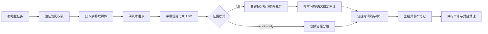

# Bili Note V3

将单个 Bilibili 或 YouTube 视频整理为可审计、可发布的 Markdown 或 Obsidian 知识笔记。

Bili Note V3 是一个保持 `$bili-note-v2` 调用名兼容的 Codex Skill，而不是单独的一键式桌面应用。Skill 负责组织模型参与的术语确认、视觉分析和笔记写作；`scripts/` 中的工具负责下载、转写、证据整理、审计、发布和受控清理等确定性步骤。

## 功能

- 支持单个 Bilibili 或 YouTube 视频，优先选择一条人工字幕，无可用人工字幕时选择一条平台自动字幕，最后回退到本地 Qwen3-ASR。
- ASR 前确认专业术语，减少缩写、项目名和中英混合词误识别。
- 支持完整图文模式：动态关键帧、云端视觉分析、图表/数据/示意图紧密裁剪。
- 支持 `quick`、`balanced`、`deep` 三档视觉扫描，以及焦点时间窗和转录提示定点补帧。
- 支持对已有任务追加焦点扫描；关键帧 manifest 保留扫描范围、来源、固定帧和最大时间间隔。
- 以 `frames/frame_manifest.json` 作为唯一时间戳来源，拒绝零时间戳、错帧和未验证的
  `manual-analysis` 视觉结果。
- 插图必须绑定到对应证据段、帧和时间点；视觉语义审计未通过时禁止发布后清理。
- 支持纯音频模式：只下载音频，不抽帧、不调用视觉模型、不嵌入图片。
- 支持普通 Markdown 和 Obsidian，笔记与附件可分别配置保存目录。
- 用时间戳证据、覆盖率和术语歧义进行阶段审计。
- 在进入 ASR/关键帧前校验平台声明时长与本地媒体时长，拒绝把会员预览片段当作完整视频。
- 通过不接触 Cookie 的浏览器交接协议支持 Edge、Chrome 和通用浏览器连接器。
- 对重复投递使用确定性 Job 门禁：只有 final 审计和完整源覆盖同时通过才允许复用；试看或旧 Job 会恢复到访问阶段。
- 发布审计通过后，可安全删除登记过的临时视频或音频。
- 不提取弹幕、评论或 YouTube Live Chat，不把互动内容当作视频证据。

## 两种模式

| 模式 | 适用内容 | 本地下载 | 云端处理 | 笔记输出 |
| --- | --- | --- | --- | --- |
| `full`（默认） | 课程、演示、幻灯片、屏幕操作、包含图表的数据视频 | 视频/音频、字幕或 ASR | 仅选中的关键帧 | 图文笔记；只嵌入紧密裁剪的有效视觉证据 |
| `audio-only` | 访谈、播客、聊天或画面与内容无关的视频 | 严格只下载音频、字幕或 ASR | 不上传画面 | 纯文本笔记，并声明“音频优先整理，未核验画面内容” |

## 环境要求

- Python 3.10 或更高版本。
- `yt-dlp`。
- YouTube 需要 Deno 或受支持的 Node.js 运行时处理 JavaScript challenge。
- `ffmpeg` 和 `ffprobe`。
- 无可用字幕时需要 Qwen3-ASR 环境。
- 完整图文模式需要 Codex 可调用的云端图像模型。
- 登录或会员视频需要可用的 Browser/Chrome/Edge 集成和用户已有的合法观看权限。Edge 与 Chrome 是同等支持的 handoff 后端；V3 不读取任何浏览器配置文件或 Cookie。

ASR 环境默认放在 `~/.cache/bili-note-v2/qwen3-asr-venv`，也可以用
`BILI_NOTE_QWEN_CACHE` 或 `BILI_NOTE_QWEN_PYTHON` 指向已有的本地环境；这些变量只保存
本机路径，不应填写 API key、Cookie 或其他认证信息。

macOS 可安装基础工具：

```bash
brew install ffmpeg yt-dlp
```

检查当前能力：

```bash
python3 scripts/check_environment.py
```

检查已有 Job 是否可以复用：

```bash
python3 scripts/job_gate.py "${BILI_NOTE_JOB_DIR}" --json
```

试看、部分覆盖、旧 schema、缺失 source coverage 或 final 审计未通过时，不得复用旧笔记。
认证交接可显式选择 Edge 或 Chrome：

```bash
python3 scripts/access_preflight.py "${BILI_NOTE_JOB_DIR}" --backend edge --json
python3 scripts/access_preflight.py "${BILI_NOTE_JOB_DIR}" --backend chrome --json
```

仅当检查结果提示无字幕视频的 ASR 路径未就绪时，安装共享 ASR 环境：

```bash
python3 scripts/setup_asr.py
```

## 安装为 Codex Skill

将仓库克隆到 Codex 的个人技能目录：

```bash
CODEX_SKILLS_DIR="${CODEX_SKILLS_DIR:-$HOME/.codex/skills}"
git clone https://github.com/<owner>/bili-note-v2.git \
  "${CODEX_SKILLS_DIR}/bili-note-v2"
```

然后开启一个新的 Codex 任务，并使用 `$bili-note-v2` 调用。若技能列表尚未刷新，请重启 Codex。

## 快速使用

完整图文笔记：

```text
请使用 $bili-note-v2 将 https://www.bilibili.com/video/BV... 整理成完整图文笔记，
发布到我的 Obsidian 笔记库。术语提示：H2 是 氢气化学式
Superconducting Tokamak。
```

YouTube 单视频：

```text
请使用 $bili-note-v2 将 https://www.youtube.com/watch?v=XXXXXXXXXXX 整理成完整图文笔记，
发布到我的 Obsidian 笔记库。
```

焦点补帧或增量扫描：

```bash
python3 scripts/select_keyframes.py "${BILI_NOTE_JOB_DIR}" \
  --video "${BILI_NOTE_MEDIA}" \
  --profile balanced \
  --start 00:12:00 --end 00:15:00 \
  --timestamps 00:12:18,00:13:42 \
  --append
```

`--profile quick` 使用 I-frame 快速侦察并在候选不足时回退到间隔帧；`balanced` 保持间隔帧与场景变化帧；`deep` 使用更密的间隔和更高预算。`--append` 会保留既有 `F####` 帧，不覆盖已经完成的视觉分析。

纯音频笔记：

```text
请使用 $bili-note-v2 以 audio-only 模式整理 https://www.bilibili.com/video/BV...，
不分析画面，发布为 Obsidian 纯文本笔记，并在发布成功后清理临时媒体。
```

Skill 会在 ASR 前给出术语表供确认。即使没有专业术语，也需要明确确认空术语表后才会继续。

## 输出配置

初始化任务后，可将一句自然语言保存要求落实为明确路径。路径变量必须由使用者设置，仓库位置和目录结构不随 Skill 分发：

```bash
BILI_NOTE_JOB_DIR="./jobs/example"
: "${BILI_NOTE_NOTE_DIR:?set note directory}"
: "${BILI_NOTE_ASSET_DIR:?set attachment directory}"
```

Obsidian：

```bash
python3 scripts/configure_output.py "${BILI_NOTE_JOB_DIR}" \
  --format obsidian \
  --note-dir "${BILI_NOTE_NOTE_DIR}" \
  --asset-dir "${BILI_NOTE_ASSET_DIR}" \
  --profile-name portable \
  --cleanup-media
```

普通 Markdown：

```bash
python3 scripts/configure_output.py "${BILI_NOTE_JOB_DIR}" \
  --format markdown \
  --note-dir "${BILI_NOTE_NOTE_DIR}" \
  --asset-dir "${BILI_NOTE_ASSET_DIR}" \
  --cleanup-media
```

发布器只复制笔记实际引用的裁剪图，并按目标格式重写链接。任何发布或目标文件审计失败都会保留临时媒体。

完整图文模式的视觉结果必须由实际图像能力（云端视觉、local VLM 或明确的人审）产生；
没有图像能力时应等待可用运行时或选择 `audio-only`，不能用文本模型、缩略图 montage 或
默认 `0` 秒时间戳伪造视觉覆盖。

## 工作流



完整操作契约、恢复规则和各阶段命令见 [SKILL.md](SKILL.md)。证据格式和发布规则见 [references/](references/)。

## 项目结构

```text
bili-note-v2/
├── SKILL.md                  # Codex 的主技能说明
├── README.md                 # GitHub 项目入口
├── agents/openai.yaml        # Codex 展示与默认提示元数据
├── assets/                   # 图文和纯音频笔记模板
├── references/               # 认证、证据、视觉分析与发布规范
├── scripts/                  # 确定性流水线工具
└── tests/test_pipeline.py    # 端到端单元测试
```

本地测试任务和下载媒体应放在 `test-runs/`；该目录已被 Git 忽略。

## 安全与隐私边界

- 不请求、读取、复制、解密或保存 Cookie、密码、授权头和浏览器配置文件。
- 登录态只通过 Browser/Chrome 集成使用；用户需自行完成登录。
- 只处理当前用户有权观看的内容；遇到拒绝访问或 DRM 时停止，不绕过访问控制。
- 仅选中的关键帧可以发送到云端模型；完整视频、音频和认证数据保持在本地。
- 清理操作只删除任务目录内已登记且归该任务所有的媒体，不删除用户提供的外部源文件。

## 当前限制

- V3 支持单个 Bilibili 或 YouTube 视频，不批量处理播放列表或频道。
- YouTube 正在直播、即将直播或仍在处理的 post-live 内容不进入本版；已结束并稳定为普通 VOD 后可处理。
- 完整图文模式中的帧语义分析和最终笔记写作由 Codex/模型编排，不是一个独立的纯 CLI 转换器。
- 登录或会员内容能否获取本地媒体，取决于当前 Browser/Chrome 集成是否能进行安全交接。
- Edge/Chrome 交接只接受浏览器连接器提交的本地媒体副本和可验证播放事实，不读取浏览器配置文件或 Cookie。
- 会员/预览/登录受限任务会停在 `waiting_user_action`，而不是生成“已完成”的部分笔记。
- 不支持 Cookie/OAuth/PO Token 导入、DRM 绕过、录屏替代下载、弹幕、评论或 Live Chat 提取。

## 开发与验证

运行完整测试：

```bash
PYTHONDONTWRITEBYTECODE=1 python3 -m unittest discover -s tests -v
```

在已安装 Codex 的机器上验证 Skill 结构：

```bash
SKILL_CREATOR_DIR="${SKILL_CREATOR_DIR:-$HOME/.codex/skills/.system/skill-creator}"
python3 "${SKILL_CREATOR_DIR}/scripts/quick_validate.py" .
```

提交仓库前，请确认未包含 `test-runs/`、下载媒体、浏览器状态、账号信息或本地绝对路径。
